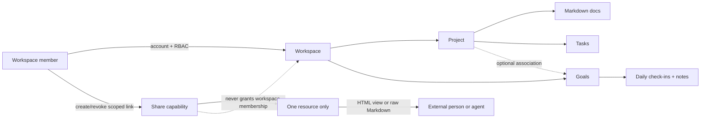
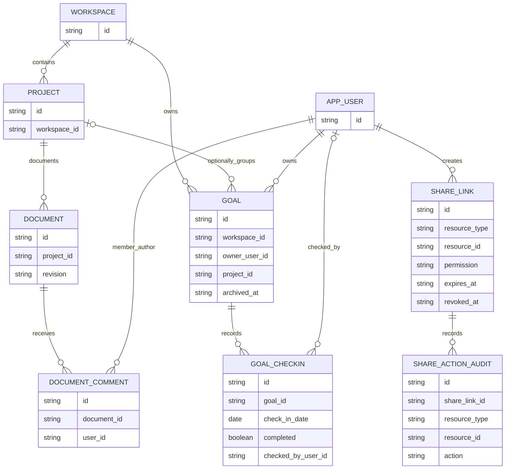

# Spec: Kaneo Workspace Collaboration

## Context Snapshot

- Project / module: Kaneo web + API; workspace collaboration layer over the existing project/task app and custom agent-control layer.
- Supersedes: None.
- Source revision reviewed: `740b4b599aa04156ec1ae8823cf11dd7f63fe95d` (working tree was clean before this spec and its review note).
- Stack / runtime: pnpm 10.32.1 monorepo; API Hono + PostgreSQL/Drizzle + Better Auth; web React/TanStack Router/TanStack Query/Tailwind v4/Tiptap Markdown.
- Current behavior:
  - `project.isPublic` enables an unauthenticated read-only project route at `/public-project/:projectId`; current UI offers Kanban/List and marks itself read-only.
  - API route `/api/public-project/:id` is registered before global authentication. It currently returns the general `getTasks()` payload, including workspace/assignee/external-link fields; there is no public-project rate limit or integration test. The UI checks `project:share`, but the project update API enforces `project:update` instead, so the share permission is not a reliable server-side boundary.
  - Task descriptions and activity comments store Markdown, and the web has a reusable Tiptap editor. There is no first-class project document/page model. `activity.taskId` is required, so it cannot directly hold document comments; `commentTable` is not the active task-comment path.
  - There is no recurring goal/check-in model or weekly matrix. Project archive uses `archivedAt`; task archive is a virtual task status and is not the right model for goals.
  - Public project app access is already global through `kaneo.quoc.app` and Cloudflare Tunnel; no Tailscale or open account registration is required for a scoped share page. Account registration remains disabled; named collaborators use workspace membership.
- Desired behavior: one workspace where project context, Markdown docs, tasks, and personal/shared weekly goals are connected but remain distinct data types; selected resources can be read or edited through explicit public links without login/Tailscale; agents can fetch shared Markdown directly.
- Relevant files to read before implementation:
  - `apps/api/src/index.ts` — public route placement and authentication middleware order.
  - `apps/api/src/project/index.ts`, `apps/api/src/project/controllers/get-public-project.ts` — current public project and visibility behavior.
  - `apps/api/src/task/controllers/get-tasks.ts` — current project payload and public-data leak boundary.
  - `apps/api/src/utils/require-workspace-permission.ts`, `apps/api/src/utils/workspace-access-middleware.ts`, `packages/permissions/src/index.ts` — server permission patterns.
  - `apps/api/src/database/schema.ts`, `apps/api/src/database/relations.ts` — Drizzle tables and relations.
  - `apps/api/src/task/controllers/update-task-description.ts`, `apps/api/src/activity/controllers/create-comment.ts` — Markdown and comment patterns.
  - `apps/web/src/routes/public-project.$projectId.tsx`, `apps/web/src/routes/_layout/_authenticated/dashboard/settings/projects/$projectId/visibility.tsx` — public page and current share UI.
  - `apps/web/src/components/activity/comment-editor.tsx`, `apps/web/src/components/task/task-description.tsx` — Markdown editor and responsive sheet patterns.
  - `apps/web/src/components/common/project-layout.tsx`, `apps/web/src/components/common/header/mobile-project-nav.tsx`, `apps/web/src/routes/_layout/_authenticated/dashboard/workspace/$workspaceId/project/$projectId/gantt.tsx` — project view navigation and horizontal-scroll pattern.
  - `tests/api-integration/workspace-rbac.test.ts`, `tests/api-integration/project.test.ts`, `tests/api-integration/task.test.ts` — API/RBAC test conventions.
- Existing constraints:
  - Keep named-user workspace RBAC and registration policy, including the current member permission to create projects; anonymous share is not account creation and must not become a global auth bypass.
  - Public share must be authorized server-side per resource and action. Never expose task execution manifests, run data, workspace membership, or agent-control actions through public writes.
  - `apps/web/PRODUCT.md` and `apps/web/DESIGN.md` are missing. Impeccable context found an incumbent visual implementation, so extend it; do not redesign the visual world in this spec.
  - No code, deployment, or production database changes are authorized by this spec alone.

## Objective

- Turn Kaneo into a small-team workspace that keeps the reason for work, the work itself, and recurring progress connected without pretending they are the same thing.
- A member can write and discuss project Markdown docs; a person or agent with a public link can access only the resource and actions that link grants; weekly goals preserve day-by-day notes and history.
- Success means public links work from an ordinary internet connection without login/Tailscale, public reads expose only safe fields, anonymous writes cannot reach workspace/admin/agent-control operations, and the weekly grid never loses or silently shifts a check-in.

## Scope

- In:
  - Harden existing public project read access, including a safe response DTO, rate limits, and server-side enforcement of `project:share`.
  - Add resource-scoped public links with `view` and `edit` modes, expiration/revocation for write links, and audit identity tied to the share link rather than a fictitious user.
  - Preserve the current project public URL as a read-only compatibility path while new links use an opaque share capability.
  - Add project-level Markdown documents with authenticated member editing/comments, conflict detection, and a public human-readable page plus raw Markdown endpoint.
  - Add workspace-level goals that can be private or explicitly shared, with optional project association; add date-only daily check-ins, Markdown detail notes, archive/history, and weekly totals.
  - Support the user’s video workflow as a weekly goal plus Markdown check-in notes; v1 statistics count check-in days, not individual videos or artist fields.
  - Add anonymous task editing through a project share link, with the strict action and agent-control boundaries in this spec.
  - Responsive weekly matrix based on the supplied sketch: goal name, seven dates, a computed total, inner horizontal scroll, and a distinct note/details action.
- Out:
  - Changing the existing workspace role matrix or member project-creation behavior; anonymous management of workspace/project settings, roles/permissions, invites, API keys, integrations, agent execution manifests/schedules/runs, or any anonymous delete operation.
  - Anonymous editing of a workspace or an entire agent-controlled project. A project with an execution manifest or managed execution tasks is read-only to public links.
  - Realtime co-editing, full Confluence page hierarchy, arbitrary database/custom-field builder, file attachment uploads in project docs, offline mode, and new authentication providers.
  - A dedicated video-record database or analytics by composer/singer. If those statistics become important, that is a separate spec; Markdown notes are not parsed as structured data.
  - Replacing the current Kaneo visual identity, changing Cloudflare/Tailscale topology, or deploying this feature to production.

## UX Baseline

| # | Requirement | Pass condition |
|---|---|---|
| 1 | Keyboard | Tab follows visual order; Enter activates links/buttons; Space toggles a check-in; arrows move between date cells where the grid has focus; Escape closes a sheet/dialog. |
| 2 | Focus | Every interactive control has a visible `:focus-visible` state; focus returns to the trigger after closing a dialog/sheet. |
| 3 | Accessibility | Labels and errors are associated with controls; status changes are announced; text contrast is at least 4.5:1; touch controls are at least 44px. |
| 4 | Viewports | 320–1440px: no page-level horizontal overflow, no clipped controls; only the date-grid container may scroll horizontally. |
| 5 | States | Docs, share links, and goals define empty/loading/error/saving/saved/conflict/revoked/expired states with a recovery action. |
| 6 | Consistency | Extend Kaneo’s existing tokens, spacing, components, and route patterns; no second CSS system or parallel visual identity. |
| 7 | Platform | Web-only; scrollbar remains visible where needed to communicate the matrix’s horizontal position. |
| 8 | Copy | Actions name what they do; public edit links explain that anyone holding the link can change the granted resource and cannot be reliably identified. |

## Thuật ngữ

- **Workspace member**: người có account và membership trong workspace; hành động gắn với danh tính người dùng và workspace role.
- **Share link / capability**: URL ngẫu nhiên cấp đúng một resource và một mức quyền; ai cầm URL có quyền đó, không chứng minh được danh tính thật. Mọi public write được audit theo share-link ID, không gán thành người dùng đã xác minh.
- **Resource**: project, document, goal, hoặc một check-in; public access không tự lan sang resource được liên kết.
- **Goal**: mục tiêu/habit lặp lại được theo dõi theo ngày; không phải task Kanban.
- **Check-in**: trạng thái hoàn thành của một goal trong một ngày lịch cụ thể, có thể kèm ghi chú Markdown.
- **Video log v1**: các ngày tick goal “làm video” cùng note Markdown; không phải kho video record có thể query từng nhạc sĩ/ca sĩ.
- **Agent-readable Markdown**: nội dung tài liệu trả trực tiếp qua HTTP `text/markdown`, không cần JavaScript, cookie, account hay Tailscale.

## Assumptions

- Người được mời vào workspace tiếp tục dùng account; public link là luồng riêng cho người/agent bên ngoài.
- Personal goal mặc định private. Goal có thể được chia sẻ rõ ràng ở phạm vi workspace/project.
- Goal cá nhân có check-in của owner; goal shared có tối đa một tick cho mỗi ngày, ghi lại ai đã tick. V1 không có ma trận theo từng thành viên.
- Project share `edit` cho phép tạo/cập nhật task cơ bản trong project đó; không cho xóa task, đổi assignee, sửa labels/settings, mời/kick thành viên, tạo share link khác hoặc chạy agent-control. Các project có execution manifest/managed run không nhận public write link.
- Project documents được share độc lập; bật public cho project không tự công khai toàn bộ docs.
- Goal/check-in lưu ngày theo PostgreSQL `date` (không timestamp); mỗi goal lưu IANA timezone lấy từ browser của creator lúc tạo và có thể sửa. Shared goal dùng timezone đó cho mọi thành viên; tuần mặc định Thứ Hai–Chủ Nhật.
- Link `view` không hết hạn mặc định nhưng revoke được; link `edit` hết hạn sau 30 ngày và có thể revoke sớm. Public comments không nằm trong v1; comments dùng account workspace.
- Public writes bị chặn cho project có `execution_manifest` hoặc task gắn với `task_run`/`execution_schedule`; muốn ngoại lệ cần threat model riêng.
- “Log video” v1 ghi trong note của check-in. Total là số ngày đã check-in, không phải số video; nhiều video trong một ngày vẫn chỉ tính một ngày.
- Document save dùng revision/CAS để chặn ghi đè âm thầm; v1 chưa có giao diện khôi phục toàn bộ lịch sử phiên bản.

## Open Questions

- Không còn quyết định sản phẩm chặn implementation: mày đã chốt project-wide task scope, write links hết hạn sau 30 ngày, và chặn public writes trên project có agent-control data. Public delete/permission changes bị loại theo safety default; muốn đổi phải có quyết định riêng.
- Trước khi phát hành public write, phải hoàn thành release gates ở T7: rotate credentials từng bị lộ và kiểm tra OTP/login rate limit trên self-hosted.

## Approach

- Chọn hai ranh giới quyền riêng:
  1. Account membership + workspace RBAC cho cộng tác viên có danh tính.
  2. Share capability cho resource public cụ thể; quyền public giới hạn ở `view` hoặc `edit`. Comments chỉ dành cho authenticated workspace members trong v1.
- Không dùng project `isPublic` làm quyền cho docs/goals. Giữ route legacy project read-only để không làm gãy link cũ, nhưng lọc payload, rate-limit và sửa server-side share permission. Link mới dùng token capability có thể thu hồi.
- Ma trận quyền: Project `view` đọc DTO an toàn; `edit` tạo/cập nhật trường task cơ bản nhưng không xóa/assign. Document `view/edit` chỉ áp dụng lên đúng doc; goal/check-in `view/edit` chỉ xem hoặc sửa check-in/note của đúng goal; quyền link không đổi owner/visibility. Comments yêu cầu workspace member login.
- Capability token có entropy tối thiểu 256 bit; chỉ hash lưu trong database; URL token bị redacted khỏi logs, page đặt `Referrer-Policy: no-referrer` và `noindex`. Write links có expiry, rate limit theo token/IP, record audit theo share ID; tên người viết có thể nhập nhưng ghi rõ là chưa xác minh.
- Public project DTO chỉ trả field phục vụ board/list/detail. Không trả `workspaceId`, user IDs/avatar/assignee identity, external integration metadata, agent execution fields, hay resource chưa được share.
- Docs là entity riêng: Markdown text, project relation, revision CAS, authenticated comments; comments có storage/model riêng chứ không ép vào activity table đang yêu cầu `taskId`.
- Goals là entity riêng ở workspace level: private/share scope, owner, optional project association, target-per-week, timezone, archivedAt. Check-in dùng date-only + note Markdown; matrix count được tính từ check-in rows, không lưu counter có thể drift.
- Video use case dùng goal/check-in + note Markdown, không tạo video database v1. Dashboard chỉ thống kê số ngày check-in và mục tiêu; không hứa đếm video/nhạc sĩ/ca sĩ.
- Thứ tự: capture product/design authority → harden public boundary + capability model → Docs → Goals/check-ins → gated anonymous writes → API/UI/UAT.
- Decision (T3, EP 2026-10-14): quyền member map lên statements hiện có để KHÔNG đổi role matrix (Out-of-scope) — documents dùng `task:read`/`task:update` (nội dung công việc project); goals/check-ins KHÔNG thêm statement mới: private goal = owner-only (controller check), shared goal = read cho workspace member, write (tick/note/sửa goal) cho owner hoặc member có `task:update` (collaborator); share-link management dùng `project:share` cho mọi resource type.
- Decision (T6, EP 2026-10-14): week boundary của matrix tính theo viewer-local Monday–Sunday v1; giá trị check-in vẫn là DATE string nên lịch sử không trôi ngày giữa các timezone. Day-boundary đúng theo goal.timezone để tăng cấp ở spec riêng nếu cần.
- Decision (EP, 2026-10-14): migration 0048 được trim tay sau `drizzle-kit generate` — bản generate kéo nhầm CREATE/ALTER của repair migrations 0044-0047 (không có snapshot trong meta/), sẽ fail trên DB sạch lẫn upgrade; chỉ giữ diff của spec. compose.local.yml đổi port postgres sang 15432 do 5432/5433 bị Hyper-V excluded ranges chặn trên host này.

## Diagram

`SHARE_LINK.resource_type/resource_id` is a polymorphic association, not a physical `RESOURCE` table. It must be validated against the allowed resource/action matrix server-side; it is not permission to traverse linked objects. The actual table/relation details are resolved in implementation after migration review.

## Bỏ qua

- Không dựng bản clone Confluence: không realtime co-edit, cây trang nhiều tầng, generic database, template marketplace, hay full-text search engine trong v1.
- Không dựng video database/record type cho từng bài trong đợt này; ghi chú video thuộc check-in và chỉ dùng thống kê theo ngày.
- Không cho share một project rồi tự động share mọi docs/assets liên quan; mỗi resource có quyền riêng.
- Không cho public link đổi quyền, membership, workspace/project settings, xóa dữ liệu, agent-control, mở account registration, hoặc gửi anonymous comments; comments dùng account member.
- Không ép 7 ngày co lại để vừa màn điện thoại; cuộn bên trong grid là chủ đích, còn trang phải đứng yên theo chiều ngang.

## Risks

- P0: public GET hiện có payload rộng và không rate-limit; mở thêm write trước khi harden sẽ biến link thành cửa đọc/sửa dữ liệu vượt ý định.
- P0: `project:share` hiện chỉ được kiểm tra ở UI; custom role có `project:update` nhưng thiếu `project:share` vẫn có thể bật public bằng API.
- P0: anonymous edit là bearer permission: nếu link bị forward/log/copy nhầm thì người khác sửa được; không có danh tính người thật để quy trách nhiệm.
- P0: project này còn là agent-control plane; sửa task description/status có thể ảnh hưởng envelope hoặc execution workflow. Server phải chặn public writes với project/task được agent-control quản lý.
- P1: đổi timestamp sang ngày UTC làm check-in chạy sang hôm trước/sau; dùng `date` và timezone cố định theo goal.
- P1: dùng task làm goal hoặc dùng check-in làm video record sẽ làm sai thống kê/semantic; giữ entity riêng.
- P1: Markdown công khai có thể thành XSS nếu renderer cho HTML/unsafe URL thực thi; public renderer phải escape/sanitize và có regression tests.
- P1: UI share thiếu trạng thái expired/revoked/denied sẽ khiến user tưởng link hỏng; cung cấp lời giải thích và cách xin link mới.
- Security precondition: tool output trong phiên vận hành trước đã chứa credentials; trước khi bật public write, coi chúng là đã lộ và rotate. OTP sign-in vẫn bật; rate-limit/unknown-email behavior chưa được verify.

## Task List

### T1: Capture product/design authority

- Acceptance:
  - Với user review, tạo `apps/web/PRODUCT.md` bằng Impeccable init; chỉ ghi product facts đã xác nhận, không tự invent brand/visual world.
  - Tạo `apps/web/DESIGN.md` từ incumbent UI bằng Impeccable document; không redesign.
  - Tạo surface brief cho Docs/Goals/share, có journey, first viewport và signature interactions; brief phải trỏ ảnh sketch hiện có và source incumbent.
- Skills: `impeccable`, `flow`, `mobile-responsive`.
- Reproduce: chạy `D:\.claude\skills\impeccable\scripts\impeccable.cmd context` từ `apps/web`, sau đó `init`/`document` theo output của helper.
- Verify: PRODUCT/DESIGN/surface brief tồn tại, chỉ chứa confirmed facts; owner review flow trước khi có UI code.
- Files:
  - `apps/web/PRODUCT.md` — tạo theo Impeccable product schema sau owner interview.
  - `apps/web/DESIGN.md` — document code/tokens incumbent; không tự viết visual world mới.
  - Surface brief: resolved via `impeccable surface-brief write`; canonical paths recorded here before implementation:
    - Docs: `apps/web/.impeccable/surfaces/ce-workspaceid-project-projectid-docs-tsx-6534b73b.md`
    - Goals matrix: `apps/web/.impeccable/surfaces/dashboard-workspace-workspaceid-goals-tsx-35dcfd3f.md`
    - Share UI brief (visibility settings surface, T7): covered by the Docs brief share dialog + UX Contract in T7.
  - T1 note (2026-10-14, EP): PRODUCT/DESIGN/surface briefs written from confirmed spec facts + incumbent code; simulated-user substitution disclosed — owner review of these artifacts is pending and tracked as a T1 checkpoint condition before any public write is enabled.

### T2: Harden public project boundary và capability-link API

- Acceptance:
  - API kiểm tra `project:share` server-side khi đổi public visibility; `project:update` đơn lẻ không đủ.
  - Capability routes là unauthenticated routes riêng đăng ký trước global auth; mỗi handler bắt buộc validate token/resource/permission/expiry/revocation. Không bypass wildcard auth middleware.
  - Legacy `/api/public-project/:id` chỉ trả DTO an toàn cho Kanban/List/task detail; không có workspace ID, user/assignee identifiers, avatars, external integration metadata, hoặc agent-control fields. Với project có execution manifest hoặc task có `task_run`/`execution_schedule`, raw task `description` bị loại khỏi public DTO vì execution envelope có thể nằm trong đó.
  - Legacy public project giữ read-only behavior; private project không đọc được từ anonymous route.
  - Share link mới có resource type/id + `view|edit`, hash token lưu ở database, expiry/revoke, actor audit theo link ID; link `view` không hết hạn mặc định, link `edit` hết hạn sau 30 ngày; không có raw token trong log.
  - Mỗi public mutation append metadata-only row vào `share_action_audit` (share ID, resource, action, timestamp); không lưu raw token hoặc request body.
  - Link chỉ áp dụng đúng resource; không kế thừa quyền sang linked docs/tasks khác.
  - Project share may read only assets attached to tasks included in that project resource; it does not expose Docs or external integrations. Binary attachments on Docs are out of v1.
  - Server rate-limit public reads/writes. Public `edit` bị từ chối nếu project có `execution_manifest` hoặc bất kỳ task nào có liên kết `task_run`/`execution_schedule`; project đó vẫn có thể được share `view` bằng DTO đã lọc.
  - Integration tests cover anonymous/unauthenticated, wrong scope, wrong resource, expired/revoked link, data minimization (including execution-envelope redaction), rate-limit, audit attribution, `project:share` vs `project:update`, và agent-control refusal.
- Reproduce: `pnpm --filter @kaneo/api db:generate && pnpm --filter @kaneo/api test:integration && pnpm --filter @kaneo/api test:unit`; apply migration to clean and upgrade test databases, never production.
- Files:
  - `apps/api/src/index.ts` — register only explicit capability routes before global authentication; keep wildcard auth fail-closed.
  - `apps/api/src/database/schema.ts` — pattern `projectTable`/`workspaceRoleTable`; share/audit tables need explicit indexes and referential strategy.
  - `apps/api/drizzle/**` — generated migration; review SQL and verify clean-install/upgrade path.
  - `apps/api/src/database/relations.ts` — relation pattern `projectTableRelations`.
  - `tests/api-integration/helpers/database.ts` — add share/audit tables to migration/reset test harness.
  - New `tests/api-integration/public-share.test.ts` — public DTO/capability tests.
  - `apps/api/src/project/index.ts` — route + `requireWorkspacePermission` pattern.
  - `apps/api/src/project/controllers/get-public-project.ts`, `apps/api/src/task/controllers/get-tasks.ts` — public DTO boundary.
  - `apps/api/src/utils/require-workspace-permission.ts`, `apps/api/src/utils/workspace-access-middleware.ts` — server-side authorization.
  - `apps/api/src/auth.ts` — rate-limit configuration source.
  - `tests/api-integration/workspace-rbac.test.ts`, `tests/api-integration/project.test.ts` — route/RBAC integration test patterns.

### T3: Project Docs API và authenticated collaboration

- Acceptance:
  - Member có quyền workspace/project phù hợp có thể list/create/read/update Markdown docs trong project; unauthorized member không đọc hoặc ghi được.
  - Document content lưu Markdown; mỗi save có revision CAS. Save với revision cũ trả conflict, không ghi đè nội dung mới âm thầm.
  - Member comments gắn document; comment CRUD tuân theo author/workspace permission. Không dùng `activityTable` làm doc comment vì `taskId` bắt buộc; không dùng `commentTable` legacy nếu chưa chứng minh route đang dùng nó.
  - Markdown public renderer không thực thi raw script/unsafe URL; attachment upload nằm ngoài v1.
  - Delete/archiving document không làm token/link trỏ sang resource khác; link tới document bị xóa/revoked phải fail closed.
- Reproduce: `pnpm --filter @kaneo/api db:generate && pnpm --filter @kaneo/api test:integration && pnpm --filter @kaneo/api test:unit`; apply migration to clean and upgrade test databases, never production.
- Files:
  - `apps/api/src/database/schema.ts` — pattern CUID2, cascade/index, timestamps.
  - `apps/api/drizzle/**` — generated migration; review SQL and verify clean-install/upgrade path.
  - `apps/api/src/database/relations.ts` — project/task relation pattern.
  - `apps/api/src/task/controllers/update-task-description.ts` — Markdown persistence/event/asset cleanup pattern; không copy task-specific behavior mù.
  - `apps/api/src/activity/controllers/create-comment.ts` — task comment semantics; doc comments cần relation riêng.
  - `apps/api/src/project/index.ts`, `apps/api/src/task/index.ts` — Hono route/Valibot/OpenAPI pattern.
  - `tests/api-integration/helpers/database.ts` — add document/comment tables to migration/reset fixture.
  - New `tests/api-integration/document.test.ts` — document CRUD, revision conflict, and comment authorization.
  - `tests/api-integration/project.test.ts`, `tests/api-integration/task.test.ts` — DB-backed route patterns.

### T4: Docs UI, member comments và public Markdown reader

- Acceptance:
  - Project có Docs view dạng danh sách phẳng, xuất hiện trong desktop project navigation và mobile project menu; tạo/mở tài liệu không qua màn trung gian thừa; editor dùng Tiptap Markdown đã có.
  - Save state thể hiện `Đang lưu`/`Đã lưu`/`Lỗi`; conflict cho phép reload hoặc sao chép bản nháp, không tự chọn ghi đè.
  - Member có thể bình luận trên doc; public link hiển thị đúng một doc, không tự bật project public.
  - Public page cho người đọc và endpoint Markdown raw đều hoạt động không cookie/login/Tailscale; endpoint trả `text/markdown` và không nạp private related resources.
  - README mô tả Docs/Markdown/public-agent link và cách dùng ở mức user-facing; giữ attribution/boilerplate upstream, không viết lại README thành marketing.
  - Empty/loading/error/conflict/revoked states có nội dung và recovery action rõ.
  - User-facing strings dùng i18next; thêm keys vào toàn bộ locale được hỗ trợ, `pnpm i18n:check` và `pnpm i18n:coverage` PASS.
- UX Contract:
  - Journey: mở project → Docs → mở/tạo trang → viết Markdown → save → member comment → tạo link view/edit → copy link; agent fetch raw Markdown.
  - Default: Docs list ở project; page đọc được trước, edit action chỉ hiện cho member/link có quyền.
  - Public reader không có chrome đăng nhập; có title, nội dung, trạng thái cập nhật, link/CTA xin quyền mới khi token invalid.
  - Responsive 320–1440; nội dung đọc có max-width; không có page-level horizontal overflow.
- Skills: `impeccable`, `frontend-taste-chatgpt`, `mobile-responsive`, `flow`.
- Visual Ref: `apps/web/src/components/activity/comment-editor.tsx`, `apps/web/src/components/task/task-description.tsx`, current project layout; use `apps/web/DESIGN.md` after T1, no new theme tournament.
- Reproduce: `pnpm --filter @kaneo/web test && pnpm --filter @kaneo/web typecheck && pnpm --filter @kaneo/web build && pnpm i18n:check && pnpm i18n:coverage`.
- Files:
  - New `apps/web/src/routes/_layout/_authenticated/dashboard/workspace/$workspaceId/project/$projectId/docs.tsx` — mirror `board.tsx`/`gantt.tsx` in the same directory.
  - `apps/web/src/components/common/project-layout.tsx`, `apps/web/src/components/common/header/mobile-project-nav.tsx` — add Docs to desktop and mobile project navigation.
  - `apps/web/src/components/activity/comment-editor.tsx` — shared Markdown editor.
  - `apps/web/src/components/task/task-description.tsx` — save/conflict/editor integration pattern.
  - `apps/web/src/fetchers/`, `apps/web/src/hooks/queries/`, `apps/web/src/hooks/mutations/` — API/query/mutation pattern.
  - `i18n/*.json` — add matching keys in every supported locale; `i18n/resources.ts` already imports locale files.
  - `README.md` — update the product feature overview with Docs, Goals, and scoped sharing without changing upstream attribution.
  - `apps/web/src/routes/public-project.$projectId.tsx` — public reader boundary; do not copy unsafe payload assumptions.

### T5: Goals/check-ins API và lịch sử

- Acceptance:
  - Goal có owner, private/shared visibility, optional project association, optional weekly target, timezone, position, and `archivedAt`.
  - Check-in dùng `DATE` calendar value, không timestamp, và có một shared tick tối đa mỗi goal/ngày; actor ghi lại ai đã tick.
  - Check-in có unique constraint `(goal_id, check_in_date)` và lưu `completed` boolean; untick chỉ đổi `completed=false`, không hard-delete row/note/history. Toggle idempotent khi double-submit/concurrent request; note Markdown sửa được bằng revision/CAS; ngày cũ không bị chuyển ngày khi đọc từ timezone khác.
  - Read/list API hỗ trợ tuần và range; row totals được aggregate từ check-in rows, không counter cache tự trôi.
  - Archive ẩn goal khỏi active list và chặn ghi mới, nhưng giữ check-ins/history; restore đưa lại active list.
  - Private goal chỉ owner đọc/sửa; workspace-shared goal tuân thủ workspace permission; public share vẫn cần capability link riêng.
- Reproduce: `pnpm --filter @kaneo/api db:generate && pnpm --filter @kaneo/api test:integration && pnpm --filter @kaneo/api test:unit`; apply migration to clean and upgrade test databases, never production.
- Files:
  - `apps/api/src/database/schema.ts`, `apps/api/src/database/relations.ts` — pattern `projectTable` + archive timestamp; use PostgreSQL `date` for check-in.
  - `apps/api/drizzle/**` — generated migration; review SQL and verify clean-install/upgrade path.
  - New `apps/api/src/goal/**` — route/controller convention mirrored from `apps/api/src/project/**`.
  - `apps/api/src/task/controllers/update-task-status.ts` — transaction/locking pattern; adapt only where needed.
  - `tests/api-integration/helpers/database.ts` — add goal/check-in tables to migration/reset fixture.
  - New `tests/api-integration/goal.test.ts` — date-only check-in, concurrent toggle, timezone, archive, and privacy tests.

### T6: Weekly Goals matrix và check-in detail UI

- Acceptance:
  - Default shows current Monday–Sunday week, with previous/next week navigation and current-week reset.
  - Rows are active goals; date cells reflect `completed=true`/unchecked; the right total counts only completed dates, or displays `count/target` if a weekly target exists.
  - Clicking the checkbox changes only completion. A distinct note/details affordance opens a responsive sheet for Markdown note and related project doc link.
  - Archive removes a goal from the active matrix without deleting historical check-ins; past weeks remain viewable.
  - Grid owns horizontal scroll, first goal column and total remain legible/sticky, body never overflows horizontally; date cells retain 44px mobile hit targets.
  - Basic statistics are per-goal days checked by week/range. Video notes are not parsed into item-level counts.
  - User-facing strings use i18next; add keys to all supported locales and pass `pnpm i18n:check` plus `pnpm i18n:coverage`.
- UX Contract:
  - User opens Goals → sees current week and active rows → taps checkbox → completion updates with immediate feedback → taps separate note affordance → writes/saves Markdown → copies a scoped public link if needed → archives goal when inactive.
  - Grid stays a table-like matrix, not a Kanban board. Header shows weekday + calendar date. No streak gamification by default.
  - Empty state offers one direct action to create a goal; archived view is secondary, not a first-run step.
  - Mobile keeps row label visible and scrolls only the 7-date region; no squeeze-to-fit layout.
- Skills: `impeccable`, `frontend-taste-chatgpt`, `mobile-responsive`, `flow`.
- Visual Ref: `plans/ui-reviews/kaneo-workspace/weekly-goals-sketch.png` (user sketch; hierarchy reference, not pixel-copy) + `apps/web/src/routes/_layout/_authenticated/dashboard/workspace/$workspaceId/project/$projectId/gantt.tsx` (horizontal-scroll/touch pattern) + `apps/web/src/components/task/task-details-sheet.tsx` (detail sheet pattern).
- Reproduce: `pnpm --filter @kaneo/web test && pnpm --filter @kaneo/web typecheck && pnpm --filter @kaneo/web build && pnpm i18n:check && pnpm i18n:coverage`.
- UI verify: serve built app with `pnpm --filter @kaneo/web preview --host 127.0.0.1 --port 4173`; capture desktop full page at 1440px and mobile at 375/390px plus empty/detail/archive states; run `$env:NODE_PATH="D:\pcloud\workspace\code\kaneo\node_modules"; node D:\.claude\skills\mobile-responsive\scripts\check-overflow.js http://localhost:4173/dashboard/workspace/<seededWorkspaceId>/goals 320,375,414,768,1024,1280,1440`. Horizontal overflow is allowed only inside the matrix scroller.
- Files:
  - New `apps/web/src/routes/_layout/_authenticated/dashboard/workspace/$workspaceId/goals.tsx` — workspace-level route beside `index.tsx` and `members.tsx`; public path `/dashboard/workspace/$workspaceId/goals`.
  - `apps/web/src/components/nav-main.tsx`, `apps/web/src/components/common/workspace-layout.tsx`, `apps/web/src/routes/_layout/_authenticated/dashboard/workspace/$workspaceId/index.tsx` — workspace navigation and screen shell for Goals.
  - `apps/web/src/routes/_layout/_authenticated/dashboard/workspace/$workspaceId/project/$projectId/gantt.tsx` — `overflow-auto`, touch-pan and min-width scroll pattern.
  - `apps/web/src/components/task/task-details-sheet.tsx`, `apps/web/src/components/task/task-description.tsx` — detail sheet/Markdown editor patterns.
  - `i18n/*.json` — add matching Goals keys in every supported locale.
  - Existing `apps/web/src/components/ui/checkbox.tsx`, `sheet.tsx`, `scroll-area.tsx`, `table.tsx` — use current primitives.

### T7: Public edit controls, task mutations, and adversarial verification

- Acceptance:
  - Share UI lets an authorized owner choose `view` or `edit`, copy/revoke the link, and understand its scope. Copy success is inline; no success toast spam.
  - A project `edit` link can create/update basic tasks only. It cannot delete tasks, reassign users, change labels/settings, manage members/share links, or invoke agent control.
  - Project-wide `edit` is disabled if the project has an `execution_manifest` row or any task in it has a `task_run` or `execution_schedule` row; the project may remain view-only.
  - Document `edit` affects only that document. Goal/check-in `edit` affects only that goal’s completion boolean and Markdown note; it cannot change goal owner/visibility, hard-delete check-ins, or delete history.
  - View-only links cannot mutate through direct API calls even if the UI is altered; edit links cannot cross resource IDs or use a sibling token.
  - Each anonymous write appends an immutable audit event keyed by share-link ID and action; it does not impersonate a workspace user.
  - `edit` links expire after 30 days and can be revoked earlier; `view` links do not expire by default but remain revocable.
  - Revoked/expired/malformed tokens fail closed with no resource-existence leak. Rate limit returns 429 with recovery guidance. Raw token is never saved or logged.
  - Before enabling public writes in production, credentials exposed in the earlier operational session are rotated and self-hosted OTP/login rate limits are verified.
  - Public Markdown rendering blocks script/unsafe URL execution; referrer and analytics do not leak bearer tokens.
- UX Contract:
  - Share dialog states show resource name, permission, expiry, and exact effects. `edit` requires explicit confirmation with warning that anyone holding the URL can change the resource; offer revoke in the same surface.
  - Project edit explains that the link can create/update task title, description, status, priority and dates, but cannot delete, assign or manage the project; do not imply identity verification.
  - Expired/revoked link says access was removed and asks owner for a new link; do not redirect to signup.
- Skills: `impeccable`, `mobile-responsive`, `flow`.
- Visual Ref: current `apps/web/src/routes/_layout/_authenticated/dashboard/settings/projects/$projectId/visibility.tsx` and `plans/ui-reviews/kaneo-workspace/weekly-goals-sketch.png` for the adjacent details flow; new share UI inherits `apps/web/DESIGN.md`.
- Reproduce: `pnpm --filter @kaneo/api test:integration && pnpm --filter @kaneo/web test && pnpm --filter @kaneo/web typecheck && pnpm --filter @kaneo/web build && pnpm i18n:check && pnpm i18n:coverage`.
- Files:
  - `apps/api/src/project/index.ts`, `apps/api/src/task/index.ts`, `apps/api/src/utils/require-workspace-permission.ts` — server route/permission pattern.
  - New share-link middleware/controller under `apps/api/src/share/**` — never weaken global auth middleware.
  - `apps/web/src/routes/_layout/_authenticated/dashboard/settings/projects/$projectId/visibility.tsx` — current share settings pattern; replace/extend only after API guard is correct.
  - `apps/web/src/routes/public-project.$projectId.tsx` — existing public viewer; retain read-only compatibility.
  - `tests/api-integration/workspace-rbac.test.ts`, `tests/api-integration/project.test.ts`, `tests/api-integration/task.test.ts`, `tests/api-integration/helpers/database.ts` — authorization, regression, and test-database reset patterns.
  - New `tests/api-integration/share-link-write.test.ts` — direct API denial/allow matrix for anonymous write scopes.
  - `i18n/*.json` — matching share UI keys in every supported locale.

## Checkpoints

- After T1: owner has reviewed PRODUCT/DESIGN/surface brief; không có code hoặc public write nào được bật.
- After T2: parent verifies public DTO/data minimization and direct anonymous API tests before any anonymous write endpoint is enabled.
- After T3/T4: member-only Docs CRUD/comments pass; public Markdown link reads one document and no private neighbors.
- After T5/T6: `DATE` boundary, timezone grouping, toggle idempotency, archive retention, keyboard/touch, and 320–1440 layout pass.
- Before T7 release: view/edit mode matrix tests pass, agent-control refusal verified, owner UAT confirms the warning/revoke flow, exposed credentials are rotated, and self-hosted OTP/login rate limits are evidenced.

## External Review Brief

### Reviewer cần phán

- Is the resource-capability model narrow enough for a self-hosted app that also runs agent-control tasks?
- Does editing a project through an anonymous link have any route to delete/admin/agent execution operations?
- Does the public DTO leak workspace/member/integration/agent data, and are legacy links still compatible?
- Are documents, comments, revisions, goals, and check-ins modeled as distinct records with safe migrations?
- Does the goals matrix’s check-in date/timezone model preserve history across users and timezones?
- Does the UI make toggle vs note, private vs shared, and view vs edit links obvious without adding unnecessary steps?
- Does verification catch IDOR/BOLA, token replay/revocation, stale document writes, XSS, rate-limit gaps, and mobile overflow?

### Reviewer nên đọc trước

- `apps/api/src/index.ts`, `apps/api/src/project/index.ts`, `apps/api/src/project/controllers/get-public-project.ts`.
- `apps/api/src/task/controllers/get-tasks.ts`, `apps/api/src/utils/require-workspace-permission.ts`, `apps/api/src/utils/workspace-access-middleware.ts`.
- `apps/api/src/database/schema.ts`, `packages/permissions/src/index.ts`.
- `apps/web/src/routes/public-project.$projectId.tsx`, `apps/web/src/components/activity/comment-editor.tsx`, `apps/web/src/routes/_layout/_authenticated/dashboard/workspace/$workspaceId/project/$projectId/gantt.tsx`, `apps/web/src/components/nav-main.tsx`.
- `plans/ui-reviews/kaneo-workspace/pre-lock.md` and the user-provided grid reference path in T6.

### Reviewer không cần phán

- Whether to build a generic Notion/Confluence replacement; that is explicitly out of scope.
- Video content analytics or taxonomy; v1 only counts goal check-in days.
- Production credential rotation procedure; verify only that the precondition has been completed safely.

## User Test

| Hành động | Kết quả kỳ vọng | Chuẩn nhìn |
|---|---|---|
| Mở share link ở cửa sổ private, không login/Tailscale | Chỉ thấy đúng project/doc/goal mà link cấp | Không xuất hiện workspace ID, assignee identity hoặc tài liệu không share |
| Đổi link từ view sang edit và thử trực tiếp API | Chỉ hành động đúng scope thành công; delete/settings/invite bị từ chối; project có manifest/run không cấp write link | UI nói rõ ai cầm link có thể làm gì; có revoke ngay cạnh link |
| Vào project → Docs, tạo Markdown, save rồi nhờ member comment | Nội dung còn sau reload; comment gắn đúng doc; stale save báo conflict | Reading width dễ đọc, empty/error/conflict có recovery |
| Vào Goals, tick một ngày rồi mở note riêng | Tick cập nhật độc lập; note mở sheet riêng và giữ Markdown sau reload | Tick/note hit areas tách biệt; page không tràn ngang |
| Đổi tuần, archive goal, mở lại history | Check-in ngày cũ còn nguyên; archive chỉ ẩn khỏi active matrix | Header có thứ/ngày, tổng hàng đúng; cuộn chỉ nằm trong grid |
| Bấm copy public Markdown link rồi gửi agent | Agent GET được Markdown thô không cần login/JS/Tailscale | Nút báo “Đã sao chép” tại chỗ; token không hiện thành nội dung log/UI khác |

Năm câu Y/N sau UAT:

1. Layout có vừa 320–1440px, không cắt control và không làm cả trang cuộn ngang không?
2. Checkbox, note, share, revoke dùng được bằng bàn phím và touch không?
3. Focus/selected/expired/revoked state có nhìn thấy và hiểu được không?
4. Empty/loading/error/conflict state có nói rõ chuyện gì và cách phục hồi không?
5. Docs/Goals/share UI có khớp visual system hiện tại và giữ đúng hierarchy của sketch không?

## Completion Gates

- [ ] API unit + integration tests PASS; generated migrations apply to a clean test database and upgrade an existing test database; rollback/recovery plan is reviewed before production.
- [ ] `/verify` cross-check scope, public payload, permission boundaries, data model và acceptance.
- [ ] Security tests PASS: anonymous auth bypass only on explicit share routes; IDOR/BOLA, revocation, expiry, rate limit, token-log redaction, XSS, and agent-control deny cases.
- [ ] Web build/typecheck/tests and `pnpm i18n:check && pnpm i18n:coverage` PASS; Impeccable detector findings for changed targets reviewed.
- [ ] Full-page desktop + mobile screenshots and relevant empty/error/conflict/revoked states exist and are readable; overflow script PASS at 320,375,414,768,1024,1280,1440.
- [ ] User Test checklist passes; public link tested from a normal internet client without Tailscale.
- [ ] Named-user invite flow and email delivery UAT pass; registration remains disabled.
- [ ] Credential rotation and OTP/login rate-limit preconditions verified before enabling public write links.

## Pre-lock Review Record

- Surf job: `02c638d9-c67e-4c63-9891-9da215629a5c`; distilled record: `plans/ui-reviews/kaneo-workspace/pre-lock.md`.
- Accepted: treat share links as scoped capabilities; keep distinct data entities; separate tick from note action; personal goals private by default; comments remain account-attributed in v1.
- Accepted with scope change: user chose project-wide task editing via link, but the permission excludes destructive/admin/agent-control fields and is denied for agent-managed projects.
- Not in v1: video records; only day-level goal statistics, as the user explicitly selected.
