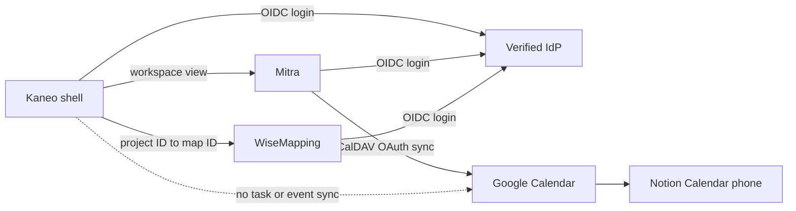

# Spec: Tích hợp Mitra Calendar và WiseMapping Mind Map vào Kaneo

## Context Snapshot

- Project: Kaneo, web project-management app và agent-control layer riêng; source repo `D:\pcloud\workspace\code\kaneo`, branch `kaneo/prodesk-production`.
- Stack: pnpm monorepo; API Hono/Drizzle/PostgreSQL; web React 19, TanStack Router/Query, Vite, Tailwind v4.
- Current behavior: workspace sidebar có Goals, Projects, Members, Invitations; project views có Backlog, Tasks, Gantt, Docs. Kaneo chưa có Google Calendar client hay Mind Map view. `CUSTOM_OAUTH_*` cấu hình Kaneo làm OAuth/OIDC client, không biến Kaneo thành Identity Provider.
- Desired behavior: Calendar là workspace-level view mở Mitra; Mind Map là project-level view trỏ tới một map WiseMapping. Hai app giữ runtime/database riêng. Kaneo chỉ giữ cấu hình URL và liên kết `project_id → map_id`; không sao chép lịch hoặc nội dung map vào Kaneo.
- Relevant files to read:
  - `apps/web/src/components/nav-main.tsx` — workspace navigation.
  - `apps/web/src/components/common/workspace-layout.tsx` — workspace page shell.
  - `apps/web/src/components/common/project-layout.tsx`, `apps/web/src/components/common/header/mobile-project-nav.tsx` — project view navigation desktop/mobile.
  - `apps/web/src/routes/_layout/_authenticated/dashboard/workspace/$workspaceId/project/$projectId/docs.tsx` — authenticated project route pattern.
  - `apps/api/src/database/schema.ts` — existing `integrationTable`.
  - `apps/api/src/github-integration/index.ts`, `apps/api/src/github-integration/controllers/create-github-integration.ts` — project integration auth, permission and upsert pattern.
  - `apps/api/src/utils/get-settings.ts`, `apps/api/src/schemas.ts`, `apps/api/src/index.ts` — public config source và auth middleware order; chỉ tham khảo `get-settings.ts`/`configSchema`, không thêm service URL vào public `/api/config`; đăng ký config endpoint mới sau `authenticateApiRequest`.
  - `apps/web/src/components/share/share-project-surface.tsx` — guest/share surface boundary.
- Existing constraints: `apps/web/PRODUCT.md` and `apps/web/DESIGN.md` are product/design authority. Guest share payloads must not gain integration data. No external credential in Kaneo/Git/logs. ProDesk remains private-network only; service hosting, DNS/firewall, OAuth secret provisioning and lifecycle admission are not authorized by this spec.
- External references reviewed: [Mitra Google integration](https://mitracal.com/docs/integrations/google/), [Mitra SSO](https://mitracal.com/docs/sso/), [Mitra reminders](https://mitracal.com/docs/reminders/), [WiseMapping OIDC](https://github.com/wisemapping/wisemapping-open-source/blob/develop/doc/oidc/README.md), [WiseMapping license](https://github.com/wisemapping/wisemapping-open-source/blob/develop/LICENSE.md).

## Objective

Đưa lịch và mind map vào đúng chỗ trong Kaneo mà không trộn ba ứng dụng thành một cục. Người dùng mở Calendar từ workspace, mở đúng Mind Map từ project; Google Calendar vẫn là lịch chung cho Notion Calendar trên điện thoại, còn Mitra/WiseMapping giữ dữ liệu của chúng.

## Amendment (SPEC-2026-10-31, owner request trong EP session)

Owner yêu cầu điều khiển hiện diện của hai entry ngay trong UI Kaneo (không đụng env/restart) và muốn khi tắt thì UI trở về y như bản chưa có feature: entry ẩn hẳn khỏi sidebar/switcher. Quyết định owner đã chốt bằng lời trong EP session:

- Thêm **workspace-level toggle** trong UI Workspace Settings cho từng service (Mitra Calendar, WiseMapping Mind Map), chỉ người có `workspace:manage_settings` đổi được.
- Lưu trạng thái vào DB (migration mới cho riêng mục này — duyệt thay cho ràng buộc “không thêm migration” cũ).
- Env `KANEO_*_BASE_URL` vẫn là **cap tối đa**: env không cấu hình → endpoint không bao giờ trả service, toggle không có gì để bật. DB toggle chỉ làm mờ/tắt trong phạm vi env cho phép. Mặc định toggle = bật (giữ hành vi hiện tại khi nâng cấp).
- Khi service bị tắt (env hoặc toggle), nav item “Lịch” và nút “Mind Map” trong switcher **ẩn hẳn**, route trực tiếp trả view disabled có hướng dẫn rõ, không trắng trang.
- Ranh giới không đổi: vẫn nhúng iframe, không gộp source; không thêm service URL vào public `/api/config`; toggle không lộ URL cho người không có quyền workspace.
- Lý do owner: sau khi dùng thấy không phù hợp thì ẩn cho gọn, khi cần bật lại; về lâu dài nếu tích hợp thật source thay vì nhúng cũng thay thế được ở cùng chỗ này.

## Scope

- In:
  - Workspace-level Calendar entry/route trong Kaneo, mở Mitra trong embedded view khi endpoint cho phép.
  - Project-level Mind Map view, một liên kết WiseMapping cho mỗi project.
  - Cấu hình optional cho hai service URL; thiếu cấu hình thì không render entry chết.
  - API authenticated để đọc cấu hình và gắn/gỡ `map_id` cho project.
  - OIDC dựa trên cùng verified-email Identity Provider khi provider hiện có hỗ trợ; app vẫn giữ account, session và quyền riêng.
  - Empty/loading/unavailable/reauth states, external-open recovery, responsive behavior, UAT và rollback không xóa dữ liệu ngoài Kaneo.
  - (Amendment) Workspace-level UI toggle bật/tắt từng service trong Workspace Settings, lưu DB (migration riêng), env vẫn là cap tối đa; tắt thì nav entry ẩn hẳn.
- Out:
  - Cài đặt/nâng cấp Mitra hoặc WiseMapping trên ProDesk; DNS, firewall, tunnel, public exposure; tạo Google OAuth app; cấp secret; backup/restore service volumes. Đây là lifecycle riêng theo Home Server runbook, không nhét vào Kaneo Compose.
  - Gộp/fork source hai ứng dụng, viết lại editor/calendar, hoặc thay Gantt.
  - Đồng bộ task Kaneo thành event, đồng bộ event thành task, nối node map với task, tự tạo map qua API hoặc tự đồng bộ membership/role giữa hai app.
  - Đưa calendar, map ID, service URL hay iframe vào guest/full-share routes hoặc public DTO.
  - Đổi cấu hình đăng nhập hiện tại của Kaneo hoặc thêm Identity Provider mới.
  - Mở public service endpoint. Service URL phải là endpoint HTTPS đã được owner duyệt và reachable theo private-network policy hiện hành.

## UX Baseline

| # | Tiêu chí | Điều kiện đạt |
|---|---|---|
| 1 | Keyboard | Sidebar/view links theo thứ tự Tab; embedded mode cho phép vào/ra iframe bằng keyboard; external-open, login và map-link controls thao tác bằng Enter/Space. |
| 2 | Focus | Keyboard focus nhìn thấy rõ; pointer focus không thêm outline mới; embedded mode trả focus/Tab về parent sau iframe; open-only mode giữ focus trong Kaneo cho tới khi user mở link. |
| 3 | A11y | Iframe có title mô tả; controls có label; error/loading có status semantics; text contrast ≥4.5:1. Trên coarse-pointer, mọi target trong navigation bị scope chạm tới ≥44×44px: workspace/project SidebarTrigger, NavMain collapsible trigger/items, MobileProjectNav trigger, 5 view items, project rows, Add Project và external-open. Desktop giữ kích thước incumbent. |
| 4 | Viewport | 320–1440px không tràn ngang; iframe co theo content area, không đẩy page ra ngoài viewport; sidebar/mobile nav không bị chèn. |
| 5 | States | Cấu hình thiếu, map chưa liên kết, loading, OIDC chưa đăng nhập, service unavailable, link lỗi và success đều có đường phục hồi rõ. |
| 6 | Nhất quán | Shell dùng `apps/web/DESIGN.md` và component hiện có; iframe giữ giao diện/attribution của service, không skin hay che nguồn. |
| 7 | Platform | Web authenticated workspace/project route; không thêm vào share, backlog hoặc Gantt. |
| 8 | Copy | Lời gọi tên việc: “Lịch”, “Mind Map”, “Mở riêng”, “Liên kết map”; không lộ hostname, OAuth/config chẩn đoán cho user. |

## Thuật ngữ

- **Service riêng**: Mitra/WiseMapping chạy với runtime, database và backup riêng; Kaneo không gộp source hay lưu nội dung của chúng.
- **Embedded view**: route Kaneo chứa iframe tới service khác; cùng màn hình nhưng không có nghĩa dùng chung database hoặc quyền.
- **View mode**: cấu hình theo từng service, giá trị `embedded` hoặc `open-only`; mode không được suy ra mù từ lỗi iframe.
- **Workspace Calendar**: lịch cá nhân của user đang đăng nhập, hiển thị qua Mitra; không gắn theo project.
- **Project Mind Map**: một WiseMapping `map_id` được liên kết với một project Kaneo.
- **External-open recovery**: link mở service riêng trong tab mới khi iframe không dùng được; đây là đường lui, không thay thế default embedded view nếu iframe đã pass.
- **Integration binding**: row `integration` trong Kaneo lưu provider type và reference không bí mật; xóa binding không xóa tài nguyên ngoài.

## Assumptions

1. Mitra và WiseMapping đã được provision riêng, có HTTPS private origin và OIDC sẵn sàng; thiếu chúng thì integration route bị ẩn/blocked, không tự cài dịch vụ.
2. Hai service dùng cùng Identity Provider với Kaneo và email OIDC đã verified. WiseMapping match account theo email; existing local account cần confirm link một lần, sau đó local password/login và self-registration bị disable; account gắn provider khác không tự link. SSO không đồng bộ account ID, workspace membership hay quyền.
3. Mitra được cấu hình Google OAuth và Google Calendar hai chiều; UAT dùng calendar thuộc Google account đã connect, không dùng calendar native của Mitra. Google Calendar vẫn là nguồn chung cho Notion Calendar trên điện thoại. Notification của Notion Calendar mobile là acceptance bắt buộc theo yêu cầu owner; Mitra native push không thay thế được.
4. V1 liên kết một map đã tạo trong WiseMapping bằng map ID. Người có `manage_settings` quản lý liên kết; map collaborators vẫn được quản trong WiseMapping.
5. `integrationTable` đã có unique constraint theo `(projectId, type)`; lưu `type="wisemapping"` và JSON chỉ chứa `mapId`, không cần schema migration.
6. Giao diện WiseMapping phải giữ attribution “Powered by WiseMapping” theo WPL 1.0: hiển thị trên mọi màn hình WiseMapping UI, giữ vị trí upstream và link về website WiseMapping; không che bằng overlay hoặc CSS.

## Open Questions

- Private WiseMapping editor chưa được tài liệu chính thức xác nhận là frameable. Owner đã chấp nhận open-only mode nếu candidate không hỗ trợ private iframe. Mỗi service có `viewMode` cấu hình tường minh; không tự đổi mode theo lỗi runtime. Với `embedded`, first-time OIDC login phải chạy ở top-level qua link “Mở riêng để đăng nhập”, rồi quay lại/reload iframe; không đưa IdP vào `frame-src` trừ khi đã chứng minh IdP cho phép framing. Nếu cookie/session vẫn không dùng được trong frame, chọn `open-only`; không chuyển sang proxy rewrite/API editor/code merge.
- Exact service origins là deployment config bên ngoài scope này; không hardcode domain production vào frontend, không ghi secret vào spec/repo.

## Approach

- Chọn service boundary: Kaneo chỉ thêm entry points, protected configuration và map reference. Mitra giữ Google OAuth token/calendar cache; WiseMapping giữ map, history và collaboration.
- Calendar đứng ở workspace sidebar vì lịch là của user, không phải của một project. Map đứng trong project view vì quan hệ map–project là một-một.
- Không đưa service base URLs vào public settings/guest DTO. API trả cấu hình cho authenticated workspace member; URL phải qua HTTPS validation và exact-origin allowlist. `iframe-src` chỉ nhận từ server configuration, không nhận arbitrary URL từ form/query.
- Map binding đọc/ghi qua API có project access guard. Dùng existing `integrationTable` với type `wisemapping` và `mapId`; `workspace.manage_settings` mới được gắn/gỡ. Unlink xóa row Kaneo, không gọi delete map ở WiseMapping.
- Map view yêu cầu quyền project member trong Kaneo **và** quyền map trong WiseMapping. Kaneo không cấp quyền WiseMapping ngầm; user phải được phép trong cả hai hệ.
- Không pass bearer token, OAuth secret, task data, project description hay `postMessage` auth payload sang iframe. First-time OIDC login mở ở top-level qua service; user quay lại Kaneo rồi reload embedded view. Nếu session cookie bị chặn trong frame, service đó chuyển sang explicit `open-only` mode.
- Phân biệt hai policy: response Kaneo dùng CSP `frame-src` để chỉ cho phép exact configured service origins; response từng service dùng CSP `frame-ancestors` để chỉ cho phép exact Kaneo origin. `frame-ancestors` phải là HTTP response header, không phải meta tag; kiểm tra cả `X-Frame-Options` xung đột. Repo app source hiện không khai báo CSP; T3 phải xác định header thực tế do app hay deployment adapter sở hữu. OIDC authorization chạy top-level trước iframe để redirect tới IdP không bị parent `frame-src` chặn; sau login mới reload frame. Chỉ cập nhật policy qua source-owned guarded bundle; không wildcard và không sửa trực tiếp host.
- Pre-lock flow:
  1. User chọn Lịch trong workspace sidebar → Kaneo kiểm tra authenticated settings → Mitra mở trong frame; user thao tác với tài khoản Google của chính họ.
  2. User chọn Mind Map trong project → Kaneo đọc binding của project → đúng map được nhúng. Nếu chưa có binding, người có `manage_settings` tạo map ở WiseMapping rồi nhập map ID vào Kaneo.
  3. Nếu service đang lỗi hoặc frame không đăng nhập được, hiện Retry và Mở riêng; các view Tasks/Gantt/Docs vẫn nguyên trạng.
- Diagram hệ thống:

## Bỏ qua

- Không biến Mitra/WiseMapping thành package/component bên trong Kaneo; iframe không phải data merge.
- Không lưu calendar events, map XML, OAuth token hay Google credentials trong Kaneo.
- Không đổi các project views hiện có, guest-share capability, agent-control envelope hay task lifecycle.
- Không tự public service, tự chọn domain, tự tạo Google OAuth consent app hoặc tự thêm host lifecycle project.
- Không tự động share WiseMapping map cho mọi Kaneo member; không hứa cùng role giữa hai app.

## Risks

- Cookie/callback/CSP có thể chặn private editor trong iframe; chỉ build gate thật trên candidate endpoints mới xác nhận được.
- Same OIDC issuer không đồng nghĩa cùng quyền; route guard Kaneo không chặn người đã có URL và quyền riêng trong WiseMapping.
- Mitra OIDC cần bật trước khi nạp dữ liệu thật; account anonymous cũ không tự chuyển sang account OIDC mới. WiseMapping OIDC còn disable local login/HTTP Basic/self-registration; existing password sessions có thể sống đến token expiry, phải chọn accept overlap hoặc revoke trước cutover.
- Google OAuth consent để testing có thể hết grant sau 7 ngày; production readiness cần consent/app status phù hợp.
- Rollback Kaneo không được xóa Mitra/WiseMapping volumes, maps, Google calendar hoặc WiseMapping history.
- Owner Home Server policy yêu cầu service mới có registry entry, source-owned lifecycle wrapper, data/backup classification và private-network evidence; các việc đó thuộc service-admission task riêng.

## Task List

### T1 — Runtime config, map binding và authorization API

- Acceptance:
  - Authenticated workspace member đọc được trạng thái/config của embedded services, gồm URL và mode; unauthenticated/share holder không nhận service URL hay map ID.
  - Không thêm service URL vào public `GET /api/config`: route `/config` được đăng ký trước global auth middleware. `get-settings.ts`/`configSchema` chỉ tham khảo, không mở rộng. Endpoint config mới đăng ký sau `authenticateApiRequest` và dùng `workspaceAccess.fromParam("workspaceId")` hoặc guard tương đương để xác nhận membership; session đăng nhập đơn thuần chưa đủ.
  - `KANEO_MITRA_BASE_URL`/`KANEO_WISEMAPPING_BASE_URL` và mode tương ứng `KANEO_MITRA_VIEW_MODE`/`KANEO_WISEMAPPING_VIEW_MODE` là optional. Mode chỉ nhận `embedded` hoặc `open-only`; URL phải là HTTPS absolute URL, không userinfo/query/fragment. Thiếu URL hoặc mode thì service không khả dụng, không đoán mode và không render iframe rỗng. Authenticated config trả URL+mode; public `/api/config` không trả trường nào trong số này.
  - Mind Map GET/PUT/DELETE binding dùng `workspaceAccess.fromProject`; PUT/DELETE thêm `requireWorkspacePermission({ workspace: ["manage_settings"] })`. `mapId` là opaque ID tối đa 256 ký tự như một path segment; reject ID rỗng, `.`/`..` và bản percent-encoded, separator path/query/fragment, raw backslash và control characters; không giả định ID chỉ là số. Encode ID đúng một lần khi tạo URL. ID malformed trả validation error; map không tồn tại/không có quyền do WiseMapping xử lý, không probe bằng credential của Kaneo.
  - Row dùng `integrationTable`, `type="wisemapping"`, `config` chỉ có `mapId`; unique project/type đảm bảo tối đa một map mỗi project. Unlink không gọi WiseMapping API và không xóa map.
  - Không thêm migration, Google token, task/event sync, hoặc public/share DTO field.
- Reproduce: từ repo root `pnpm --filter @kaneo/api test:integration`.
- Verify: API integration tests cho workspace member, authenticated outsider phải bị 403, unauthenticated/share guest, project permission, link/unlink, invalid ID và project isolation; `pnpm --filter @kaneo/api build`.
- Files:
  - `apps/api/src/database/schema.ts` — `integrationTable` type/config/unique constraint hiện có.
  - `apps/api/src/github-integration/index.ts` — `workspaceAccess.fromProject` và `manage_settings` route guard.
  - `apps/api/src/github-integration/controllers/create-github-integration.ts` — upsert hiện có theo project/type.
  - `apps/api/src/utils/get-settings.ts` — public settings source; inspect only, do not add service URL fields.
  - `apps/api/src/schemas.ts` — `configSchema` is public; do not add external service URLs.
  - `apps/api/src/index.ts` — auth middleware order; register service config endpoint after authentication middleware.
  - `apps/api/src/utils/workspace-access-middleware.ts`, `apps/api/src/utils/validate-workspace-access.ts` — workspace membership guard.
  - `tests/api-integration/` — authenticated route, authorization và share-boundary test patterns.

### T2 — Workspace Calendar và project Mind Map views

- Acceptance:
  - Có Calendar item text-only ở workspace sidebar, match pattern `NavMain`, không nằm trong project view switcher. Trên coarse-pointer, workspace/project SidebarTrigger, NavMain group trigger/items và các navigation control mới có hit area ≥44×44px; desktop giữ kích thước incumbent.
  - Có Mind Map item ở desktop project view switcher; route Mind Map giữ switcher hiển thị (`showViewSwitcher=true`, khác Docs editor). Backlog/Tasks/Gantt/Docs giữ thứ tự và hành vi cũ. Mobile picker hiện dưới `md`, desktop switcher từ `md` trở lên; hai nav không chồng nhau ở 640–767px. Mind Map dùng icon semantic không trùng `CalendarDays` của Gantt; nhãn chữ vẫn hiện.
  - View mode per service đến từ authenticated config. `embedded` render iframe; `open-only` không render iframe và chỉ hiện link rõ “Mở riêng”; thiếu/invalid mode thì feature disabled. Không tự suy hoặc đổi mode theo lỗi browser.
  - Calendar chỉ mở Mitra của user hiện tại qua configured origin; Mind Map mở đúng `mapId` của project hiện tại. `activeView` và route detection nhận `mindmap`; đổi project từ Mind Map giữ view và chỉ mount frame sau khi binding project đích đã tải, không giữ map cũ.
  - Không có binding thì chỉ người có `manage_settings` thấy thao tác link; map được tạo ngoài WiseMapping rồi gắn bằng ID. Người không có quyền map thấy lỗi/recovery từ WiseMapping, không tự được cấp quyền. Map ID được encode thành một path segment; malformed ID bị từ chối, còn map không tồn tại/không được phép dùng lỗi từ WiseMapping.
  - Loading, missing-config, unlinked-map, auth/error và unavailable states có thông báo ngắn, Retry khi hợp lý và external-open action. Embedded mode có link “Mở riêng để đăng nhập” cho first-time OIDC ở top-level; sau login user quay lại và Retry/reload iframe. Nếu cookie/session không dùng được trong frame, đổi service sang `open-only`; không redirect IdP bên trong iframe. Chỉ embedded mode render iframe và yêu cầu accessible frame title; open-only chỉ render named external link. Data không nằm trong URL query ngoài map ID cần thiết.
  - Routes chỉ authenticated; `share-project-surface` và public DTO không thay đổi.
- UX Contract:
  - Surface: Operate, shell Kaneo hiện có; iframe giữ nguyên UI và attribution của service.
  - States: configured/loaded; loading; integration disabled; map chưa liên kết; OIDC chưa có session; service/frame lỗi; retry; embedded/open-only; linked/unlinked.
  - Keyboard: focus đi theo nav → content → fallback actions; Tab vào/ra iframe ở embedded mode; controls ngoài frame dùng Enter/Space; không chặn browser back. First login mở top-level OIDC qua link riêng rồi user quay lại; không truyền token. Desktop Mind Map route giữ project switcher để user đổi view mà không phải back ra trước.
  - A11y: `title` cho iframe, tên rõ cho nav/retry/open/link; status lỗi/loading được announce; không dựa vào màu để chỉ trạng thái.
  - Responsive: shell hoạt động 320–1440px; iframe co trong vùng content, không ép page scroll ngang; mobile project view menu dùng grid 2 cột cho đủ 5 view, mọi mục ≥44×44px và không tràn ở 320px. Mobile picker và desktop switcher loại trừ nhau tại mọi width; test edges 640/767/768px. Trên coarse-pointer, workspace/project SidebarTrigger, NavMain group trigger/items, MobileProjectNav trigger, project rows, Add Project và external-open đều ≥44×44px. Desktop controls giữ kích thước incumbent.
  - Token: theo `apps/web/DESIGN.md`; không skin external app hoặc thêm CSS framework.
- Skills: `flow`, `impeccable`, `frontend-taste-chatgpt`, `mobile-responsive`.
- Visual Ref: `apps/web/DESIGN.md`, `apps/web/src/components/common/project-layout.tsx`, `apps/web/src/components/common/workspace-layout.tsx`, `apps/web/src/components/nav-main.tsx`.
- Reproduce: từ repo root `pnpm --filter @kaneo/web test`.
- Verify: focused tests cho nav/route/frame states; `pnpm --filter @kaneo/web typecheck`; `pnpm --filter @kaneo/web build`; `pnpm i18n:check`; Impeccable detector một lượt sau khi hoàn tất.
- Files:
  - `apps/web/src/components/nav-main.tsx` — workspace-level nav item pattern; đảm bảo hit area 44px trên coarse-pointer cho navigation trong scope.
  - `apps/web/src/components/common/workspace-layout.tsx` — workspace shell.
  - `apps/web/src/components/common/project-layout.tsx` — thêm `mindmap` vào activeView/route detection; hiển thị switcher trên Mind Map; giữ mindmap trong `handleProjectSwitch`; đổi desktop switcher sang `md:inline-flex` để khớp mobile picker `md:hidden`.
  - `apps/web/src/components/common/header/mobile-project-nav.tsx` — thêm view/callback, grid 2 cột cho 5 view và 44px hit area cho trigger/items/project rows/Add Project trên coarse-pointer.
  - `apps/web/src/routes/_layout/_authenticated/dashboard/workspace/$workspaceId/project/$projectId/docs.tsx` — file-route + ProjectLayout pattern.
  - `apps/web/src/components/share/share-project-surface.tsx` — preserve guest separation.
  - `apps/web/src/fetchers/`, `apps/web/src/hooks/queries/`, `i18n/*.json`, `i18n/schema.json` — API client, query and localized copy patterns.

### T3 — External-service compatibility, rollback và release evidence

- Acceptance:
  - Mode được cấu hình tường minh cho từng service. Với `embedded`: test từ browser profile đã logged-out; OIDC first login chạy top-level qua “Mở riêng để đăng nhập”, rồi quay lại/reload frame. Verify Kaneo `frame-src` chỉ service origins, service `frame-ancestors` chỉ Kaneo origin, X-Frame-Options, cookies, redirect; smoke mở private editor/map thật, edit/save/reload và deny unauthorized map. Không redirect IdP bên trong frame. Nếu cookie/session vẫn chặn frame, set mode `open-only`.
  - Với `open-only`: không render iframe; verify route có external-open action, top-level OIDC login, edit/view đúng tài nguyên và copy không ám chỉ nội dung đang embed. Ghi mode đã chọn cho từng service; không claim embed. Không bypass CSP hay wildcard.
  - Mitra OIDC migration: trước khi OIDC được bật trên service có dữ liệu, inventory account anonymous/native. Nếu còn dữ liệu, chuyển Mitra-native events sang Google Calendar trước cutover hoặc dừng chờ quyết định owner; không để dữ liệu cũ bị bỏ lại trong account rỗng mới. Sau first OIDC login, xác nhận Google account cần dùng được connect lại.
  - Google OAuth: xác nhận consent screen/grant không còn ở trạng thái Testing có grant hết hạn sau 7 ngày. Nếu vẫn Testing thì production gate BLOCKED; việc publish/verification Google OAuth app thuộc service-admission task, không làm lén trong Kaneo.
  - Mitra UAT: connect Google account, chọn calendar thuộc account đó (không dùng native Mitra calendar), tạo event có reminder; đợi documented sync interval, xác nhận event tới Google Calendar và Notion Calendar mobile, rồi xác nhận chính Notion Calendar gửi notification đúng giờ. Mitra-native push không tính là pass. Thiếu Notion Calendar notification thì T3 fail và không được DONE.
  - WiseMapping: hai project test mở hai map khác nhau; unlink trong Kaneo không xóa map; người thiếu quyền bị chặn bởi WiseMapping. Test OIDC link existing local owner/admin bằng verified email; xác nhận map/history còn truy cập, local email/password login, HTTP Basic và self-registration bị disable, account gắn provider khác fail closed. Kiểm existing local password session: chấp nhận overlap tới token expiry theo cấu hình (7 ngày mặc định) hoặc revoke trước cutover; ghi quyết định trong receipt. Kiểm attribution trên mọi WiseMapping UI screen: visible, giữ vị trí và link đích theo WPL.
  - Tắt URL config/rollback về Kaneo image trước thay đổi làm hai entry biến mất; Board/Gantt/Docs tiếp tục hoạt động; external volumes/data được giữ nguyên.
  - Owner decision (2026-11-04): không dựng candidate/staging app riêng; dùng production làm nơi owner UAT vì hiện chỉ owner dùng Kaneo. Deploy thẳng production qua **canonical r10e guarded rollout** sau khi plan/backup/migration/rollback/health gates pass. Quyết định này chỉ bỏ bước xác nhận trên một môi trường staging; KHÔNG bỏ digest pin, H7 readiness, pre/post encrypted backup receipt, migration verifier, kill-switch/canary/health/rollback gates của release lane, hoặc owner UAT bắt buộc. Không dùng legacy wave scripts. Không đổi DNS/firewall/public exposure hoặc provision Mitra/WiseMapping lifecycle trong task này.
- Reproduce: từ `apps/web` chạy `pnpm build && pnpm preview --port 4173`, sau đó dùng authenticated candidate session và configured private service URLs.
- Verify: UI Gate — screenshot 1280×800 và 375×812 cho Calendar/Mind Map ở mode đã chọn; check overflow 320/375/414/640/767/768/1024/1280/1440; đo bounding box ≥44×44px của mọi coarse-pointer control trong affected navigation. Embedded mode: phân biệt `frame-src` Kaneo với `frame-ancestors`/`X-Frame-Options` service, test logged-out top-level OIDC rồi reload frame. Open-only mode: xác nhận không render iframe. Browser console không có frame/auth errors; xác nhận WiseMapping session migration, Mitra OIDC migration, Google consent status và Notion Calendar notification thực tế; `git diff --check`; manual service UAT.
- Files:
  - `apps/web/PRODUCT.md`, `apps/web/DESIGN.md` — product/surface authority.
  - `apps/api/src/index.ts`, `apps/api/src/config/index.ts` — vị trí public `/api/config`; không thêm service URLs vào endpoint này.
  - `apps/api/src/utils/get-settings.ts`, `apps/api/src/schemas.ts` — config public; implementation không thêm URL/mode vào `configSchema`.
  - `apps/web/src/components/common/project-layout.tsx`, `apps/web/src/components/nav-main.tsx` — existing navigation preserved.
  - Kaneo deployment wrapper/bundle và external-service origins — chỉ thay đổi qua approved source-owned deploy lane; file paths được chốt khi service-admission task riêng mở.

### T4 — Workspace-level UI toggle cho hai entry (Amendment, revised theo spec review round 1)

- Acceptance:
  - Bảng mới `workspace_integration_settings` (một row mỗi workspace, `workspace_id` unique FK cascade): `mitra_enabled boolean default true`, `wisemapping_enabled boolean default true`. Migration drizzle mới đánh số 0052 (tiếp mạch journal hiện có); không đụng bảng/cột khác. Ghi chú phạm vi: ràng buộc “không thêm migration” của T1 chỉ áp dụng cho T1 — migration T4 được owner duyệt riêng qua amendment này. Row settings được tạo lazily (upsert khi PUT lần đầu); GET khi chưa có row coi như cả hai enabled=true.
  - GET authenticated `workspace-config` shape có 3 trạng thái: env chưa cấu hình → service `null`; env đã cấu hình nhưng DB toggle off → `{ enabled: false }` (KHÔNG có `baseUrl`/`viewMode`); env đã cấu hình và toggle on → `{ enabled: true, baseUrl, viewMode }`. `enabled` = env configured AND DB toggle on. Toggle DB default true → hành vi nâng cấp giữ nguyên. Web hiểu `null` → entry ẩn + Settings hiển thị note “dịch vụ chưa được cấu hình ở máy chủ” (không lộ env var/hostname); `{enabled:false}` → entry ẩn + Settings cho bật lại; `{enabled:true,...}` → entry hiện. PUT trả cùng shape theo trạng thái mới; khi tắt phải xác nhận URL vắng khỏi response.
  - PUT toggle endpoint `PUT /embedded-integration/workspace-config/:service` với `workspaceId` truyền bằng query (`workspaceAccess.fromQuery("workspaceId")` — đồng bộ với GET hiện tại, KHÔNG dùng fromParam vì path không chứa workspaceId): body `{ enabled: boolean }`; `:service` whitelist `mitra|wisemapping` (giá trị khác → 400); guard `requireWorkspacePermission({ workspace: ["manage_settings"] })`; response trả lại service object gộp mới (giống GET shape). Unauthenticated 401; member thường 403; PUT idempotent (upsert row).
  - Nav fail-closed chống flash: khi query config chưa tải thành công (loading hoặc error), nav item “Lịch” và nút “Mind Map” KHÔNG render — chỉ render khi có config loaded và `enabled`. Không hiện entry rồi biến mất. Switcher desktop/mobile khi Mind Map ẩn còn 4 view, mobile giữ grid 2 cột (2×2).
  - Toggle off (env vẫn on): route Calendar/Mind Map truy cập trực tiếp vẫn tồn tại, hiển thị disabled message phân biệt nguyên nhân: copy riêng cho “đã bị tắt trong cài đặt workspace” (hướng dẫn bật lại: Settings → Integrations) và “chưa được cấu hình ở máy chủ” (không hướng dẫn tự bật — không lộ env/hostname/OAuth). Hai nhóm copy không trộn lẫn.
  - UI toggle: section/card riêng **Integrations** trong Workspace Settings (trang `general`, bên ngoài form Workspace Information, cùng mức với các card khác); dùng component Switch semantic có sẵn của Base UI (role=switch/aria-checked do primitive cung cấp, tên qua `aria-labelledby`, focus/Space keyboard giữ nguyên); Switch target ≥44×44px trên coarse-pointer, row có min-height 44px; kết quả mutation announce qua `role="status"` (pending/success/error). Toggle chỉ hiện khi service configured; permission UI dùng `canManageEmbeddedIntegrations()` (KHÔNG dùng `canManageWorkspace()`); member thường không thấy toggle nhưng vẫn thấy entry nếu enabled.
  - i18n keys mới (13 locale) tối thiểu **9 keys tổng**: 7 Settings keys (`embedded.settings.sectionTitle`, `embedded.settings.mitraLabel`, `embedded.settings.wisemappingLabel`, `embedded.settings.serviceNotConfigured`, `embedded.settings.saving`, `embedded.settings.saveSuccess`, `embedded.settings.saveError`) + 2 copy toggle-off (`embedded.calendarDisabledByWorkspace`, `embedded.mindMapDisabledByWorkspace`). Không thêm 2 key status riêng nữa; `saving`/`saveSuccess`/`saveError` dùng chung cho cả hai toggle. Copy không lộ hostname/env var/config chẩn đoán.
  - Guest/share surface không đổi. Map binding của project không bị xóa khi toggle off — chỉ ẩn UI; bật lại là dùng lại được ngay.
- Reproduce: từ repo root `pnpm --filter @kaneo/api test:integration`; `pnpm --filter @kaneo/web test`.
- Verify: integration tests cho PUT toggle (member 403, outsider 403, unauth 401, invalid service 400, toggle off → GET/PUT trả `{enabled:false}` và JSON không chứa URL, toggle on lại → enabled=true + URL, env off → service null dù toggle on, default missing row → enabled=true); web tests cho nav fail-closed (loading/error → không render entry) + enabled → entry hiện + switcher 4/5 view + toggle section permission; typecheck; build; i18n:check; biome; smoke UI toggle on→off→on thấy entry biến mất/quay lại; `git diff --check`.
- Files:
  - `apps/api/src/database/schema.ts` + `apps/api/drizzle/0052_*.sql` — bảng mới + migration.
  - `apps/api/src/embedded-integration/*` — config gộp (đọc settings row) + PUT `workspace-config/:service` + controller settings.
  - `apps/web/src/hooks/queries/embedded-integration/use-embedded-services-config.ts` — shape mới; mutation `use-set-embedded-service-enabled` mới.
  - `apps/web/src/components/nav-main.tsx`, `apps/web/src/components/common/project-layout.tsx`, `apps/web/src/components/common/header/mobile-project-nav.tsx` — fail-closed ẩn/hiện entry theo config.
  - `apps/web/src/routes/_layout/_authenticated/dashboard/settings/workspace/general.tsx` — thêm card **Integrations** (component con mới ví `apps/web/src/components/settings/embedded-integrations-settings.tsx`).
  - `i18n/*.json` — keys mới theo danh sách trên.
  - `tests/api-integration/embedded-integration.test.ts` — tests toggle.

## Checkpoints

- Sau T1: integration API không rò URL/map ID qua public `/api/config` hay guest DTO; map binding per-project, map ID validation đúng, không migration, unlink không xóa external data.
- Trước T2: candidate services chứng minh được OIDC và ít nhất một đường dùng thật. Nếu private iframe pass, bật embedded mode; nếu bị chặn, dùng open-only recovery đã owner chấp thuận, ghi rõ mode và không claim embedded. Không gộp source.
- Sau T2: web tests/typecheck/build/i18n pass; desktop/mobile capture đủ state và không tràn ngang.
- Sau T4: toggle on→off ẩn entry, off→on trả lại entry, map binding giữ nguyên qua chu kỳ; env vẫn là cap; migration chạy sạch trên DB test.
- Trước DONE: T3 external smoke, rollback rehearsal, independent review và owner UAT đều PASS. Notion Calendar mobile notification là yêu cầu bắt buộc; Mitra-native push không thay thế. Thiếu notification hoặc thiếu evidence cho mode đã chọn (embedded/open-only) thì tối đa PARTIAL.

## External Review Brief

### Reviewer cần phán

- Có đúng ranh giới “Kaneo shell, service/data riêng” không; có chỗ nào lỡ biến iframe thành quyền chia sẻ hay data sync ngầm không?
- Service URL có vô tình đi qua public `/api/config` không; `mapId` binding có fail-closed, project-scoped, validated và share-safe không?
- WiseMapping existing-account OIDC migration, Mitra Google-connected calendar và Notion notification test có đúng không? CSP `frame-src`/`frame-ancestors`, cookie/redirect và WPL attribution có bằng chứng thật không?
- Workspace Calendar và project Mind Map có đúng cấp, không làm vỡ nav desktop/mobile hoặc Gantt hiện tại không?
- Rollback có giữ external data và Kaneo cũ chạy được không?

### Reviewer nên đọc trước

- `apps/web/PRODUCT.md`, `apps/web/DESIGN.md`, `apps/api/src/auth.ts`.
- `apps/api/src/database/schema.ts`, GitHub integration route/controller và `integrationTable`.
- `apps/web/src/components/nav-main.tsx`, `project-layout.tsx`, `mobile-project-nav.tsx`, `share-project-surface.tsx`.
- External docs trong Context Snapshot; runtime evidence của candidate endpoints khi có.

### Reviewer không cần phán

- Calendar UI mới từ đầu, task↔event sync, map node↔task sync, đổi Kaneo auth provider, redesign toàn app hoặc production DNS/firewall.

## User Test

| Hành động | Kết quả kỳ vọng | Chuẩn nhìn |
|---|---|---|
| Mở Calendar từ workspace sidebar | Mitra mở đúng user calendar; project hiện tại không đổi | Không xuất hiện như một project task view; không có trang trắng nếu chưa cấu hình |
| Lần đầu mở khi chưa đăng nhập Mitra/WiseMapping | OIDC đăng nhập ở tab riêng; quay lại Kaneo rồi tải lại embedded view, hoặc dùng open-only mode nếu cookie bị chặn | Không kẹt trong iframe login loop, không chuyển token qua URL/message |
| Tạo event trong Google-connected calendar của Mitra, đặt reminder | Event tới Google Calendar và Notion Calendar mobile; Notion Calendar gửi notification đúng giờ | Không dùng calendar native Mitra; push riêng của Mitra không tính |
| Mở Mind Map ở project A rồi chuyển sang project B | Vẫn ở Mind Map view, tải đúng map B | Không giữ frame/map A; mobile menu đủ 5 view trong 2 cột, target ≥44px; tại 640/767/768px chỉ một view navigation hiện |
| Gắn map ID hợp lệ rồi unlink | Kaneo gỡ liên kết; WiseMapping map và history vẫn còn | Từ chối `.`, `..`, encoded dot-segments, slash/backslash, `?`, `#`, control chars; map không tồn tại/không có quyền có recovery của WiseMapping |
| Dùng open-only mode hoặc làm frame lỗi tạm thời | Open-only không render iframe; lỗi tạm thời có Retry và Mở riêng | Không giả là đang embed; Board, Tasks, Gantt, Docs không bị ảnh hưởng |

5 câu Y/N:

1. Calendar có nằm ở workspace, còn Mind Map nằm trong đúng project không?
2. User không cấu hình service hoặc không được cấp map permission có bị chặn an toàn, có cách phục hồi rõ không?
3. Thay project có đổi đúng map và không lộ map ID qua guest share không?
4. Mọi view dùng được ở 320–1440px, không tràn ngang/cắt control không?
5. Tắt integration/rollback Kaneo có giữ nguyên event, map, history và các view cũ không?

## Completion Gates

- [x] T1 API integration tests, API build, workspace membership guard, map binding và guest non-exposure PASS.
- [ ] T2 web tests, typecheck, build, i18n và Impeccable detector PASS.
- [ ] T3 Mitra/WiseMapping OIDC migration, Google OAuth consent/grant bền vững, Notion Calendar notification và smoke của mode đã chọn PASS.
- [x] T4 workspace toggle: migration + endpoint guards + UI toggle + nav ẩn/hiện theo config + tests PASS (Amendment).
- [ ] Responsive UI evidence desktop/mobile, overflow matrix 320–1440px gồm edges 640/767/768px, không có hai view switcher cùng hiện, và mọi coarse-pointer navigation target đo được ≥44×44px PASS.
- [ ] Rollback rehearsal giữ nguyên data external; owner UAT checklist PASS.
