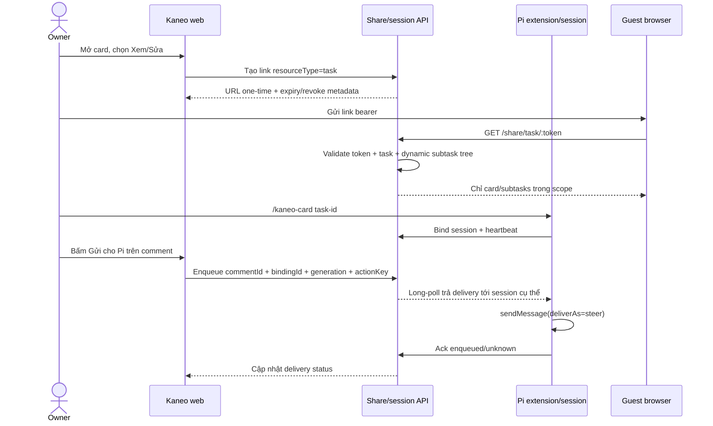

# Spec: Kaneo — Cộng tác bằng card và Pi session

## Context Snapshot

- **Project / module:** Kaneo web/API (`D:\pcloud\workspace\code\kaneo`) và Pi extension `kaneo-mcp` (`D:\pcloud\workspace\code\python`). Đây là execution contract liên repo; chưa sửa source.
- **Stack:** Kaneo là pnpm monorepo, web React/TanStack/Vite, API Hono/Drizzle/PostgreSQL; Pi extension TypeScript.
- **Current behavior:** Sidebar ghi cookie nhưng UI khởi tạo từ Zustand `user-preferences`; cookie không được đọc. Nút `Copy` trong task detail copy task URL; `GitBranch` copy branch name. Share links có scope project/document/goal/task-description/comment; `full` chỉ dành cho project. MCP đã có phần lớn task/project/comment/subtask/label/file operations nhưng chưa có binding cho Pi session thường.
- **Current agent boundary:** `task_run` là worker lane có lease/epoch/dispatcher. `logicalSessionId` thuộc run này, không phải registry của mọi Pi session. Tạo comment hiện auto-steer khi có live worker run; `kaneo_upload_asset(surface=comment)` cũng tạo comment qua cùng đường.
- **Desired behavior:** Card là nguồn sự thật chung. Một Pi session bind một card một lần; agent tự biết card hiện hành, đọc thay đổi mới và cập nhật đúng card/subtasks/marker. Owner có thể gửi một comment vào đúng session bằng action riêng. Người không đăng nhập có thể share riêng một card cùng cây subtask, không nhìn được board hay card khác.
- **Related contracts:** `SPEC-2026-10-22-kaneo-full-project-share-link` (bearer scope/audit/guest side effects), `SPEC-2026-10-27-kaneo-subtask-board-focus-markers` (subtask relations/workMarkerCounts), `agent-contract.md` + `agent-control/contract.json` (formal task_run authority). Spec này không supersede các contract đó; chỉ thêm scope mới.
- **Relevant files:**
  - Kaneo: `apps/web/src/components/ui/sidebar.tsx`, `components/common/layout.tsx`, `store/user-preferences.ts`; `components/task/task-properties-sidebar.tsx`, `components/activity/comment-card.tsx`, `components/share/share-dialog.tsx`; `apps/api/src/share/**`, `task/**`, `task-relation/**`, `activity/controllers/create-comment.ts`, `execution/service.ts`, `mcp/tools.ts`, `database/schema.ts`.
  - Pi extension: `app_presets/pi/extensions/kaneo-mcp/{index.ts,tools.ts,kaneo-client.ts,execution-runtime.ts}` trong repo Python.
- **UI authority:** `apps/web/PRODUCT.md` + `apps/web/DESIGN.md`; đây là Operate UI, chỉ mở rộng incumbent surface, không redesign.

## Objective

- Đóng sidebar thì sau reload và route remount nó vẫn đóng; mở thì vẫn mở.
- Chia sẻ đúng một card và cây subtask bằng link `view` hoặc `edit`, không cần account, không mở cả project.
- Bind Pi session vào card một lần bằng `/kaneo-card`; agent dùng card đó làm default target, đọc subtask mới và cập nhật trạng thái/comment/marker mà không bắt mày nhắc lại ID.
- Comment vẫn là comment. Khi mày bấm **Gửi cho Pi**, nội dung của comment đó mới được chuyển vào đúng session, có receipt rõ ràng và không gửi trùng.

## Scope

- **In:**
  - Một nguồn state bền cho sidebar hiện/ẩn; mobile drawer vẫn đóng khi tải lại.
  - Task-scoped bearer capability mới, `view`/`edit`, root card + cây subtask động; server kiểm tra scope mỗi request.
  - Share dialog từ task detail; khách nhận link vào một task-detail view cô lập.
  - `/kaneo-card <task-id|task-url>` / xem binding / `off`; binding gắn đúng Pi session, không nhầm với task assignee hay worker lease.
  - Tool path gọn cho card hiện hành; bổ sung MCP wrapper còn thiếu cho subtask CRUD và work markers.
  - Binding presence + delivery queue để nút comment gửi tới đúng session.
  - Test API/UI/extension và owner UAT cho share, binding, prompt delivery, sidebar.
- **Out:**
  - Không nâng quyền link project hiện tại; không đổi URL public cũ, link `task_description` hoặc `activity_comment`.
  - Không cho guest xem board/list/Gantt/docs/search, workspace/member directory, integration, project/account settings hay agent-control data.
  - Guest không xóa task nào, chuyển root card, sửa assignee, tạo relation ra ngoài cây, tạo/revoke link.
  - Không gộp session binding thành `task_run`; không đổi worker lease/epoch/phase/dispatcher/PR/merge contract.
  - Không gửi prompt từ anonymous share link.
  - Không thêm agent status column hay đổi Kanban lifecycle.
  - Không redesign Kaneo; không sửa code/deploy trước khi owner review spec.

## UX Baseline

| # | Requirement | Pass condition |
|---|---|---|
| 1 | Keyboard | Tab theo thứ tự nhìn thấy; Enter/Space kích hoạt; Escape đóng dialog/sheet và trả focus về trigger. Pi command gõ trực tiếp, không wizard thừa. |
| 2 | Focus | Keyboard focus thấy rõ theo `apps/web/DESIGN.md`; không tạo focus ring đen mới cho pointer. |
| 3 | Accessibility | Label có nghĩa, error gắn với control, contrast text ≥4.5:1, action touch ≥44px; send status có announcement. |
| 4 | Viewport | Web 320–1440px không tràn ngang; guest task reflow, link/dialog không bị cắt. |
| 5 | States | Loading, empty, link revoked/expired, session offline, pending, delivered, unknown, failed và stale/deleted card đều nói rõ bước tiếp theo. |
| 6 | Consistency | Dùng Button/Dialog/Sheet/Tiptap/token hiện có; không dựng component/CSS system thứ hai. |
| 7 | Platform | Web theo Kaneo; Pi command theo Pi TUI convention hiện tại. |
| 8 | Copy | Nói rõ link là bearer: ai có link có quyền đã chọn và không xác minh danh tính. Nút gọi tên hành động. |

## Thuật ngữ

- **Card / task:** một hàng `task` Kaneo; không phải `project`.
- **Subtask tree:** card gốc và mọi task nối xuống bằng relation `subtask` trong cùng project.
- **Task-scoped share:** bearer link `resourceType=task`; chỉ cấp quyền cho một card và cây con hiện tại.
- **Pi card binding:** liên kết giữa một Pi session cụ thể và task ID; là context/routing, không phải share link hay `task_run`.
- **Formal task_run:** worker run hiện có, có principal/host/lease/epoch và parent review gate.
- **Comment delivery:** receipt riêng cho hành động chuyển một comment đã tồn tại vào session; không phải comment mới.
- **Work marker:** `workMarkerCounts` hiện có; visual cue, không phải task status hoặc label taxonomy.

## Assumptions

1. Owner đã chọn **subtask tree động**: link tự bao gồm subtask mới được tạo bên dưới card sau khi share; dialog phải nói rõ điều này.
2. Task share chỉ có `view`/`edit`; link `edit` hết hạn sau 30 ngày như edit-link hiện tại, link `view` theo TTL hiện hành, mọi link revoke được.
3. Guest edit được field card-local, status, tạo comment, attachments, attach/detach label hiện có, work markers, tạo/sửa/reorder subtask trong cây. Guest không được sửa/xóa comment, xóa root/child, đổi assignee hay xem member directory; anonymous delete giữ nguyên policy hiện hành.
4. Work markers được expose **chỉ trong resourceType=task mới** vì owner muốn dùng card để theo dõi tiến độ; legacy project-share DTO giữ nguyên policy cũ.
5. Guest comment có actor `share-link holder`/link ID, không giả thành account; không tạo mention/assignee notification hoặc Pi delivery.
6. Pi binding dùng task ID hoặc URL task authenticated; không nhận share bearer URL làm danh tính. API key tiếp tục nằm trong secret store hiện có.
7. Một card có tối đa một Pi session active có quyền ghi trong v1. Rebind thay thế binding cũ rõ ràng; không broadcast prompt cho mọi session cùng agent principal.
8. Formal `task_run` và Pi card binding là hai mode riêng. Owner đã chốt ngày 2026-11-10: giữ auto-steer hiện có cho human comment trên live formal worker run; Pi session ad-hoc chỉ nhận comment khi owner bấm nút. Comment do agent/API-key, guest, system hoặc attachment-only không tự steer. Mặc định v1 đề xuất, chờ owner review: nếu formal run được claim sau khi đã bind, formal run thắng; claim transaction revoke binding và stale hóa delivery chưa claim; session cũ không tự resume binding sau khi run kết thúc.
9. Card helper endpoints kiểm bindingId + task subtree server-side, còn quyền workspace vẫn đến từ agent principal hiện có. Binding không thu hẹp authority của API key đối với global tools khi owner bật chúng; hard isolation khỏi mọi off-card API call là ngoài v1 và không được quảng cáo như sandbox.
10. Theo agent-control safety hiện hành, task có run/schedule/phase-card bị deny toàn object. Nếu project có execution manifest, task-share vẫn có thể dùng cho cây ordinary đã chứng minh an toàn nhưng descriptions của toàn cây bị redact/read-only; không heuristic nào được dùng để cho description qua. ShareDialog báo trước cho owner.

## Open Questions

- Guest không được đổi assignee ở v1. Mở quyền gán người là tính năng riêng vì phải duyệt member data tối thiểu được lộ (ID/tên/avatar).

## Approach

- **Sidebar:** Zustand `user-preferences` đã persist trong localStorage là nguồn duy nhất. `SidebarProvider` nhận controlled `open`/`onOpenChange`; toggle và Account Settings cùng cập nhật key đó. Bỏ cookie write chết. `openMobile` tiếp tục là state tạm, không persist.
- **Card share:** Thêm resource type `task`, không nhét filter task ID vào project link. `resolveShareLink` tiếp tục fail-closed theo exact resource type. Resolver tính root + descendants cùng project trên server; mọi read/write/comment/asset/relation handler kiểm tra task ID thuộc cây trước khi gọi mutation. Link mới không gọi `buildFullProjectPayload`.
### Task-share DTO and scope contract

- New `resolveTaskShareScope` resolves the root and current same-project `subtask` descendants on every request with a cycle-safe recursive query; reject cyclic trees and depth >32 with generic 404. Child addition is one transaction that creates a fresh task and its subtask relation under a parent already in scope; no arbitrary endpoint/`blocks`/`related` relation write is exposed. Reorder changes only sibling positions.
- `resourceType=task` uses an explicit DTO, not `fullGetTaskDetail` or a project share payload. Include only allowlisted card fields + `contentRevision`, current in-tree child tasks, in-tree `subtask` edges, task comments and in-tree assets. If the project has an execution manifest, descriptions are null/omitted and read-only project-wide; if any task in the tree has a run/schedule/phase-card relation, fail the entire link closed. For edit links return only the status choices `{slug,name,isFinal}` needed by the card status popover, not a board/column DTO. Omit `blocks`/`related`, `userId`, assignee name/avatar, `workspaceId`, execution state and all out-of-tree task metadata. The linked `projectId` may be carried only as an opaque adapter/cache scope if existing components require it; it grants no authority and must not expose project metadata. Parent breadcrumb is included only when that parent is inside the shared subtree (normally false for the root).
- Every read/write/comment/relation/asset path rechecks task membership; asset read tickets also verify `asset.taskId` remains in the current scope. Share link and root routes never expose any sibling task identifiers.

### Task-share API contract

All paths are relative to `/api`; failures outside scope return generic 404. DTOs below are exact allowlists, not ORM rows.

| Method/path | Request → response | Permission/boundary |
|---|---|---|
| `POST /share-manage/` | `{resourceType:"task",resourceId,permission}` → `{id,resourceType,resourceId,permission,expiresAt,createdAt,token,url}` | Authenticated `project:share`; only `view/edit`; use existing TTL/revoke rules |
| `GET /share-manage/?resourceType=task&resourceId=...` | → `[{id,resourceType,resourceId,permission,expiresAt,revokedAt,createdAt,url}]`; never return token/API key | Authenticated `project:share`; exact task resource |
| `DELETE /share-manage/:id` | → `{success:true}` | Authenticated `project:share`; revoke only this link |
| `GET /share/task/:token` | → `{permission,rootTaskId,scopeProjectId?,statusOptions?,root:{id,number,title,description:string|null,status,statusLabel,priority,startDate,dueDate,contentRevision,workMarkerCounts,labels,assetRefs},subtasks:[in-tree task DTOs],commentsPage:{items:[{id,content,createdAt,updatedAt,authorName,authorType}],nextCursor}}` | Public capability; `statusOptions:[{slug,name,isFinal}]` only for edit, no board/column DTO; scopeProjectId is adapter-only |
| `GET /share/task/:token/task/:taskId` | → `{permission,rootTaskId,scopeProjectId?,statusOptions?,task:{same allowlist},subtasks,commentsPage:{items:[{id,content,createdAt,updatedAt,authorName,authorType}],nextCursor}}` | Task must be root/descendant in current tree; otherwise generic 404 |
| `PATCH /share/task/:token/task/:taskId` | `{patch:{title?,description?,status?,priority?,startDate?,dueDate?},expectedContentRevision}` → `{task,contentRevision}` | Edit; `taskId` in subtree; no `userId/projectId/position`; description omitted/rejected when project has manifest |
| `POST /share/task/:token/task/:parentTaskId/subtasks` | `{expectedParentContentRevision,title,description,status,priority,startDate?,dueDate?}` → `{task,relation,parentContentRevision}` | Atomic fresh-child + `subtask` relation; parent in scope; no `userId/projectId/position`; CAS/bump parent |
| `PUT /share/task/:token/subtask-relations/:relationId/position` | `{position,expectedParentContentRevision}` → `{relation,parentContentRevision}` | Edit; reorder only siblings under an in-scope parent; CAS/bump that parent |
| `POST /share/task/:token/task/:taskId/labels` / `DELETE /share/task/:token/task/:taskId/labels/:labelId` | `{labelId}` on attach → scoped task label receipt | Edit; label must be existing and in same workspace; no global create/delete |
| `POST /share/task/:token/task/:taskId/comments` | `{content}` → `{commentId,content,authorName,createdAt}` | Edit; link-attributed create only; no mention/assignee/TUI side effects |
| `POST /share/task/:token/asset/upload-ticket`, `POST /share/task/:token/asset/finalize` | Existing two-step upload DTO → scoped asset receipt | Edit; taskId must be in tree; quotas/MIME rules apply |
| `GET /share/task/:token/asset/:assetId` | → safe image or download | View/edit; re-check asset taskId in current subtree |
| `PUT /share/task/:token/task/:taskId/work-markers` | `{workMarkerCounts,expectedContentRevision}` → `{workMarkerCounts,contentRevision}` | Edit; content CAS; no change to execution `taskRevision` |

Before T3, API tests freeze this route/DTO table and prove each request/response boundary; do not infer an endpoint by forwarding to project-full routes.

- **Guest scope:** Cho sửa title/description/status/priority/dates, tạo comment, file, attach/detach label hiện có, work markers, tạo/sửa/reorder child trong cây. Không xóa task (root hoặc child), drag/drop đổi vị trí giữa lane (status field update vẫn được), move project, đổi assignee, tạo relation ngoài cây, tạo label toàn workspace, sửa project/workspace/share/admin/integration/agent-control. Root delete/move revoke link trong cùng transaction; task trong cây thành agent-controlled thì share fail closed.

### Task-share action matrix

| Action/data | View link | Edit link | Boundary |
|---|---|---|---|
| Root + current subtask tree | Read | Read | Dynamic tree, cùng project |
| Card title/description/status/priority/dates | Read | Update | Partial field update + CAS; manifest project descriptions hidden/read-only, run/schedule/phase-card task fails closed |
| Existing labels + work markers | Read | Attach/detach existing; update marker counts | Không tạo label/workflow taxonomy mới |
| Comments | Read | Create comment | No edit/delete comments; actor là link holder |
| Attachments | Read/download | Upload vào card/subtask | Share ticket, MIME/size/quota caps |
| Subtasks | Read | Create/update/reorder | Create makes a fresh child; delete bị deny cho anonymous holder |
| `blocks`/`related` relations | Omit | Omit/deny | Never reveal endpoints or allow link creation |
| Root delete/project move/assignee identity/member list | Deny mutation/read | Deny mutation/read | Không lộ member directory hay đổi project scope |
| Board/docs/search/integrations/agent-control/share settings | Deny | Deny | Không có endpoint/resource ngoài card scope |

- **UI:** Dùng `Copy` hiện có trong `TaskPropertiesSidebar` làm ShareDialog trigger chỉ khi actor có `project:share`; người không có quyền share vẫn giữ copy task URL như hiện tại. Dialog quản lý link và luôn có action copy internal task URL. Cập nhật tooltip/aria-label, không giữ shortcut giả. `GitBranch` copy branch name giữ nguyên. Comment row giữ `CopyShareLinkButton`; `Gửi cho Pi` là action riêng.
- **Pi binding:** `kaneo-mcp` đăng ký `/kaneo-card <task-id|authenticated-task-url>`, `/kaneo-card` (show), `/kaneo-card off`; `/share/.../<token>` không bao giờ là binding input. Extension lấy `agentPrincipalId` từ config hiện có `KANEO_AGENT_PRINCIPAL_ID` (không từ model); API xác minh principal active/owned theo cùng predicate `getOwnedPrincipal`, rồi lấy `runtimeId/hostId` từ principal row — không tin `hostId` từ body. `sessionId` lấy từ Pi session manager; đây là routing assertion, mọi scoped request phải gửi `bindingId+sessionId` và khớp binding row. Lưu `{taskId, projectId, bindingId, sessionId, savedKaneoMode}` trong custom entry; không lưu bearer/API key/transcript path. `kaneo_read_share_link` hỗ trợ đọc `resourceType=task` như untrusted read-only reference, không bind. `before_agent_start` chỉ chèn pointer ngắn (ID/title/project/status); không nhét description/comments/tree.
- **Card tools:** Khi bound, root helpers không nhận taskId; target lấy từ binding. Child-specific helpers có thể nhận `subtaskId`/`assetId`/`commentId`, nhưng API xác minh ID thuộc subtree/card của binding trước mutation/read. Bound tools gồm `kaneo_card_get`, `kaneo_card_update`, `kaneo_card_create_subtask`, `kaneo_card_update_subtask`, `kaneo_card_delete_subtask` (descendant-only), `kaneo_card_list_comments`, `kaneo_card_create_comment`, `kaneo_card_upload_asset`, `kaneo_card_get_asset`, `kaneo_card_update_work_markers`; mọi scoped call mang `bindingId+sessionId+generation`. API dùng `contentRevision` CAS. Generic task/asset mutators bị ẩn cả khi `/kaneo on`; `/kaneo-card off` khôi phục global mode. `kaneo_create_project` vẫn là thao tác global tường minh. Preserve mọi Pi built-in và extension tool khác. Comments paginated latest 10, tối đa 50/cursor; context không chứa comment dump.
- **Session inbox:** Web không được gọi local TUI trực tiếp. Bắt buộc migration tạo binding registry + durable delivery outbox; một active binding/task qua partial unique index và `bindingGeneration`. Pi long-poll, heartbeat 30 giây; offline sau 90 giây. Outbox request hết hạn sau 1 giờ. Nếu formal run được claim sau binding, formal run thắng: claim transaction khóa binding, stale hóa delivery queued và tăng generation. Nếu còn delivery `claimed` có lease chưa hết, formal claim trả 409 typed `ad-hoc-delivery-in-flight` tới khi ack hoặc lease hết (tối đa 60s); poll/mutation/ack đều recheck formal lease, binding không tự resume sau run.
- **Comment delivery:** Chỉ authenticated workspace actor có quyền task:update; mọi share-capability UI đều ẩn action này. UI tạo `clientActionKey` một lần cho click; DB unique `(bindingId,clientActionKey)`, không unique theo commentId. Resend rõ ràng tạo action/attempt mới; nếu attempt trước `unknown`, xác nhận UI cảnh báo có thể gửi trùng. Delivery row giữ `commentId`, `commentUpdatedAt`, `contentHash`, `bindingGeneration`, state và claim lease — không lưu transcript. Claim trả content/attachment asset IDs chỉ khi revision/hash hiện tại khớp. State: `queued→claimed→enqueued`; stale comment/rebind/revoke→`stale`; chưa claim hết 1h→`expired`; claim lease 60s hết mà chưa ack→`unknown`, không auto replay. Pi gọi `pi.sendMessage(...,deliverAs="steer")`; ack chỉ nghĩa là đã xếp vào Pi, không phải model đã đọc. `unknown` resend có thể trùng; UI nói thật.
- **Formal task_run:** Theo quyết định owner 2026-11-10, giữ auto-steer hiện tại cho human comment trên live formal run. `createComment` nhận actor provenance từ authenticated middleware (không từ body); API-key/agent comments, guest comments, system markers và attachment-only tag không steer và không tạo no-run bot fallback. Guest comments đi dedicated share path. Khi taskRun claim xảy ra sau bind, áp dụng formal-run-wins rule ở Session inbox.
- **Deleted/moved card:** Binding và outbox revalidate trước mỗi mutation/delivery. Task 404, project đổi hoặc quyền mất → stale, không tiếp tục ghi; Pi báo owner bind task mới hoặc `/kaneo-card off`.

### Session binding/outbox API contract

All paths below are under `/api`. Agent binding/card routes require the existing verified `x-api-key` auth used by `kaneo-mcp` (no cookie/OAuth impersonation); auth resolves `userId`. Bind additionally supplies configured `agentPrincipalId`, server verifies active ownership, and derives `hostId` from that principal row. Every session-scoped request carries `bindingId`, Pi `sessionId`, and `bindingGeneration`.

| Method/path | Request → response | Boundary |
|---|---|---|
| `POST /agent-sessions/bindings` | `{taskId,agentPrincipalId,sessionId}` → `{bindingId,bindingGeneration,hostId,status,heartbeatAt}` | Verified API key; checks principal ownership, workspace membership, `task:update`, task state and no active formal run |
| `GET /agent-sessions/tasks/:taskId/binding-status` | → `{bindingId,bindingGeneration,status,hostLabel,lastHeartbeatAt}` | Authenticated workspace member with task-read access only; no guest/session path or Pi sessionId |

> **Implementation amendment (T5, EP decision):** `binding-status` returns `{bound, online, formalRunOwned, hostId, bindingId, rootTaskId, sessionId, bindingGeneration}` for workspace members. The frozen row above forbade Pi `sessionId`; T5's Send-to-Pi needs the routing assertion client-side (fresh `clientActionKey` + `sessionId`+`generation` per queue call). Rationale: `sessionId` is a routing assertion, not a credential — the delivery queue route still requires a non-agent browser actor with `task:update`, matching binding/generation, and claim/ack re-verify principal ownership server-side. Guest share surfaces still never see this route (workspace-access guard). Receipt read route stays workspace-scoped (no content in receipts).
| `POST /agent-sessions/bindings/:bindingId/heartbeat` | `{sessionId,bindingGeneration}` → `{status,heartbeatAt}` | Exact active binding; stale mismatch 409 |
| `POST /agent-sessions/bindings/:bindingId/revoke` | `{sessionId,bindingGeneration}` → `{revoked:true}` | Explicit `/kaneo-card off` or rebind; generation increments |
| `GET /agent-sessions/bindings/:bindingId/card` | query `{sessionId,bindingGeneration}` → bounded `{root:{...,contentRevision},subtasks:[{...,contentRevision}]}` | Task-read permission; bound tree only, no broad project DTO |
| `PATCH /agent-sessions/bindings/:bindingId/tasks/:taskId` | `{sessionId,bindingGeneration,expectedContentRevision,patch}` → `{task,contentRevision}` | `task:update`; field allowlist; target must be root/descendant |
| `POST /agent-sessions/bindings/:bindingId/tasks/:parentTaskId/subtasks` | `{sessionId,bindingGeneration,expectedParentContentRevision,task}` → `{task,relation,parentContentRevision}` | `task:create` + parent `task:update` + binding scope; atomic fresh child + subtask edge; CAS/bump parent |
| `DELETE /agent-sessions/bindings/:bindingId/subtasks/:taskId` | `{sessionId,bindingGeneration,expectedParentContentRevision}` → `{deleted:true,parentContentRevision}` | `task:delete`; descendant only, never root; CAS/bump parent |
| `PUT /agent-sessions/bindings/:bindingId/tasks/:taskId/work-markers` | `{sessionId,bindingGeneration,expectedContentRevision,workMarkerCounts}` → `{workMarkerCounts,contentRevision}` | `task:update`; bound scope; never bumps execution `taskRevision` |
| `POST /agent-sessions/bindings/:bindingId/tasks/:taskId/assets/upload-ticket` and `POST /agent-sessions/bindings/:bindingId/tasks/:taskId/assets/finalize` | Existing ticket/finalize fields + `{sessionId,bindingGeneration}` → scoped asset receipt | `task:update`; bound task only; upload limits apply |
| `GET /agent-sessions/bindings/:bindingId/assets/:assetId` | Query `{sessionId,bindingGeneration}` → safe text or download | Task-read permission; asset's task must still be in bound subtree |
| `GET /agent-sessions/bindings/:bindingId/comments` | Query `{sessionId,bindingGeneration,cursor?,limit?}` → `{items,nextCursor}` | Task-read permission; latest 10 default, max 50 |
| `POST /agent-sessions/bindings/:bindingId/comments` | `{sessionId,bindingGeneration,content}` → comment receipt | `task:update`; agent-origin attribution; no auto-steer/fallback |
| `POST /agent-sessions/deliveries` | `{bindingId,bindingGeneration,commentId,clientActionKey}` → `{deliveryId,state,expiresAt}` | Authenticated human with task:update; server verifies current task binding; denied to share-capability actors |
| `GET /agent-sessions/bindings/:bindingId/inbox` | Query `{sessionId,bindingGeneration,waitMs≤25000}` → claimed delivery + comment payload | Atomic claim; content/hash rechecked at claim; stale has no payload |
| `POST /agent-sessions/deliveries/:deliveryId/ack` | `{bindingId,sessionId,bindingGeneration,claimId,outcome:"enqueued"|"failed_before_send"}` → state receipt | Exact claim only; no ack by 60s becomes `unknown`; ack is not read/understood receipt. Formal run claim waits/rejects while claim lease is active |

Migration is mandatory and additive. `agent_session_binding` has a partial unique active row per task and monotonic generation; `comment_delivery` has unique `(bindingId,clientActionKey)`, pinned comment timestamp/hash, claim ID/lease, state and expiry. Keep receipt metadata on revoke/delete; never persist raw comment text in the outbox. Task deletion/comment deletion/rebind mark unclaimed deliveries stale in the same transaction. There is no down migration: application rollback leaves additive tables/columns and recovery is roll-forward.

## Diagram



```mermaid
flowchart TD
    A[Sidebar open/closed] --> B[Zustand localStorage]
    B --> C[Controlled SidebarProvider]
    D[Share token] --> E[Strict resourceType=task]
    E --> F[Resolve root + descendants]
    F --> G{Cùng project, còn quyền và không agent-controlled?}
    G -->|Có| H[Cho phép action matrix card-local]
    G -->|Không| I[404 fail closed]
    J[/kaneo-card task-id] --> K[Pi session binding]
    K --> L[Card-focused tools + compact context]
    M[Comment mới] --> N{Owner bấm Gửi cho Pi?}
    N -->|Không| O[Comment vẫn là thảo luận]
    N -->|Có| P[Durable delivery outbox]
    P --> Q[Đúng Pi session nhận ở lượt kế]
```

## Bỏ qua

- Không đổi permission/URL/resource scope/DTO privacy của `view/edit/full` project links; `full` tiếp tục project-only. Task writes chỉ thêm stale `contentRevision` CAS và 409 khi client ghi đè revision cũ.
- Không dùng share URL làm session identity; `kaneo_read_share_link` vẫn read-only.
- Không tạo agent lifecycle/column mới; Kanban status và `task_run` giữ nguyên authority.
- Không thêm member identity/directory vào public task DTO.
- Không tạo taxonomy marker mới; dùng `workMarkerCounts` hiện có. Existing project-share DTO không đổi.
- Không retry delivery `unknown` vô hạn; owner phải resend rõ ràng.
- Không thay đổi `kaneo-agent-control` command/envelope/lease/dispatcher, ngoại trừ kết nối một session binding riêng ngoài formal run.

## Risks

- Nếu dùng project link rồi lọc ở UI, endpoint quên filter có thể lộ cả board; bắt buộc `resourceType=task` và server-side action matrix.
- Subtask động làm child thêm sau share tự được lộ; disclosure phải hiện trước khi tạo link.
- Pi binding không phải API security sandbox; authenticated agent principal vẫn có workspace permissions. Không đưa share token vào prompt/session.
- Local Pi TUI không nhận push trực tiếp từ web; cần durable inbox/claim/ack, nếu không nút chỉ giả vờ gửi.
- Comment và prompt đang bị trộn trong `createComment`; upload `surface=comment` cũng tạo activity. Tách delivery cho normal session nhưng không phá formal run là integration risk.
- Task description có thể bị owner và agent sửa đồng thời; update phải field-scoped và stale description write phải conflict/fail, không overwrite im lặng.
- Pi session có thể offline, chết giữa send/ack hoặc đổi binding; trạng thái `unknown/stale` phải trung thực và không gửi nhầm session mới.
- `sidebar_state` cookie ghi nhưng không đọc; nếu để sót cookie path có thể tiếp tục lỗi ở insecure local dev.

## Task List

### T1 — Sidebar nhớ trạng thái cuối
- id: T1
- depends_on: []
- wave: 1
- risk: T2
- Acceptance:
  - Desktop open/closed state lấy từ một persistent Zustand key; toggle, Ctrl+B, Account Settings và route remount cùng đọc/ghi một state.
  - Reload khi sidebar đóng vẫn đóng; mở thì vẫn mở. Mobile drawer `openMobile` tiếp tục đóng sau reload.
  - Xóa `cookieStore.set`/cookie constant chết; không còn unhandled rejection trên insecure local dev.
  - Có store/component test cho close→reload/remount, open→reload, Settings toggle cập nhật ngay và mobile drawer không persist.
- UX Contract:
  - Giữ nguyên shell, không thêm dialog/setting. Account preference hiện có cập nhật cùng state ngay.
  - Keyboard shortcut Ctrl/Cmd+B giữ nguyên; initial state không flash về mặc định.
- Skills: `ui-design`, `flow`, `mobile-responsive`.
- Visual Ref: `apps/web/DESIGN.md`; layout không đổi nên không cần wireframe riêng.
- Reproduce: từ repo root `pnpm --filter @kaneo/web test`.
- Verify: `pnpm --filter @kaneo/web typecheck`, `pnpm --filter @kaneo/web build`; smoke reload/route remount ở 1280px + 375px.
- Files:
  - `apps/web/src/components/ui/sidebar.tsx` — `SidebarProvider` persistence.
  - `apps/web/src/components/common/layout.tsx` — controlled `open`/`onOpenChange`.
  - `apps/web/src/store/user-preferences.ts` — persisted preference.
  - `apps/web/src/routes/_layout/_authenticated/dashboard/settings/account/preferences.tsx` — existing sidebar switch.
  - New/related tests under `apps/web/src/components/ui/`.

### T2 — Task-scoped share capability backend
- id: T2
- depends_on: []
- wave: 1
- risk: T4
- Acceptance:
  - Add `task` to `SHARE_RESOURCE_TYPES`, create/list validator allowlists, and `manage.ts` resource lookup (explicit task branch before the activity-comment fallback), plus create/list/revoke flow. Reuse token encryption/AAD, `noindex/no-store/no-referrer`, rate-limit, audit, expiry and revoke mechanism. `resolveShareLink` keeps exact type match and generic 404; `full` remains project-only; task links allow `view/edit` only.
  - Resolve task link with exact resource type; calculate current root+descendant set on every request through the cycle-safe `resolveTaskShareScope` (depth limit 32; cycle/limit overflow fails closed). All actions verify task belongs to this set and same project; out-of-tree/cross-project IDs, wrong token type, revoked/expired link, agent-controlled task or moved root fail with generic 404.
  - Task share uses an explicit allowlisted task DTO; it must not reuse `fullGetTaskDetail` or a project DTO. Return only root/descendant card fields, `subtask` edges with both endpoints in scope, comments and in-tree assets; omit `blocks`/`related`, `userId`, assignee names/avatars, workspace IDs and execution fields. A task tree touching run/schedule/phase-card fails closed; in manifest projects descriptions are redacted/read-only project-wide. `view` is read-only; `edit` is limited to the action matrix. Guest cannot delete root/child, move root, change assignee, create arbitrary relations, create workspace labels, manage links, or touch project/workspace/account/integration/agent-control.
  - `workMarkerCounts` is included only in the new `task` DTO; existing project-share and public DTOs remain unchanged. Marker mutations update one count atomically or use expected revision; no stale full-map last-write-wins.
  - Guest comment attribution uses `shareLinkId` / unverified share holder, never a fake `userId`; audit row commits atomically with each mutation. No mention/assignee notification or TUI steering.
  - Asset read/upload uses share-scoped tickets and existing MIME/size/count caps. Add an explicit `task` predicate in asset authorization; unknown resource types fail closed instead of falling through to another handler. Asset IDs outside root/subtree fail closed.
  - Root delete/move revokes task-scoped links in the same transaction; a child moved/unlinked leaves the scope immediately. `view`/`edit` permission and 30-day edit TTL match existing policy.
  - Add `task.contentRevision` (default 1) with a mandatory migration and one shared CAS helper. Authenticated owner, MCP, legacy project `edit/full` share, task-share and bound-card writes to task fields/markers/subtask structure or order advance it in the same transaction; task field edits use that task's revision, relation changes CAS/bump the parent. All task-field/marker/relation-order writers supply `expectedContentRevision`; stale writes return 409/current version. Expose this concurrency token only in authenticated task DTOs, new task-share DTO, and project legacy `edit`/`full` mutation payloads; do not expose it in read-only public, `view`, document or comment DTOs. Existing link permissions/URLs stay unchanged, but stale concurrent writes now return 409 instead of last-write-wins. Never bump or expose execution `taskRevision` for ordinary content/marker edits. Marker updates may send the full map only with this CAS; stale JSONB maps never overwrite newer values.
  - Freeze the per-method/path request/response DTO, permission, scope predicate, error, asset check and side-effect matrix before T3. Add negative tests for out-of-tree `blocks`/`related` reads, assignee-field leakage, cycle detection, and every excluded write boundary.
- Reproduce: from repo root `pnpm --filter @kaneo/api test:integration`.
- Verify: integration suite proves wrong type/out-of-tree/asset/relation/cross-project denial, no `blocks/related` or assignee leak, dynamic child inclusion, cycle/depth fail-closed, guest task-delete denial, root move/delete revocation, edit/view, manifest-description redaction/read-only and run/schedule/phase-card whole-task denial, description/marker CAS under concurrent writes without `taskRevision` drift, audit, agent-control exclusion, no owner identity/token leak, old project-share permissions/URLs/DTO scope unchanged except additive stale-write 409; run the real migration upgrade check on a disposable pre-migration DB; `pnpm --filter @kaneo/api build`.
- Files:
  - `apps/api/src/share/resolve-share-link.ts`, `manage.ts`, `index.ts`, `public-write.ts`, `full-write.ts`, `full-access.ts`, `asset-ticket.ts`, `apps/api/src/project/controllers/public-project-dto.ts`, new `task-share-access.ts` — token/resource/action handlers, conditional legacy edit/full revision transport and explicit subtree DTO.
  - `apps/api/src/database/schema.ts`, `apps/api/src/schemas.ts`, task `get-task/get-tasks` DTOs, mandatory additive Drizzle migration after current 0052, shared content-revision helper, task update/status/priority/work-marker controllers, `scripts/check-migration-0053-upgrade.mjs` and `apps/api/package.json` check script — content CAS without changing execution `taskRevision`. Rollback is app rollback with schema retained; recovery is roll-forward, no destructive down migration.
  - `apps/api/src/task/controllers/delete-task.ts` and task move handler — revoke on root delete/move.
  - All task mutation controllers `apps/api/src/task/controllers/update-*.ts`, `bulk-update-tasks.ts`, `task-relation/controllers/**`, and `apps/api/src/mcp/tools.ts` — bump/compare/forward `contentRevision` in the mutation transaction; authenticated web/MCP/full-share/task-share writes participate in CAS.
  - Extend `tests/api-integration/full-share.test.ts` or add `task-share.test.ts`.

### T3 — Share dialog và guest task-detail view
- id: T3
- depends_on: [T2]
- wave: 2
- risk: T2
- Acceptance:
  - `TaskPropertiesSidebar` hiện có nút `Copy` mở ShareDialog `Xem/Sửa` khi actor có `project:share`; nếu actor không có quyền share, giữ nguyên copy task URL hiện tại. Dialog vẫn có copy internal URL. Cập nhật tooltip/aria-label và bỏ keyboard shortcut giả; `GitBranch` copy branch name không đổi.
  - Authenticated owner/member comment row giữ `CopyShareLinkButton` hiện có; guest share surface không có link management. `Gửi cho Pi` là action riêng.
  - Share UI có create/copy/revoke/expiry; không có lựa chọn `Full` cho task. Trước khi tạo edit link, hiển thị cảnh báo bearer + cây subtask động; nếu project có manifest, báo owner trước rằng descriptions sẽ bị ẩn/read-only.
  - `/share/task/:token` mở root; `/share/task/:token/task/:taskId` mở root hoặc child trong cùng capability. Cả hai route chỉ hiển thị subtree; không board/sidebar/breadcrumb dẫn ra ngoài cây. Extend `ShareCapabilityRuntime` thành discriminated context `{resourceType, permission, rootTaskId, projectId, token}`; capability-aware permission adapter giữ project-full hiện tại, task `view` là read-only, task `edit` chỉ mở mutation theo action matrix. Không dùng blanket `manageTasks/assignTasks` cho task edit.
  - Guest view link không render mutation affordance. Guest edit link chỉ hiện sửa card fields, create-comment, upload, existing-label attach/detach, marker edit và subtask create/update/reorder; hide task/subtask delete, assignee, project move, generic `TaskRelations`, share-link management, comment edit/delete và Send-to-Pi. TaskRelations không hiển thị cho guest; parent breadcrumb chỉ hiện nếu parent nằm trong subtree. Assignee row/identity bị ẩn, không hiện giả `Unassigned`. Manifest project không render description editor; controlled task tree fails closed.
  - Capability-aware fetcher supplies minimal `{slug,name,icon,isFinal}` status options from task-share DTO; guest status/popover and property mutations never call authenticated workspace/project fetchers or generic task mutators. In task-share mode, workspace-member, project-list, integration, generic-column, workspace-label, execution and unscoped relation hooks are disabled; no network request may enumerate workspace members or project data. Every existing task-field and subtask-order UI mutation sends `expectedContentRevision`; create/delete/move retain their dedicated atomic routes. On 409 keep editor input, refetch current state, and show recoverable conflict.
  - Guest states: loading, invalid/expired/revoked, read-only, editing/saving/conflict, upload failure; không signup redirect.
  - Permission/URL scope và happy-path UI của project shares + `activity_comment` copy-link giữ nguyên; task edit thêm stale-revision 409 có recovery thay vì silent overwrite.
- UX Contract:
  - Surface mode `Operate`; giữ `apps/web/DESIGN.md`, Base UI/Radix wrappers, light/dark, existing responsive sheet. Không tạo visual world.
  - Dialog states: no links / creating / active link / copied / revoke pending / revoked / expired. Copy feedback inline.
  - Guest view: card detail + subtasks + comments/files, không board navigation. View/edit affordance đúng permission; marker picker dùng task DTO cho edit link, không bật cho legacy project-share. Các control mới/chạm sửa đạt ≥44px trên touch; giữ keyboard/focus và reduced motion ở 320–1440px.
- Skills: `ui-design`, `flow`, `impeccable`, `mobile-responsive`, `wiremark`.
- Visual Ref: Wiremark source/SVG show flow/layout intent; actual Share trigger stays in the incumbent `TaskPropertiesSidebar` Copy slot, while Send remains in `comment-card` action row. Tokens/components stay from `apps/web/DESIGN.md`.
- Reproduce: `pnpm --filter @kaneo/web test`, `pnpm --filter @kaneo/web typecheck`, `pnpm --filter @kaneo/web build`.
- Verify: local guest link at 320/375/1280/1440; view link has zero mutation affordances; edit link has only matrix-permitted controls and no delete/assignee/move/relation-panel/Send-to-Pi; no parent breadcrumb leaves the tree; no assignee identity or sibling task data; no authenticated workspace/project/integration/member-directory requests; marker controls appear only for task edit, not legacy project-share; dynamic subtask changes, view/edit/revoke/expired states; `task_description` and project share routes still resolve unchanged. `pnpm i18n:check`, capture desktop/mobile states and run Impeccable detector once after UI implementation.
- Files:
  - `apps/web/src/components/share/share-dialog.tsx`, `share-capability.tsx`, `copy-share-link-button.tsx`.
  - `apps/web/src/fetchers/share/share-api.ts`, `share-full-api.ts`, `share-public-api.ts` — retain conditional `contentRevision` for edit/full writers only.
  - New `apps/web/src/routes/share/task/$token.tsx`, `apps/web/src/routes/share/task/$token/task/$taskId.tsx`, and task-share hooks/fetchers.
  - `apps/web/src/routes/share/project/$token/task/$taskId.tsx`, `components/task/task-properties-sidebar.tsx`, `task-details-content.tsx`, `task-subtasks.tsx`, `task-relations.tsx`, `task-status-popover.tsx`, `task-priority-popover.tsx`, `task-due-date-popover.tsx`, `task-description.tsx`, `activity/comment-card.tsx`.
  - `apps/web/src/hooks/use-workspace-permission.ts`, `components/providers/auth-provider/hooks/use-auth.ts`, `hooks/queries/task/use-get-task.ts` — permission/runtime and scoped DTO mapping.
  - `apps/web/src/hooks/mutations/task/use-update-*.ts`, `use-update-work-markers.ts`, `use-bulk-operations.ts`, `use-reorder-project-tasks.ts`, `hooks/mutations/task-relation/**`, `fetchers/task/update-*.ts`, `fetchers/task/bulk-operation.ts`, `fetchers/share/share-full-api.ts`, `share-public-api.ts` — thread `expectedContentRevision` through every task-field/relation writer, including bulk/reorder; create/delete/move and read-only routes stay unchanged.
  - `apps/web/src/components/share/share-dialog.test.tsx`, `share-readers.test.tsx`, relevant route/component tests, `i18n/*.json` and `i18n/schema.json`; assert view link has no mutation controls and edit link exposes only action-matrix controls.

### T4 — Pi session/card binding và card-focused MCP tools
- id: T4
- depends_on: [T2]
- wave: 2
- risk: T3
- Acceptance:
  - Register `/kaneo-card <task-id|authenticated-task-url>`, `/kaneo-card` (show), `/kaneo-card off`. Reject `/share/.../<token>` as binding input; never store bearer/API key/transcript path.
  - Bind one exact Pi session to one task. Extension supplies `agentPrincipalId` from local `KANEO_AGENT_PRINCIPAL_ID` config, never from model arguments; server applies the same `(userId, agentPrincipalId, isActive)` ownership predicate as `getOwnedPrincipal` and derives `runtimeId/hostId` from the principal row. Store `{taskId, projectId, bindingId, sessionId, savedKaneoMode}` in the session custom entry; resume/model switch keeps it, new Pi session starts unbound. `sessionId` is a routing assertion, not a credential. Rebind revokes prior binding and stale-fences its inbox. One active writer session per card.
  - Bind validates authenticated `whoami`, `agentPrincipalId` belongs to that API-key user and is active, workspace membership, effective `task:update` permission and task/project identity; no implicit assignee inference and no client-supplied host. Server returns `bindingId`, `bindingGeneration`, heartbeat/status, and the canonical `hostId` from the principal row. Bind is rejected while a formal run is live.
  - Unbound `/kaneo on` preserves existing `kaneo_create_project`/`kaneo_create_task`/task-status workflow. `/kaneo-card` activates only card-scoped tools and snapshots the global Kaneo mode for unbind. `/kaneo on/off` while bound updates that saved post-unbind mode but never changes the card-tool boundary. On resume it restores bound mode; `/kaneo-card off` restores the saved mode. Built-ins and unrelated extensions are always preserved. While bound, `/kaneo on` may expose safe global tools but never generic task mutators; `/kaneo off` hides global tools but leaves the scoped card tools active until `/kaneo-card off`.
  - Server exposes bind/show/unbind/heartbeat operations and a binding-scoped task inbox. Migration is mandatory: binding table has `taskId`, `projectId`, `agentPrincipalId`, `hostId`, `sessionId`, `bindingGeneration`, heartbeat/status/revocation/revision; partial unique index permits one active binding per task. Every scoped mutate/poll/ack sends `bindingId+sessionId+generation`; mismatch/revoke returns typed stale-binding and never targets a replacement session. Host/principal come from the DB principal row, not the body. Store no raw Pi session path. Task detail shows one compact online/offline state to authenticated workspace members only; guest route never sees binding/agent data; no Kanban badge or agent-status column.
  - `before_agent_start` injects ≤512 UTF-8 characters: card ID/code, title, project, status and task URL; not description/comments/tree. Current details are fetched on demand.
  - Bound tools are exactly `kaneo_card_get`, `kaneo_card_update`, `kaneo_card_create_subtask`, `kaneo_card_update_subtask`, `kaneo_card_delete_subtask` (descendant-only), `kaneo_card_list_comments`, `kaneo_card_create_comment`, `kaneo_card_upload_asset`, `kaneo_card_get_asset`, `kaneo_card_update_work_markers`. Root actions accept no target ID; child/asset/comment IDs are accepted only by their named helper and the API rechecks membership. Extension attaches `bindingId+sessionId+generation`; every write uses `expectedContentRevision`, stale writes return 409. Generic task/asset mutators never appear while bound; `kaneo_create_project` stays an explicit global operation. Fresh card/relation reads precede mutations; outputs stay compact.
  - Add server-scoped field update, atomic create/update/delete-descendant, comment, upload/read-asset and work-marker wrappers using the API contract in this spec. Marker writes CAS the full map with `contentRevision`; never bump execution `taskRevision`. Add bounded card snapshot + paginated comments (default latest 10, max 50 with cursor); do not inject an unbounded comment dump. Extend always-on `kaneo_read_share_link` to read task links read-only as untrusted reference data.
  - If a formal run is claimed after an ad-hoc bind, the run-claim transaction locks the binding, stales queued deliveries and revokes/increments generation. If a delivery is currently claimed, run claim returns 409 `ad-hoc-delivery-in-flight` until ack or the 60s claim lease expires; then it may proceed. Existing session receives stale-binding and does not auto-resume when run ends. Deleted/moved/inaccessible task has the same typed stale behavior; no silent fallback to generic task work.
- UX Contract:
  - One-line command, no wizard. `/kaneo-card` shows binding; `off` clears; switch requires one direct command. Binding activates only the compact card tool subset; `/kaneo on/off` can change the saved global Kaneo mode but cannot add generic task mutators until unbound. `/kaneo-card off` restores that saved mode without disabling Pi built-ins or unrelated extensions. Ordinary unbound Kaneo flow remains unchanged.
  - In bound mode, system prompt stays compact; read task/subtasks/comments only when the current user request needs them.

Tool-state transitions are explicit:

| State/event | Active Kaneo tools | Next state |
|---|---|---|
| New session, unbound, prior mode off | `kaneo_toggle` + always-on read-share | unbound/off |
| `/kaneo on` while unbound | Existing ordinary Kaneo group | unbound/on |
| `/kaneo-card <task>` | Card-scoped tools + `kaneo_create_project` + control; no generic task mutators | bound |
| `/kaneo on` while bound | Card tools + read-only identity/project lookup + explicit `kaneo_create_project`; remember global mode on; no unscoped task mutators or `update_project` | bound |
| `/kaneo off` while bound | Card tools only; remember global mode off | bound |
| `/kaneo-card off` | Restore the saved global mode (which `/kaneo on/off` may update while bound) | unbound |
| Resume same Pi session | Rehydrate binding + saved global mode | bound or stale |

Never remove Pi built-ins or unrelated extension tools in any transition.
- Skills: `pi-build-extension`, `kaneo-agent-control`, `agent-loop-orchestration`.
- Visual Ref: TUI command/response flow in Diagram; existing `kaneo-mcp/README.md`.
- Reproduce: from Python repo run existing regressions: `node --experimental-strip-types --experimental-transform-types --test app_presets/pi/extensions/kaneo-mcp/share-link.test.ts app_presets/pi/extensions/kaneo-mcp/execution-runtime.test.ts app_presets/pi/extensions/kaneo-mcp/kaneo-client.execution.test.ts`.
- Verify: bind/show/off and toggle state matrix, resume/model switch, wrong task URL/share-token rejection, owned-principal/host checks, two sessions using the same API key cannot claim each other's inbox, formal run claim stales queued delivery/revokes generation and returns 409 during a live claim lease, stale card behavior, `kaneo_read_share_link` task reference, no secret in prompt/session, no task_run lease/envelope/terminal-state drift. New binding tests run after creation with the same Node flags. No extension typecheck command is defined in the Python repo; do not claim one.
- Files (Python repo root `D:\pcloud\workspace\code\python`):
  - `app_presets/pi/extensions/kaneo-mcp/index.ts`, `tools.ts`, `kaneo-client.ts`, `execution-runtime.ts`, `share-link.ts`, `README.md`, and new `kaneo-card-binding.test.ts`.
  - Kaneo API: `apps/api/src/index.ts` route mount, `apps/api/src/mcp/index.ts`, `utils/authenticate-api-request.ts`, new binding/inbox/card-tool routes + service, `apps/api/src/execution/index.ts` and `execution/service.ts` formal-run claim fence, `database/schema.ts`, mandatory migration and scoped tests.
  - Owner status UI: `apps/web/src/components/task/task-agent-binding-status.tsx` + binding status query hook and task detail slot; authenticated owner only.

### T5 — Durable comment delivery vào Pi session
- id: T5
- depends_on: [T4]
- wave: 3
- risk: T4
- Acceptance:
  - `Gửi cho Pi` appears only for an existing comment, a live ad-hoc binding and an authenticated workspace actor with task:update. It is hidden on every share-capability surface. Its visibility is independent of `project:share` permission, references `commentId`, never creates a duplicate comment, and shows the exact bound session/host; no free-form session picker.
  - Server verifies actor permission, comment-task, binding/session/host/generation and task state, then inserts one durable delivery row; unique key is `(bindingId, clientActionKey)`, not `(bindingId, commentId)`. Duplicate clicks reuse the same action key/receipt; explicit resend creates a new action key/attempt. The row pins `commentUpdatedAt` + SHA-256 content hash; if comment is edited/deleted before claim, delivery becomes stale and is not sent. If the prior state is `unknown`, resend UI warns that the previous attempt may already be queued.
  - Pi extension holds one bounded long-poll (max wait 25s) for the exact binding/session/generation. Claim returns current comment text + attachment asset IDs only after the pinned timestamp/hash matches; the outbox row does not persist a second transcript. Pi invokes `pi.sendMessage(..., deliverAs="steer")`; ack means “queued to Pi”, not “model read it”. `steer` arrives after the current tool batch and does not interrupt a running tool.
  - Required outbox state machine: `queued → claimed → enqueued`; `stale`, `expired`, `failed_before_send`, and `unknown` are terminal for that attempt. Claim lease is 60 seconds; if a claimed Pi process dies before ack, mark `unknown` and never auto-replay. Queue expires after one hour if never claimed. Browser exposes explicit resend; on `unknown`, it warns about possible duplicate delivery. No fallback session.
  - When an ad-hoc Pi binding is active, ordinary comment creation skips the legacy auto-steer and no-active-run bot fallback; only explicit Send creates a delivery. Formal `task_run` keeps legacy auto-steer only for human browser-session comments (owner decision 2026-11-10). Both `activity/index.ts` and `comment/index.ts` pass `requestActorIsAgent(c)` from verified auth context (true for API-key callers), never request body; the shared `createComment`/`maybeSteerActiveRunFromComment` guard skips API-key/MCP agent comments on both routes. Strip attachment tags before classifying content; attachment-only comments never steer even from a browser session. Guest comments use the dedicated share path and never create delivery.
  - If a formal task_run is active, no second ad-hoc binding or duplicate Send-to-Pi target is allowed; UI indicates that the formal worker owns the card.
- UX Contract:
  - Authenticated comment rows giữ share/copy, edit/delete controls hiện có; guest rows chỉ có attribution + nội dung theo permission, không share/edit/delete. Add a distinct Send action for authenticated actors in the owner-marked slot, independent of share-link-management permission; use bound session name/host only as target context. Hide it when unbound, on any share-capability surface, or when a formal worker owns the task.
  - Feedback is inline in the comment card's normal-flow status row (not the absolute hover toolbar, which could overlap the next comment); pending disables repeat submit. Client creates one `clientActionKey` per send intent and reuses it for duplicate requests/retry of the same in-flight intent; explicit Resend after terminal state creates a new key. `unknown` Resend warns it may duplicate.
- Skills: `ui-design`, `flow`, `impeccable`, `mobile-responsive`, `pi-build-extension`.
- Visual Ref: Wiremark frame `#comment-queued`; use existing activity comment action row as visual reference.
- Reproduce: `pnpm --filter @kaneo/api test:integration`; Python repo baseline: `node --experimental-strip-types --experimental-transform-types --test app_presets/pi/extensions/kaneo-mcp/share-link.test.ts app_presets/pi/extensions/kaneo-mcp/execution-runtime.test.ts app_presets/pi/extensions/kaneo-mcp/kaneo-client.execution.test.ts`.
- Verify: comment without click does not enqueue for ad-hoc session; one accepted click queues the pinned exact comment to exact session; duplicate action key returns one receipt; edit/delete before claim marks stale; unknown is not auto-replayed and explicit resend warns; offline/expired/rebound/deleted task cannot misroute; API-key/agent and attachment-only comments never self-steer/fallback through both `/api/activity/comment` and `/api/comment/:taskId`; human browser-session comment on formal task_run retains approved legacy behavior. New delivery tests run after creation with the same Node flags.
- Files:
  - `apps/api/src/activity/index.ts`, `apps/api/src/comment/index.ts`, `activity/controllers/create-comment.ts`, `execution/service.ts`, `execution/phase-progress.ts`, `utils/authenticate-api-request.ts`, new agent-session binding/inbox/outbox routes/service, mandatory schema migration and integration tests.
  - `apps/web/src/components/activity/comment-card.tsx` and send-delivery mutation/status tests.
  - Python `app_presets/pi/extensions/kaneo-mcp/index.ts`, new inbox poller/client and tests.

### T6 — Cross-path regression and owner UAT
- id: T6
- depends_on: [T1, T2, T3, T4, T5]
- wave: 4
- risk: T3
- Acceptance:
  - Existing project `view/edit/full` permissions/URLs, public task URL, `task_description`/`activity_comment` scopes and four `/kaneo-agent-control` commands retain their current contracts; task writes add only the documented stale `contentRevision` conflict response.
  - Task share, session binding and `task_run` have independent authorization/routing; no anonymous-to-agent prompt path and no web-to-local-process shortcut.
  - Kaneo web/API tests, scoped Node extension tests, migration 0052→0053 upgrade check on a disposable DB, i18n and `git diff --check` pass. Python repo has no configured extension typecheck command; don't claim one.
  - Rendered evidence covers sidebar state, task share dialog/guest task, comment delivery states at 320/375/1280/1440; Pi smoke covers bind/resume/offline/send/ack.
- Reproduce: repo root `pnpm test && pnpm test:integration && pnpm i18n:check`; API upgrade gate runs `pnpm --filter @kaneo/api db:check-0053` with `DATABASE_URL` set to a unique disposable database upgraded from 0052 (never production); Python repo `py -3.13 -m pytest -q tests/kaneo_agent_contract_test.py tests/kaneo_agent_dispatcher_test.py` and `node --experimental-strip-types --experimental-transform-types --test app_presets/pi/extensions/kaneo-mcp/share-link.test.ts app_presets/pi/extensions/kaneo-mcp/execution-runtime.test.ts app_presets/pi/extensions/kaneo-mcp/kaneo-client.execution.test.ts app_presets/pi/extensions/kaneo-mcp/kaneo-card-binding.test.ts`.
- Verify: parent cross-checks exact changed paths in both repos, no lease/envelope/terminal-state drift in `task_run`, no bearer/API key in prompts/session/audit/log, scope matrix and delivery receipts, then owner runs local/dev User Test. Extension runtime parity and deployment receipt belong to a separate approved release task; no production deploy in this spec.
- Files: paths listed under T1–T5; runtime deployment receipt only in a later reviewed implementation task.

## Checkpoints

- Sau T1: close/open/reload/route-remount; mobile drawer vẫn đóng sau reload.
- Sau T2: route/DTO matrix, root/subtree, related/assignee non-disclosure, asset/relation, content CAS/migration, cycle, revoke/move/delete và agent-control denial pass trước khi T3 nối UI.
- Sau T4: owned principal + đúng Pi session/generation qua resume; formal claim fences binding; no secret/path; task_run lease/envelope không đổi.
- Sau T5: comment là discussion cho ad-hoc session tới khi owner bấm Send; actor source tách human/API-key/guest; receipt truthful, `unknown` không replay và không gửi nhầm.
- Trước DONE: T6 suites + rendered evidence + owner UAT PASS. Đây mới là working spec; chưa implement/archive.

## External Review Brief

### Reviewer cần phán

- Task bearer capability có thật sự giới hạn root + dynamic subtasks ở mọi API/asset/relation path không? Exact `resourceType=task` có fail-closed trước project route không?
- Root delete/move, cross-tree relation, assignee/member data và agent-control có bị chặn đúng không? Guest comment attribution/audit có tách khỏi owner và Pi control không?
- Session binding phân biệt task ID, assignee, API-key-owned agent principal, Pi routing session ID, generation và formal `task_run` rõ không? Có đường gửi nhầm session hoặc lộ token/path không?
- Content CAS có tách khỏi execution `taskRevision` và bao phủ owner/MCP/share writers không? Migration upgrade/rollback contract có rõ?
- Comment delivery có durable claim/ack/idempotency/offline recovery không? `create_comment` và attachment-only upload có thể tạo prompt ngoài ý muốn không? Formal-run claim có fence binding/in-flight delivery đúng không?
- Sidebar có một source of truth qua reload, route remount và settings control không?
- MCP coverage đủ cho subtask CRUD, work markers, comments/files mà không kéo toàn project vào context không?
- UI giữ task URL copy khi member thiếu `project:share`, phân biệt Share với comment-link copy, áp đúng view/edit affordance, không lộ assignee/related task/parent breadcrumb ngoài cây, và guest không lạc ra board không?

### Reviewer nên đọc trước

- Spec này, `apps/web/PRODUCT.md`, `apps/web/DESIGN.md`, `SPEC-2026-10-22-kaneo-full-project-share-link/SPEC.md`, `SPEC-2026-10-27-kaneo-subtask-board-focus-markers/SPEC.md`.
- Kaneo: `share/resolve-share-link.ts`, `share/manage.ts`, `share/index.ts`, `share/full-write.ts`, `project/controllers/public-project-dto.ts`, `task/controllers/*`, `task-relation/controllers/*`, `activity/index.ts` + `create-comment.ts`, `execution/index.ts` + `service.ts`, `mcp/index.ts` + `tools.ts`, `utils/authenticate-api-request.ts`, `database/schema.ts`, web ShareDialog/task-properties/task-relations/status-popover/comment-card/sidebar.
- Pi: `app_presets/pi/extensions/kaneo-mcp/{index.ts,tools.ts,kaneo-client.ts,share-link.ts,execution-runtime.ts}` và `agent-contract.md` + `agent-control/contract.json`.
- Original owner screenshots were transient and are not a durable implementation input; use the Wiremark and incumbent UI source references above. Never copy bearer URL/token text into reports or artifacts.

### Reviewer không cần phán

- Visual redesign; giữ existing Kaneo design system.
- Thay full-project share, worker Git/PR/lease/phase contracts.
- Production data, credentials, runtime deploy hoặc task mutations.

## Implementation Handoff

### Delegation Decision

- Mode: `supervised_sequential`; parent owns share authorization, binding/delivery API, auth actor provenance, run-claim exclusion and owner status UI because they are security/integration boundaries.
- No worker dispatch in this spec phase. After owner review, parent may delegate only T1 and T3 slices with exact file ownership; T2/T4/T5 security and cross-repo integration remain parent-owned unless a reviewed run grants otherwise.
- Repos: Kaneo `D:\pcloud\workspace\code\kaneo`; Pi extension `D:\pcloud\workspace\code\python`. Python extension paths are not within the Kaneo Git root.

### Parallelization Plan

- T1 sidebar is independent and can be done first.
- T2 share server, T4 binding API and T5 delivery route touch auth/schema/control paths; implement sequentially with parent integration.
- T3 guest UI waits for T2's typed resource/action contract.
- Pi extension T4/T5 waits for the server binding/inbox contract; no direct `peer` or browser-to-local-process shortcut.
- Max code parallel: 1 until shared contracts are frozen; no worktree-parallel lanes planned for this first implementation.

### Worker Suitability Check

- T1: worker-suitable after approval; small, isolated web preference change with test boundary.
- T3: worker-suitable only after T2 endpoint/action contract is frozen; no auth decisions delegated.
- T2/T4/T5: parent-only for initial pass because they touch capability authorization, session identity and message delivery.

### Worker Slices

| Slice | Role | Mode | Risk | Tasks | Files allowed | Files forbidden | Verify gate |
|---|---|---|---|---|---|---|---|
| W1 | Worker | sequential | T2 | T1 | Sidebar provider/layout/preferences/tests only | Share/API/MCP/runtime | Focused web tests, typecheck |
| W2 | Worker | sequential | T2 | T3 (sau T2 pass) | Task-share dialog/route/detail, all task/task-relation mutation hooks/fetchers for contentRevision | API authorization/schema/agent-control | Web tests, typecheck/build, stale-CAS conflict recovery, view/edit DOM/network scope and guest-route visual states |
| W3 | Worker | sequential | T2 | T4 extension slice (sau server contract freeze) | `python/app_presets/pi/extensions/kaneo-mcp/**` | Kaneo API/schema/execution/auth, runtime C: | Focused Node tests against source; no runtime deployment |
| Parent | Integrator | direct sequential | T4 | T2, T4 API/UI, T5, T6 | Server capability/session/outbox, activity actor policy, formal-run conflict gate, owner status UI, final integration | Production state/credentials | API integration, migration upgrade, scope checks, UAT |

### Context Pack

- Kaneo repo root: `D:\pcloud\workspace\code\kaneo`; Pi extension repo root: `D:\pcloud\workspace\code\python`.
- Patterns: existing token service/resolver and project-share tests; task full-page route and detail components; existing WorkMarker API/DTO; `kaneo-mcp` toggle/client patterns; `pi-build-extension` session-entry/sendMessage rules.
- Fixed decisions: new `resourceType=task`, dynamic same-project subtree, view/edit-only and no anonymous task deletion, task-only `workMarkerCounts`, no share token for Pi binding, explicit send for ad-hoc session, formal human-comment auto-steer preserved, formal run claim revokes any ad-hoc binding, content CAS uses `contentRevision` not execution `taskRevision`.
- Parent supplies the frozen bind/inbox API types to W3; worker must not invent a second message/binding protocol.

### Scope Guard

- Kaneo repo writes: sidebar, task-share API/UI/DTO, task/session binding and outbox API, activity/auth actor provenance, formal-run binding exclusion, tests, schema/migrations and migration-check script.
- Python repo writes: `app_presets/pi/extensions/kaneo-mcp/**` and scoped tests/README.
- Forbidden: `.env*`, secret stores, production DB/task data, `.wave-*`, runtime C:/production deployment in this spec, agent-control contract, lease token/epoch/finalization, dispatcher or worker-state changes. The only execution-path addition allowed is the atomic ad-hoc-binding conflict/revocation guard at run claim.
- No implementation/commit/push/deploy before owner reviews this revised working spec; runtime C:/production deployment remains a separate approved release task.

### Worker Report Required

Future code workers report `STATUS/ROLE/SCOPE/FILES_READ/FILES_TOUCHED/COMMANDS_RUN/EVIDENCE/RISKS/GAPS/NEXT_ACTION`; code adds `DIFF_SCOPE/VERIFY_RESULTS/MANUAL_SMOKE_NEEDED/SCOPE_DEVIATIONS/OUT_OF_SPEC_ADDITIONS`.

## User Test

| Hành động | Kết quả kỳ vọng | Chuẩn nhìn |
|---|---|---|
| Đóng sidebar, reload và chuyển Board→Task→Board | Sidebar vẫn đóng; mở lại thì state được nhớ | Không flash về expanded; mobile drawer không tự mở |
| Từ card mở Share, tạo link Xem rồi Sửa | Xem không có mutation controls; Sửa chỉ cho action matrix | Dialog nói rõ bearer + subtask mới sau này cũng được chia sẻ; không có Full; user không có `project:share` vẫn copy được URL nội bộ |
| Mở link ở browser chưa đăng nhập | Chỉ thấy root card và cây subtask; Xem read-only, Sửa không có delete/assignee/relation-link/send | Không thấy board/sidebar/assignee/sibling relation/card hàng xóm; parent breadcrumb ngoài cây và file/comment ngoài cây không mở được |
| Thêm subtask sau khi share, rồi mở lại link | Subtask mới xuất hiện và dùng được theo quyền link | Không cần tạo lại link; cảnh báo đã hiện trước khi tạo |
| Share ordinary card trong project có execution manifest | Card fields vẫn theo action matrix; description bị ẩn/read-only; task trong run/schedule/phase-card không mở được | Không có envelope/description lộ qua task hoặc subtask DTO |
| Trong Pi chạy `/kaneo-card <task-id>` rồi yêu cầu cập nhật | Agent dùng card hiện hành; task update/subtask/marker/file/comment đều scoped; task detail chỉ owner thấy online/offline | Không cần lặp ID; không nạp toàn project/description vào mọi turn; binding ID không nhầm session khác |
| Viết comment nhưng không bấm Gửi | Với normal Pi binding, comment chỉ lưu như thảo luận | Không có prompt delivery ngầm cho ad-hoc session |
| Bấm Gửi cho Pi | Đúng session nhận payload comment đã pin | Double-click cùng action key có một receipt; resend sau `unknown` cảnh báo có thể trùng; offline/unknown nói thật |
| Formal run claim khi card đang bind | Formal run thắng; binding bị revoke và delivery chưa claim thành stale | Session thường không tự resume khi run kết thúc; không có hai writer |
| Xóa hoặc chuyển card đang bind | Pi báo binding stale và dừng ghi | Không tự chọn card khác hoặc tiếp tục bằng dữ liệu cache |

5 câu Y/N:

1. Sidebar open/closed có được nhớ qua reload và route remount, trong khi mobile drawer vẫn đóng?
2. Link không đăng nhập chỉ mở đúng card/subtasks, bao gồm child được thêm sau khi share?
3. Guest sửa/thêm trong cây được nhưng không xóa task, chuyển root, dò card khác hoặc chạm project/agent-control?
4. `/kaneo-card` giữ đúng task cho đúng Pi session qua resume; task mất thì agent dừng và báo owner?
5. Comment chỉ vào Pi session thường khi owner bấm Send; formal run giữ human-comment auto-steer; trạng thái delivery không nói “đã đọc” khi mới chỉ enqueue?

## Deployment pre-gate decisions (owner-approved 2026-11-14)

Owner duyệt deploy production sau gates; các carry-over review items chốt như sau:

- Accept (không fix): DTO binding-status trả sessionId/hostId (amendment đã ghi ở bảng API); route mount `/api/agent-session` + field `generation` drift naming; task-delete cascade mất receipt metadata (UI fallback unknown đã xử lý chức năng); bind-into-formal-run-tree 404 generic (fail-closed đúng); F5 receipt route workspace-scoped metadata-only; regex lease-ownership coupling (pre-existing); R2 migration one-shot script bỏ CAS (admin-only).
- Đã fix trước deploy: R1 atomic CAS increment issue-edited (`d1a87682`); regression test claim-into-descendant fence (agent-session-binding suite).
- Owner UAT chạy trên production sau deploy (user quyết định 2026-11-14); `spec-archive` sau UAT PASS.

## Completion Gates

- [ ] Owner review working spec; formal `task_run` comment auto-steer policy đã được chốt là giữ legacy human-comment behavior, không dùng comment này thay nút Gửi cho Pi của session thường.
- [ ] T1–T6 acceptance, `Reproduce` commands, file scopes và repo boundaries được duyệt.
- [ ] Implementation chưa bắt đầu trong giai đoạn này; `spec-archive` chỉ sau implementation, `/verify`, required UAT và release gates PASS.

# Revision 1 (owner UAT 2026-11-15)

## R1-T1 — Bỏ cảnh báo bearer-secret rác trên popup chia sẻ thẻ
- Root cause: `share-dialog.tsx` renders `share.task.editWarning` + `share.task.subtreeNote` (dài dòng, rác thị giác).
- Fix: bỏ dòng JSX đó trong ShareDialog (giữ `manifestWarning` — useful), cập nhật test nếu assert.
- Acceptance: popup tạo/sao chép link sửa thẻ không còn text bearer-secret; `pnpm web tests` pass.

## R1-T2 — Link chia sẻ thẻ (xem/sửa) dùng board thật, chỉ có thẻ đó
- Root cause: `/share/task/:token` (sửa) + `/share/task/:token/task/:taskId` (xem) render `TaskShareReader` — layout "chế" riêng, không phải board Kaneo.
- Fix: guest thấy `KanbanBoard` thật dựng từ task-share DTO (1 root card trong lane đúng status, nhãn và preview công việc con trong cây scope; lane names chỉ là board scaffolding). View link drag-disabled; edit link kéo root qua lane bằng PATCH + `contentRevision` CAS. Click card mở route detail chỉ trong cây share.
- Acceptance: mở link xem/sửa thẻ "pi android" thấy board owner component nhưng chỉ 1 root card; task ngoài scope không lộ; full project share link behavior độc lập; web tests + typecheck pass.
- Note: detail route vẫn dùng task-share reader scoped hiện có; UAT request tập trung landing board, chưa chuyển reader sang TaskDetailsSheet owner.

## R1-T3 — Project share hiển thị thẻ đủ như owner (labels + subtask preview)
- Root cause: (a) API `full-access.ts` không trả subtask projection (`isSubtask`, `nextSubtaskPreview`); (b) web `mapShareFullProjectPayload` hard-code `false/null`; (c) `TaskCardLabels` fetch qua authenticated hook thay vì nhận labels từ task prop → guest luôn rỗng.
- Fix: API trả projection same-project; web map dùng; TaskCardLabels nhận labels prop (share path) với fallback hook.
- Acceptance: share project xem/sửa cards hiện labels + "↳ subtask" y như owner board; drag vẫn hoạt động; integration tests pass.

## R1-T4 — "Send to Pi" luôn hiển thị trên comment
- Root cause: `SendCommentToPiAction` return null khi chưa có session Pi bound+online → owner không thấy chỗ gửi.
- Fix: luôn render action khi điều kiện quyền đạt; khi chưa bind/offline → disabled + tooltip hướng dẫn `/kaneo-card`; bound thì như cũ.
- Acceptance: card chưa bind vẫn thấy nút (disabled + tooltip); card bind online gửi được, receipt queued/read giữ nguyên; tests pass.

## R1-T5 — Kiểm tra trạng thái extension kaneo-mcp trên laptop Li
- Owner hỏi extension đã cài chưa; chỉ kiểm tra read-only, không sync/restart nếu chưa có yêu cầu mutation rõ.
- Result: runtime `C:/Users/quocn/.pi/agent/extensions/kaneo-mcp` là bản cũ 10 files, không có `/kaneo-card`; chưa sync artifact mới trong revision này.

## R1 verification/deploy state
- UI unit suite 156/156, API unit 264/264, full-share + public-share integration 54/54, web typecheck/build and i18n check PASS; production remains on earlier UAT candidate until a new release is explicitly approved.
- Pi laptop status check: C:/Users/quocn/.pi/agent/extensions/kaneo-mcp is the old 10-file build, no `/kaneo-card`; no Li sync/activation was run in this revision.


# Revision 2 (owner UAT console, 2026-11-15)

## R2-T1 — Tick subtasks không gửi contentRevision cũ
- Evidence: `/api/task/status/:id` trả 409 với `currentContentRevision: 2` khi tick subtask trong detail; `get-task-relations.ts` không serialize contentRevision; `TaskSubtasks.buildTaskObject` bỏ field này nên fallback về 1.
- Fix: add contentRevision vào authenticated relation task projection + preserve vào Task object; stale-conflict toast không show raw JSON. Invalidate relation cache on content writes.
- Acceptance: subtask có revision 2 tick pass; genuinely stale conflict vẫn giữ state và hiện lỗi thân thiện; relation response vẫn không dùng làm project/workspace enumeration.

## R2-T2 — Guard event target khi rời editor
- Evidence: `TaskDescription.handleEditorMouseLeave` cast `relatedTarget` sang HTMLElement rồi gọi `.closest`; browser có thể gửi `Window`/EventTarget không có `.closest`, gây uncaught TypeError.
- Fix: gọi `closest` chỉ khi `relatedTarget` là Element (hoặc có function closest).
- Acceptance: mouse leave từ editor sang window/menu không crash; existing editor tests pass.

## R2-T3 — Phân loại các console message
- `/api/execution/project/:id/manifest` 404 là optional probe có chủ đích khi project không có execution manifest; `getExecutionManifest` map 404 thành null nên không chặn UI.
- `content.js: Combined Extension` scrollbar/grayscale logs và `Unchecked runtime.lastError` thuộc browser extension/message-port lifecycle, không phải Kaneo bundle.
- Chỉ R2-T1 409 và R2-T2 TypeError là app failures cần sửa.


## R2 verification state
- Fixed: authenticated `GET /task-relation/:taskId` includes each task's `contentRevision`; `TaskSubtasks` forwards it to status CAS and no longer surfaces raw API JSON on failure. Field edits invalidate relation projections.
- Fixed: task-description and comment-editor hover handlers guard `relatedTarget` before calling `.closest`.
- Verified: web 161/161 tests, API unit 264/264, share integration 54/54, task-subtask integration 13/13, web typecheck/build, API typecheck and `i18n:check` PASS.
- Console classification: manifest probe 404 is an intentional no-manifest response mapped to `null`; `content.js` scrollbar/grayscale and message-port errors originate from browser extensions, not the Kaneo bundle.
