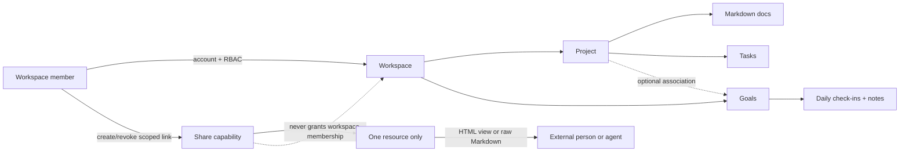
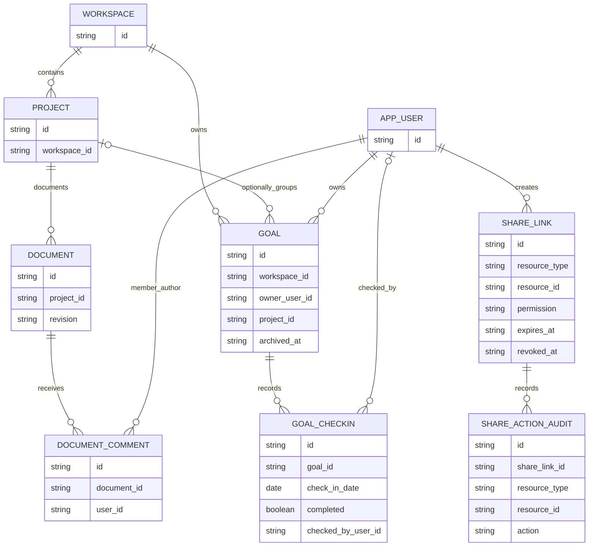
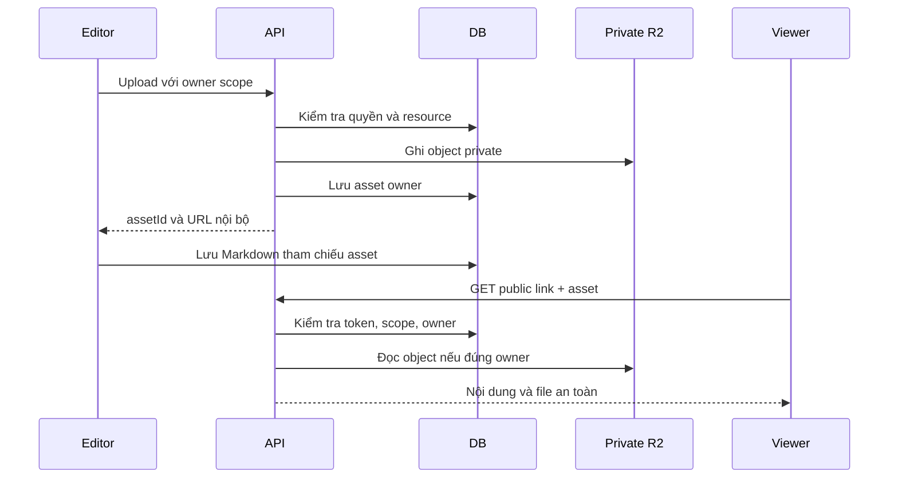

# Spec: Kaneo Workspace Collaboration

## Context Snapshot

- Project / module: Kaneo web + API; workspace collaboration layer over the existing project/task app and custom agent-control layer.
- Supersedes: None.
- Source revision reviewed: `740b4b599aa04156ec1ae8823cf11dd7f63fe95d` (working tree was clean before this spec and its review note).
- Stack / runtime: pnpm 10.32.1 monorepo; API Hono + PostgreSQL/Drizzle + Better Auth; web React/TanStack Router/TanStack Query/Tailwind v4/Tiptap Markdown.
- Current behavior:
  - `project.isPublic` enables an unauthenticated read-only project route at `/public-project/:projectId`; current UI offers Kanban/List and marks itself read-only.
  - API route `/api/public-project/:id` is registered before global authentication. It currently returns the general `getTasks()` payload, including workspace/assignee/external-link fields; there is no public-project rate limit or integration test. The UI checks `project:share`, but the project update API enforces `project:update` instead, so the share permission is not a reliable server-side boundary.
  - Task descriptions and activity comments store Markdown, and the web has a reusable Tiptap editor. There is no first-class project document/page model. `activity.taskId` is required, so it cannot directly hold document comments; `commentTable` is not the active task-comment path.
  - There is no recurring goal/check-in model or weekly matrix. Project archive uses `archivedAt`; task archive is a virtual task status and is not the right model for goals.
  - Public project app access is already global through `kaneo.quoc.app` and Cloudflare Tunnel; no Tailscale or open account registration is required for a scoped share page. Account registration remains disabled; named collaborators use workspace membership.
- Desired behavior: one workspace where project context, Markdown docs, tasks, and personal/shared weekly goals are connected but remain distinct data types; selected resources can be read or edited through explicit public links without login/Tailscale; agents can fetch shared Markdown directly.
- Relevant files to read before implementation:
  - `apps/api/src/index.ts` — public route placement and authentication middleware order.
  - `apps/api/src/project/index.ts`, `apps/api/src/project/controllers/get-public-project.ts` — current public project and visibility behavior.
  - `apps/api/src/task/controllers/get-tasks.ts` — current project payload and public-data leak boundary.
  - `apps/api/src/utils/require-workspace-permission.ts`, `apps/api/src/utils/workspace-access-middleware.ts`, `packages/permissions/src/index.ts` — server permission patterns.
  - `apps/api/src/database/schema.ts`, `apps/api/src/database/relations.ts` — Drizzle tables and relations.
  - `apps/api/src/task/controllers/update-task-description.ts`, `apps/api/src/activity/controllers/create-comment.ts` — Markdown and comment patterns.
  - `apps/web/src/routes/public-project.$projectId.tsx`, `apps/web/src/routes/_layout/_authenticated/dashboard/settings/projects/$projectId/visibility.tsx` — public page and current share UI.
  - `apps/web/src/components/activity/comment-editor.tsx`, `apps/web/src/components/task/task-description.tsx` — Markdown editor and responsive sheet patterns.
  - `apps/web/src/components/common/project-layout.tsx`, `apps/web/src/components/common/header/mobile-project-nav.tsx`, `apps/web/src/routes/_layout/_authenticated/dashboard/workspace/$workspaceId/project/$projectId/gantt.tsx` — project view navigation and horizontal-scroll pattern.
  - `tests/api-integration/workspace-rbac.test.ts`, `tests/api-integration/project.test.ts`, `tests/api-integration/task.test.ts` — API/RBAC test conventions.
- Existing constraints:
  - Keep named-user workspace RBAC and registration policy, including the current member permission to create projects; anonymous share is not account creation and must not become a global auth bypass.
  - Public share must be authorized server-side per resource and action. Never expose task execution manifests, run data, workspace membership, or agent-control actions through public writes.
  - `apps/web/PRODUCT.md` and `apps/web/DESIGN.md` are missing. Impeccable context found an incumbent visual implementation, so extend it; do not redesign the visual world in this spec.
  - No code, deployment, or production database changes are authorized by this spec alone.

## Objective

- Turn Kaneo into a small-team workspace that keeps the reason for work, the work itself, and recurring progress connected without pretending they are the same thing.
- A member can write and discuss project Markdown docs; a person or agent with a public link can access only the resource and actions that link grants; weekly goals preserve day-by-day notes and history.
- Success means public links work from an ordinary internet connection without login/Tailscale, public reads expose only safe fields, anonymous writes cannot reach workspace/admin/agent-control operations, and the weekly grid never loses or silently shifts a check-in.

## Scope

- In:
  - Harden existing public project read access, including a safe response DTO, rate limits, and server-side enforcement of `project:share`.
  - Add resource-scoped public links with `view` and `edit` modes, expiration/revocation for write links, and audit identity tied to the share link rather than a fictitious user.
  - Preserve the current project public URL as a read-only compatibility path while new links use an opaque share capability.
  - Add project-level Markdown documents with authenticated member editing/comments, conflict detection, and a public human-readable page plus raw Markdown endpoint.
  - Add workspace-level goals that can be private or explicitly shared, with optional project association; add date-only daily check-ins, Markdown detail notes, archive/history, and weekly totals.
  - Support the user’s video workflow as a weekly goal plus Markdown check-in notes; v1 statistics count check-in days, not individual videos or artist fields.
  - Add anonymous task editing through a project share link, with the strict action and agent-control boundaries in this spec.
  - Responsive weekly matrix based on the supplied sketch: goal name, seven dates, a computed total, inner horizontal scroll, and a distinct note/details action.
- Out:
  - Changing the existing workspace role matrix or member project-creation behavior; anonymous management of workspace/project settings, roles/permissions, invites, API keys, integrations, agent execution manifests/schedules/runs, or any anonymous delete operation.
  - Anonymous editing of a workspace or an entire agent-controlled project. A project with an execution manifest or managed execution tasks is read-only to public links.
  - Realtime co-editing, full Confluence page hierarchy, arbitrary database/custom-field builder, file attachment uploads in project docs, offline mode, and new authentication providers.
  - A dedicated video-record database or analytics by composer/singer. If those statistics become important, that is a separate spec; Markdown notes are not parsed as structured data.
  - Replacing the current Kaneo visual identity, changing Cloudflare/Tailscale topology, or deploying this feature to production.

## UX Baseline

| # | Requirement | Pass condition |
|---|---|---|
| 1 | Keyboard | Tab follows visual order; Enter activates links/buttons; Space toggles a check-in; arrows move between date cells where the grid has focus; Escape closes a sheet/dialog. |
| 2 | Focus | Every interactive control has a visible `:focus-visible` state; focus returns to the trigger after closing a dialog/sheet. |
| 3 | Accessibility | Labels and errors are associated with controls; status changes are announced; text contrast is at least 4.5:1; touch controls are at least 44px. |
| 4 | Viewports | 320–1440px: no page-level horizontal overflow, no clipped controls; only the date-grid container may scroll horizontally. |
| 5 | States | Docs, share links, and goals define empty/loading/error/saving/saved/conflict/revoked/expired states with a recovery action. |
| 6 | Consistency | Extend Kaneo’s existing tokens, spacing, components, and route patterns; no second CSS system or parallel visual identity. |
| 7 | Platform | Web-only; scrollbar remains visible where needed to communicate the matrix’s horizontal position. |
| 8 | Copy | Actions name what they do; public edit links explain that anyone holding the link can change the granted resource and cannot be reliably identified. |

## Thuật ngữ

- **Workspace member**: người có account và membership trong workspace; hành động gắn với danh tính người dùng và workspace role.
- **Share link / capability**: URL ngẫu nhiên cấp đúng một resource và một mức quyền; ai cầm URL có quyền đó, không chứng minh được danh tính thật. Mọi public write được audit theo share-link ID, không gán thành người dùng đã xác minh.
- **Resource**: project, document, goal, hoặc một check-in; public access không tự lan sang resource được liên kết.
- **Goal**: mục tiêu/habit lặp lại được theo dõi theo ngày; không phải task Kanban.
- **Check-in**: trạng thái hoàn thành của một goal trong một ngày lịch cụ thể, có thể kèm ghi chú Markdown.
- **Video log v1**: các ngày tick goal “làm video” cùng note Markdown; không phải kho video record có thể query từng nhạc sĩ/ca sĩ.
- **Agent-readable Markdown**: nội dung tài liệu trả trực tiếp qua HTTP `text/markdown`, không cần JavaScript, cookie, account hay Tailscale.

## Assumptions

- Người được mời vào workspace tiếp tục dùng account; public link là luồng riêng cho người/agent bên ngoài.
- Personal goal mặc định private. Goal có thể được chia sẻ rõ ràng ở phạm vi workspace/project.
- Goal cá nhân có check-in của owner; goal shared có tối đa một tick cho mỗi ngày, ghi lại ai đã tick. V1 không có ma trận theo từng thành viên.
- Project share `edit` cho phép tạo/cập nhật task cơ bản trong project đó; không cho xóa task, đổi assignee, sửa labels/settings, mời/kick thành viên, tạo share link khác hoặc chạy agent-control. Các project có execution manifest/managed run không nhận public write link.
- Project documents được share độc lập; bật public cho project không tự công khai toàn bộ docs.
- Goal/check-in lưu ngày theo PostgreSQL `date` (không timestamp); mỗi goal lưu IANA timezone lấy từ browser của creator lúc tạo và có thể sửa. Shared goal dùng timezone đó cho mọi thành viên; tuần mặc định Thứ Hai–Chủ Nhật.
- Link `view` không hết hạn mặc định nhưng revoke được; link `edit` hết hạn sau 30 ngày và có thể revoke sớm. Public comments không nằm trong v1; comments dùng account workspace.
- Public writes bị chặn cho project có `execution_manifest` hoặc task gắn với `task_run`/`execution_schedule`; muốn ngoại lệ cần threat model riêng.
- “Log video” v1 ghi trong note của check-in. Total là số ngày đã check-in, không phải số video; nhiều video trong một ngày vẫn chỉ tính một ngày.
- Document save dùng revision/CAS để chặn ghi đè âm thầm; v1 chưa có giao diện khôi phục toàn bộ lịch sử phiên bản.

## Open Questions

- Không còn quyết định sản phẩm chặn implementation: mày đã chốt project-wide task scope, write links hết hạn sau 30 ngày, và chặn public writes trên project có agent-control data. Public delete/permission changes bị loại theo safety default; muốn đổi phải có quyết định riêng.
- Trước khi phát hành public write, phải hoàn thành release gates ở T7: rotate credentials từng bị lộ và kiểm tra OTP/login rate limit trên self-hosted.

## Approach

- Chọn hai ranh giới quyền riêng:
  1. Account membership + workspace RBAC cho cộng tác viên có danh tính.
  2. Share capability cho resource public cụ thể; quyền public giới hạn ở `view` hoặc `edit`. Comments chỉ dành cho authenticated workspace members trong v1.
- Không dùng project `isPublic` làm quyền cho docs/goals. Giữ route legacy project read-only để không làm gãy link cũ, nhưng lọc payload, rate-limit và sửa server-side share permission. Link mới dùng token capability có thể thu hồi.
- Ma trận quyền: Project `view` đọc DTO an toàn; `edit` tạo/cập nhật trường task cơ bản nhưng không xóa/assign. Document `view/edit` chỉ áp dụng lên đúng doc; goal/check-in `view/edit` chỉ xem hoặc sửa check-in/note của đúng goal; quyền link không đổi owner/visibility. Comments yêu cầu workspace member login.
- Capability token có entropy tối thiểu 256 bit; chỉ hash lưu trong database; URL token bị redacted khỏi logs, page đặt `Referrer-Policy: no-referrer` và `noindex`. Write links có expiry, rate limit theo token/IP, record audit theo share ID; tên người viết có thể nhập nhưng ghi rõ là chưa xác minh.
- Public project DTO chỉ trả field phục vụ board/list/detail. Không trả `workspaceId`, user IDs/avatar/assignee identity, external integration metadata, agent execution fields, hay resource chưa được share.
- Docs là entity riêng: Markdown text, project relation, revision CAS, authenticated comments; comments có storage/model riêng chứ không ép vào activity table đang yêu cầu `taskId`.
- Goals là entity riêng ở workspace level: private/share scope, owner, optional project association, target-per-week, timezone, archivedAt. Check-in dùng date-only + note Markdown; matrix count được tính từ check-in rows, không lưu counter có thể drift.
- Video use case dùng goal/check-in + note Markdown, không tạo video database v1. Dashboard chỉ thống kê số ngày check-in và mục tiêu; không hứa đếm video/nhạc sĩ/ca sĩ.
- Thứ tự: capture product/design authority → harden public boundary + capability model → Docs → Goals/check-ins → gated anonymous writes → API/UI/UAT.
- Decision (T3, EP 2026-10-14): quyền member map lên statements hiện có để KHÔNG đổi role matrix (Out-of-scope) — documents dùng `task:read`/`task:update` (nội dung công việc project); goals/check-ins KHÔNG thêm statement mới: private goal = owner-only (controller check), shared goal = read cho workspace member, write (tick/note/sửa goal) cho owner hoặc member có `task:update` (collaborator); share-link management dùng `project:share` cho mọi resource type.
- Decision (T6, EP 2026-10-14): week boundary của matrix tính theo viewer-local Monday–Sunday v1; giá trị check-in vẫn là DATE string nên lịch sử không trôi ngày giữa các timezone. Day-boundary đúng theo goal.timezone để tăng cấp ở spec riêng nếu cần.
- Decision (EP, 2026-10-14): migration 0048 được trim tay sau `drizzle-kit generate` — bản generate kéo nhầm CREATE/ALTER của repair migrations 0044-0047 (không có snapshot trong meta/), sẽ fail trên DB sạch lẫn upgrade; chỉ giữ diff của spec. compose.local.yml đổi port postgres sang 15432 do 5432/5433 bị Hyper-V excluded ranges chặn trên host này.

## Diagram





`SHARE_LINK.resource_type/resource_id` is a polymorphic association, not a physical `RESOURCE` table. It must be validated against the allowed resource/action matrix server-side; it is not permission to traverse linked objects. The actual table/relation details are resolved in implementation after migration review.

## Bỏ qua

- Không dựng bản clone Confluence: không realtime co-edit, cây trang nhiều tầng, generic database, template marketplace, hay full-text search engine trong v1.
- Không dựng video database/record type cho từng bài trong đợt này; ghi chú video thuộc check-in và chỉ dùng thống kê theo ngày.
- Không cho share một project rồi tự động share mọi docs/assets liên quan; mỗi resource có quyền riêng.
- Không cho public link đổi quyền, membership, workspace/project settings, xóa dữ liệu, agent-control, mở account registration, hoặc gửi anonymous comments; comments dùng account member.
- Không ép 7 ngày co lại để vừa màn điện thoại; cuộn bên trong grid là chủ đích, còn trang phải đứng yên theo chiều ngang.

## Risks

- P0: public GET hiện có payload rộng và không rate-limit; mở thêm write trước khi harden sẽ biến link thành cửa đọc/sửa dữ liệu vượt ý định.
- P0: `project:share` hiện chỉ được kiểm tra ở UI; custom role có `project:update` nhưng thiếu `project:share` vẫn có thể bật public bằng API.
- P0: anonymous edit là bearer permission: nếu link bị forward/log/copy nhầm thì người khác sửa được; không có danh tính người thật để quy trách nhiệm.
- P0: project này còn là agent-control plane; sửa task description/status có thể ảnh hưởng envelope hoặc execution workflow. Server phải chặn public writes với project/task được agent-control quản lý.
- P1: đổi timestamp sang ngày UTC làm check-in chạy sang hôm trước/sau; dùng `date` và timezone cố định theo goal.
- P1: dùng task làm goal hoặc dùng check-in làm video record sẽ làm sai thống kê/semantic; giữ entity riêng.
- P1: Markdown công khai có thể thành XSS nếu renderer cho HTML/unsafe URL thực thi; public renderer phải escape/sanitize và có regression tests.
- P1: UI share thiếu trạng thái expired/revoked/denied sẽ khiến user tưởng link hỏng; cung cấp lời giải thích và cách xin link mới.
- Security precondition: tool output trong phiên vận hành trước đã chứa credentials; trước khi bật public write, coi chúng là đã lộ và rotate. OTP sign-in vẫn bật; rate-limit/unknown-email behavior chưa được verify.

## Task List

### T1: Capture product/design authority

- Acceptance:
  - Với user review, tạo `apps/web/PRODUCT.md` bằng Impeccable init; chỉ ghi product facts đã xác nhận, không tự invent brand/visual world.
  - Tạo `apps/web/DESIGN.md` từ incumbent UI bằng Impeccable document; không redesign.
  - Tạo surface brief cho Docs/Goals/share, có journey, first viewport và signature interactions; brief phải trỏ ảnh sketch hiện có và source incumbent.
- Skills: `impeccable`, `flow`, `mobile-responsive`.
- Reproduce: chạy `D:\.claude\skills\impeccable\scripts\impeccable.cmd context` từ `apps/web`, sau đó `init`/`document` theo output của helper.
- Verify: PRODUCT/DESIGN/surface brief tồn tại, chỉ chứa confirmed facts; owner review flow trước khi có UI code.
- Files:
  - `apps/web/PRODUCT.md` — tạo theo Impeccable product schema sau owner interview.
  - `apps/web/DESIGN.md` — document code/tokens incumbent; không tự viết visual world mới.
  - Surface brief: resolved via `impeccable surface-brief write`; canonical paths recorded here before implementation:
    - Docs: `apps/web/.impeccable/surfaces/ce-workspaceid-project-projectid-docs-tsx-6534b73b.md`
    - Goals matrix: `apps/web/.impeccable/surfaces/dashboard-workspace-workspaceid-goals-tsx-35dcfd3f.md`
    - Share UI brief (visibility settings surface, T7): covered by the Docs brief share dialog + UX Contract in T7.
  - T1 note (2026-10-14, EP): PRODUCT/DESIGN/surface briefs written from confirmed spec facts + incumbent code; simulated-user substitution disclosed — owner review of these artifacts is pending and tracked as a T1 checkpoint condition before any public write is enabled.

### T2: Harden public project boundary và capability-link API

- Acceptance:
  - API kiểm tra `project:share` server-side khi đổi public visibility; `project:update` đơn lẻ không đủ.
  - Capability routes là unauthenticated routes riêng đăng ký trước global auth; mỗi handler bắt buộc validate token/resource/permission/expiry/revocation. Không bypass wildcard auth middleware.
  - Legacy `/api/public-project/:id` chỉ trả DTO an toàn cho Kanban/List/task detail; không có workspace ID, user/assignee identifiers, avatars, external integration metadata, hoặc agent-control fields. Với project có execution manifest hoặc task có `task_run`/`execution_schedule`, raw task `description` bị loại khỏi public DTO vì execution envelope có thể nằm trong đó.
  - Legacy public project giữ read-only behavior; private project không đọc được từ anonymous route.
  - Share link mới có resource type/id + `view|edit`, hash token lưu ở database, expiry/revoke, actor audit theo link ID; link `view` không hết hạn mặc định, link `edit` hết hạn sau 30 ngày; không có raw token trong log.
  - Mỗi public mutation append metadata-only row vào `share_action_audit` (share ID, resource, action, timestamp); không lưu raw token hoặc request body.
  - Link chỉ áp dụng đúng resource; không kế thừa quyền sang linked docs/tasks khác.
  - Project share may read only assets attached to tasks included in that project resource; it does not expose Docs or external integrations. Binary attachments on Docs are out of v1.
  - Server rate-limit public reads/writes. Public `edit` bị từ chối nếu project có `execution_manifest` hoặc bất kỳ task nào có liên kết `task_run`/`execution_schedule`; project đó vẫn có thể được share `view` bằng DTO đã lọc.
  - Integration tests cover anonymous/unauthenticated, wrong scope, wrong resource, expired/revoked link, data minimization (including execution-envelope redaction), rate-limit, audit attribution, `project:share` vs `project:update`, và agent-control refusal.
- Reproduce: `pnpm --filter @kaneo/api db:generate && pnpm --filter @kaneo/api test:integration && pnpm --filter @kaneo/api test:unit`; apply migration to clean and upgrade test databases, never production.
- Files:
  - `apps/api/src/index.ts` — register only explicit capability routes before global authentication; keep wildcard auth fail-closed.
  - `apps/api/src/database/schema.ts` — pattern `projectTable`/`workspaceRoleTable`; share/audit tables need explicit indexes and referential strategy.
  - `apps/api/drizzle/**` — generated migration; review SQL and verify clean-install/upgrade path.
  - `apps/api/src/database/relations.ts` — relation pattern `projectTableRelations`.
  - `tests/api-integration/helpers/database.ts` — add share/audit tables to migration/reset test harness.
  - New `tests/api-integration/public-share.test.ts` — public DTO/capability tests.
  - `apps/api/src/project/index.ts` — route + `requireWorkspacePermission` pattern.
  - `apps/api/src/project/controllers/get-public-project.ts`, `apps/api/src/task/controllers/get-tasks.ts` — public DTO boundary.
  - `apps/api/src/utils/require-workspace-permission.ts`, `apps/api/src/utils/workspace-access-middleware.ts` — server-side authorization.
  - `apps/api/src/auth.ts` — rate-limit configuration source.
  - `tests/api-integration/workspace-rbac.test.ts`, `tests/api-integration/project.test.ts` — route/RBAC integration test patterns.

### T3: Project Docs API và authenticated collaboration

- Acceptance:
  - Member có quyền workspace/project phù hợp có thể list/create/read/update Markdown docs trong project; unauthorized member không đọc hoặc ghi được.
  - Document content lưu Markdown; mỗi save có revision CAS. Save với revision cũ trả conflict, không ghi đè nội dung mới âm thầm.
  - Member comments gắn document; comment CRUD tuân theo author/workspace permission. Không dùng `activityTable` làm doc comment vì `taskId` bắt buộc; không dùng `commentTable` legacy nếu chưa chứng minh route đang dùng nó.
  - Markdown public renderer không thực thi raw script/unsafe URL; attachment upload nằm ngoài v1.
  - Delete/archiving document không làm token/link trỏ sang resource khác; link tới document bị xóa/revoked phải fail closed.
- Reproduce: `pnpm --filter @kaneo/api db:generate && pnpm --filter @kaneo/api test:integration && pnpm --filter @kaneo/api test:unit`; apply migration to clean and upgrade test databases, never production.
- Files:
  - `apps/api/src/database/schema.ts` — pattern CUID2, cascade/index, timestamps.
  - `apps/api/drizzle/**` — generated migration; review SQL and verify clean-install/upgrade path.
  - `apps/api/src/database/relations.ts` — project/task relation pattern.
  - `apps/api/src/task/controllers/update-task-description.ts` — Markdown persistence/event/asset cleanup pattern; không copy task-specific behavior mù.
  - `apps/api/src/activity/controllers/create-comment.ts` — task comment semantics; doc comments cần relation riêng.
  - `apps/api/src/project/index.ts`, `apps/api/src/task/index.ts` — Hono route/Valibot/OpenAPI pattern.
  - `tests/api-integration/helpers/database.ts` — add document/comment tables to migration/reset fixture.
  - New `tests/api-integration/document.test.ts` — document CRUD, revision conflict, and comment authorization.
  - `tests/api-integration/project.test.ts`, `tests/api-integration/task.test.ts` — DB-backed route patterns.

### T4: Docs UI, member comments và public Markdown reader

- Acceptance:
  - Project có Docs view dạng danh sách phẳng, xuất hiện trong desktop project navigation và mobile project menu; tạo/mở tài liệu không qua màn trung gian thừa; editor dùng Tiptap Markdown đã có.
  - Save state thể hiện `Đang lưu`/`Đã lưu`/`Lỗi`; conflict cho phép reload hoặc sao chép bản nháp, không tự chọn ghi đè.
  - Member có thể bình luận trên doc; public link hiển thị đúng một doc, không tự bật project public.
  - Public page cho người đọc và endpoint Markdown raw đều hoạt động không cookie/login/Tailscale; endpoint trả `text/markdown` và không nạp private related resources.
  - README mô tả Docs/Markdown/public-agent link và cách dùng ở mức user-facing; giữ attribution/boilerplate upstream, không viết lại README thành marketing.
  - Empty/loading/error/conflict/revoked states có nội dung và recovery action rõ.
  - User-facing strings dùng i18next; thêm keys vào toàn bộ locale được hỗ trợ, `pnpm i18n:check` và `pnpm i18n:coverage` PASS.
- UX Contract:
  - Journey: mở project → Docs → mở/tạo trang → viết Markdown → save → member comment → tạo link view/edit → copy link; agent fetch raw Markdown.
  - Default: Docs list ở project; page đọc được trước, edit action chỉ hiện cho member/link có quyền.
  - Public reader không có chrome đăng nhập; có title, nội dung, trạng thái cập nhật, link/CTA xin quyền mới khi token invalid.
  - Responsive 320–1440; nội dung đọc có max-width; không có page-level horizontal overflow.
- Skills: `impeccable`, `frontend-taste-chatgpt`, `mobile-responsive`, `flow`.
- Visual Ref: `apps/web/src/components/activity/comment-editor.tsx`, `apps/web/src/components/task/task-description.tsx`, current project layout; use `apps/web/DESIGN.md` after T1, no new theme tournament.
- Reproduce: `pnpm --filter @kaneo/web test && pnpm --filter @kaneo/web typecheck && pnpm --filter @kaneo/web build && pnpm i18n:check && pnpm i18n:coverage`.
- Files:
  - New `apps/web/src/routes/_layout/_authenticated/dashboard/workspace/$workspaceId/project/$projectId/docs.tsx` — mirror `board.tsx`/`gantt.tsx` in the same directory.
  - `apps/web/src/components/common/project-layout.tsx`, `apps/web/src/components/common/header/mobile-project-nav.tsx` — add Docs to desktop and mobile project navigation.
  - `apps/web/src/components/activity/comment-editor.tsx` — shared Markdown editor.
  - `apps/web/src/components/task/task-description.tsx` — save/conflict/editor integration pattern.
  - `apps/web/src/fetchers/`, `apps/web/src/hooks/queries/`, `apps/web/src/hooks/mutations/` — API/query/mutation pattern.
  - `i18n/*.json` — add matching keys in every supported locale; `i18n/resources.ts` already imports locale files.
  - `README.md` — update the product feature overview with Docs, Goals, and scoped sharing without changing upstream attribution.
  - `apps/web/src/routes/public-project.$projectId.tsx` — public reader boundary; do not copy unsafe payload assumptions.

### T5: Goals/check-ins API và lịch sử

- Acceptance:
  - Goal có owner, private/shared visibility, optional project association, optional weekly target, timezone, position, and `archivedAt`.
  - Check-in dùng `DATE` calendar value, không timestamp, và có một shared tick tối đa mỗi goal/ngày; actor ghi lại ai đã tick.
  - Check-in có unique constraint `(goal_id, check_in_date)` và lưu `completed` boolean; untick chỉ đổi `completed=false`, không hard-delete row/note/history. Toggle idempotent khi double-submit/concurrent request; note Markdown sửa được bằng revision/CAS; ngày cũ không bị chuyển ngày khi đọc từ timezone khác.
  - Read/list API hỗ trợ tuần và range; row totals được aggregate từ check-in rows, không counter cache tự trôi.
  - Archive ẩn goal khỏi active list và chặn ghi mới, nhưng giữ check-ins/history; restore đưa lại active list.
  - Private goal chỉ owner đọc/sửa; workspace-shared goal tuân thủ workspace permission; public share vẫn cần capability link riêng.
- Reproduce: `pnpm --filter @kaneo/api db:generate && pnpm --filter @kaneo/api test:integration && pnpm --filter @kaneo/api test:unit`; apply migration to clean and upgrade test databases, never production.
- Files:
  - `apps/api/src/database/schema.ts`, `apps/api/src/database/relations.ts` — pattern `projectTable` + archive timestamp; use PostgreSQL `date` for check-in.
  - `apps/api/drizzle/**` — generated migration; review SQL and verify clean-install/upgrade path.
  - New `apps/api/src/goal/**` — route/controller convention mirrored from `apps/api/src/project/**`.
  - `apps/api/src/task/controllers/update-task-status.ts` — transaction/locking pattern; adapt only where needed.
  - `tests/api-integration/helpers/database.ts` — add goal/check-in tables to migration/reset fixture.
  - New `tests/api-integration/goal.test.ts` — date-only check-in, concurrent toggle, timezone, archive, and privacy tests.

### T6: Weekly Goals matrix và check-in detail UI

- Acceptance:
  - Default shows current Monday–Sunday week, with previous/next week navigation and current-week reset.
  - Rows are active goals; date cells reflect `completed=true`/unchecked; the right total counts only completed dates, or displays `count/target` if a weekly target exists.
  - Clicking the checkbox changes only completion. A distinct note/details affordance opens a responsive sheet for Markdown note and related project doc link.
  - Archive removes a goal from the active matrix without deleting historical check-ins; past weeks remain viewable.
  - Grid owns horizontal scroll, first goal column and total remain legible/sticky, body never overflows horizontally; date cells retain 44px mobile hit targets.
  - Basic statistics are per-goal days checked by week/range. Video notes are not parsed into item-level counts.
  - User-facing strings use i18next; add keys to all supported locales and pass `pnpm i18n:check` plus `pnpm i18n:coverage`.
- UX Contract:
  - User opens Goals → sees current week and active rows → taps checkbox → completion updates with immediate feedback → taps separate note affordance → writes/saves Markdown → copies a scoped public link if needed → archives goal when inactive.
  - Grid stays a table-like matrix, not a Kanban board. Header shows weekday + calendar date. No streak gamification by default.
  - Empty state offers one direct action to create a goal; archived view is secondary, not a first-run step.
  - Mobile keeps row label visible and scrolls only the 7-date region; no squeeze-to-fit layout.
- Skills: `impeccable`, `frontend-taste-chatgpt`, `mobile-responsive`, `flow`.
- Visual Ref: `plans/ui-reviews/kaneo-workspace/weekly-goals-sketch.png` (user sketch; hierarchy reference, not pixel-copy) + `apps/web/src/routes/_layout/_authenticated/dashboard/workspace/$workspaceId/project/$projectId/gantt.tsx` (horizontal-scroll/touch pattern) + `apps/web/src/components/task/task-details-sheet.tsx` (detail sheet pattern).
- Reproduce: `pnpm --filter @kaneo/web test && pnpm --filter @kaneo/web typecheck && pnpm --filter @kaneo/web build && pnpm i18n:check && pnpm i18n:coverage`.
- UI verify: serve built app with `pnpm --filter @kaneo/web preview --host 127.0.0.1 --port 4173`; capture desktop full page at 1440px and mobile at 375/390px plus empty/detail/archive states; run `$env:NODE_PATH="D:\pcloud\workspace\code\kaneo\node_modules"; node D:\.claude\skills\mobile-responsive\scripts\check-overflow.js http://localhost:4173/dashboard/workspace/<seededWorkspaceId>/goals 320,375,414,768,1024,1280,1440`. Horizontal overflow is allowed only inside the matrix scroller.
- Files:
  - New `apps/web/src/routes/_layout/_authenticated/dashboard/workspace/$workspaceId/goals.tsx` — workspace-level route beside `index.tsx` and `members.tsx`; public path `/dashboard/workspace/$workspaceId/goals`.
  - `apps/web/src/components/nav-main.tsx`, `apps/web/src/components/common/workspace-layout.tsx`, `apps/web/src/routes/_layout/_authenticated/dashboard/workspace/$workspaceId/index.tsx` — workspace navigation and screen shell for Goals.
  - `apps/web/src/routes/_layout/_authenticated/dashboard/workspace/$workspaceId/project/$projectId/gantt.tsx` — `overflow-auto`, touch-pan and min-width scroll pattern.
  - `apps/web/src/components/task/task-details-sheet.tsx`, `apps/web/src/components/task/task-description.tsx` — detail sheet/Markdown editor patterns.
  - `i18n/*.json` — add matching Goals keys in every supported locale.
  - Existing `apps/web/src/components/ui/checkbox.tsx`, `sheet.tsx`, `scroll-area.tsx`, `table.tsx` — use current primitives.

### T7: Public edit controls, task mutations, and adversarial verification

- Acceptance:
  - Share UI lets an authorized owner choose `view` or `edit`, copy/revoke the link, and understand its scope. Copy success is inline; no success toast spam.
  - A project `edit` link can create/update basic tasks only. It cannot delete tasks, reassign users, change labels/settings, manage members/share links, or invoke agent control.
  - Project-wide `edit` is disabled if the project has an `execution_manifest` row or any task in it has a `task_run` or `execution_schedule` row; the project may remain view-only.
  - Document `edit` affects only that document. Goal/check-in `edit` affects only that goal’s completion boolean and Markdown note; it cannot change goal owner/visibility, hard-delete check-ins, or delete history.
  - View-only links cannot mutate through direct API calls even if the UI is altered; edit links cannot cross resource IDs or use a sibling token.
  - Each anonymous write appends an immutable audit event keyed by share-link ID and action; it does not impersonate a workspace user.
  - `edit` links expire after 30 days and can be revoked earlier; `view` links do not expire by default but remain revocable.
  - Revoked/expired/malformed tokens fail closed with no resource-existence leak. Rate limit returns 429 with recovery guidance. Raw token is never saved or logged.
  - Before enabling public writes in production, credentials exposed in the earlier operational session are rotated and self-hosted OTP/login rate limits are verified.
  - Public Markdown rendering blocks script/unsafe URL execution; referrer and analytics do not leak bearer tokens.
- UX Contract:
  - Share dialog states show resource name, permission, expiry, and exact effects. `edit` requires explicit confirmation with warning that anyone holding the URL can change the resource; offer revoke in the same surface.
  - Project edit explains that the link can create/update task title, description, status, priority and dates, but cannot delete, assign or manage the project; do not imply identity verification.
  - Expired/revoked link says access was removed and asks owner for a new link; do not redirect to signup.
- Skills: `impeccable`, `mobile-responsive`, `flow`.
- Visual Ref: current `apps/web/src/routes/_layout/_authenticated/dashboard/settings/projects/$projectId/visibility.tsx` and `plans/ui-reviews/kaneo-workspace/weekly-goals-sketch.png` for the adjacent details flow; new share UI inherits `apps/web/DESIGN.md`.
- Reproduce: `pnpm --filter @kaneo/api test:integration && pnpm --filter @kaneo/web test && pnpm --filter @kaneo/web typecheck && pnpm --filter @kaneo/web build && pnpm i18n:check && pnpm i18n:coverage`.
- Files:
  - `apps/api/src/project/index.ts`, `apps/api/src/task/index.ts`, `apps/api/src/utils/require-workspace-permission.ts` — server route/permission pattern.
  - New share-link middleware/controller under `apps/api/src/share/**` — never weaken global auth middleware.
  - `apps/web/src/routes/_layout/_authenticated/dashboard/settings/projects/$projectId/visibility.tsx` — current share settings pattern; replace/extend only after API guard is correct.
  - `apps/web/src/routes/public-project.$projectId.tsx` — existing public viewer; retain read-only compatibility.
  - `tests/api-integration/workspace-rbac.test.ts`, `tests/api-integration/project.test.ts`, `tests/api-integration/task.test.ts`, `tests/api-integration/helpers/database.ts` — authorization, regression, and test-database reset patterns.
  - New `tests/api-integration/share-link-write.test.ts` — direct API denial/allow matrix for anonymous write scopes.
  - `i18n/*.json` — matching share UI keys in every supported locale.

## Checkpoints

- After T1: owner has reviewed PRODUCT/DESIGN/surface brief; không có code hoặc public write nào được bật.
- After T2: parent verifies public DTO/data minimization and direct anonymous API tests before any anonymous write endpoint is enabled.
- After T3/T4: member-only Docs CRUD/comments pass; public Markdown link reads one document and no private neighbors.
- After T5/T6: `DATE` boundary, timezone grouping, toggle idempotency, archive retention, keyboard/touch, and 320–1440 layout pass.
- Before T7 release: view/edit mode matrix tests pass, agent-control refusal verified, owner UAT confirms the warning/revoke flow, exposed credentials are rotated, and self-hosted OTP/login rate limits are evidenced.

## External Review Brief

### Reviewer cần phán

- Is the resource-capability model narrow enough for a self-hosted app that also runs agent-control tasks?
- Does editing a project through an anonymous link have any route to delete/admin/agent execution operations?
- Does the public DTO leak workspace/member/integration/agent data, and are legacy links still compatible?
- Are documents, comments, revisions, goals, and check-ins modeled as distinct records with safe migrations?
- Does the goals matrix’s check-in date/timezone model preserve history across users and timezones?
- Does the UI make toggle vs note, private vs shared, and view vs edit links obvious without adding unnecessary steps?
- Does verification catch IDOR/BOLA, token replay/revocation, stale document writes, XSS, rate-limit gaps, and mobile overflow?

### Reviewer nên đọc trước

- `apps/api/src/index.ts`, `apps/api/src/project/index.ts`, `apps/api/src/project/controllers/get-public-project.ts`.
- `apps/api/src/task/controllers/get-tasks.ts`, `apps/api/src/utils/require-workspace-permission.ts`, `apps/api/src/utils/workspace-access-middleware.ts`.
- `apps/api/src/database/schema.ts`, `packages/permissions/src/index.ts`.
- `apps/web/src/routes/public-project.$projectId.tsx`, `apps/web/src/components/activity/comment-editor.tsx`, `apps/web/src/routes/_layout/_authenticated/dashboard/workspace/$workspaceId/project/$projectId/gantt.tsx`, `apps/web/src/components/nav-main.tsx`.
- `plans/ui-reviews/kaneo-workspace/pre-lock.md` and the user-provided grid reference path in T6.

### Reviewer không cần phán

- Whether to build a generic Notion/Confluence replacement; that is explicitly out of scope.
- Video content analytics or taxonomy; v1 only counts goal check-in days.
- Production credential rotation procedure; verify only that the precondition has been completed safely.

## User Test

| Hành động | Kết quả kỳ vọng | Chuẩn nhìn |
|---|---|---|
| Mở share link ở cửa sổ private, không login/Tailscale | Chỉ thấy đúng project/doc/goal mà link cấp | Không xuất hiện workspace ID, assignee identity hoặc tài liệu không share |
| Đổi link từ view sang edit và thử trực tiếp API | Chỉ hành động đúng scope thành công; delete/settings/invite bị từ chối; project có manifest/run không cấp write link | UI nói rõ ai cầm link có thể làm gì; có revoke ngay cạnh link |
| Vào project → Docs, tạo Markdown, save rồi nhờ member comment | Nội dung còn sau reload; comment gắn đúng doc; stale save báo conflict | Reading width dễ đọc, empty/error/conflict có recovery |
| Vào Goals, tick một ngày rồi mở note riêng | Tick cập nhật độc lập; note mở sheet riêng và giữ Markdown sau reload | Tick/note hit areas tách biệt; page không tràn ngang |
| Đổi tuần, archive goal, mở lại history | Check-in ngày cũ còn nguyên; archive chỉ ẩn khỏi active matrix | Header có thứ/ngày, tổng hàng đúng; cuộn chỉ nằm trong grid |
| Bấm copy public Markdown link rồi gửi agent | Agent GET được Markdown thô không cần login/JS/Tailscale | Nút báo “Đã sao chép” tại chỗ; token không hiện thành nội dung log/UI khác |

Năm câu Y/N sau UAT:

1. Layout có vừa 320–1440px, không cắt control và không làm cả trang cuộn ngang không?
2. Checkbox, note, share, revoke dùng được bằng bàn phím và touch không?
3. Focus/selected/expired/revoked state có nhìn thấy và hiểu được không?
4. Empty/loading/error/conflict state có nói rõ chuyện gì và cách phục hồi không?
5. Docs/Goals/share UI có khớp visual system hiện tại và giữ đúng hierarchy của sketch không?

## Completion Gates

- [ ] API unit + integration tests PASS; generated migrations apply to a clean test database and upgrade an existing test database; rollback/recovery plan is reviewed before production.
- [ ] `/verify` cross-check scope, public payload, permission boundaries, data model và acceptance.
- [ ] Security tests PASS: anonymous auth bypass only on explicit share routes; IDOR/BOLA, revocation, expiry, rate limit, token-log redaction, XSS, and agent-control deny cases.
- [ ] Web build/typecheck/tests and `pnpm i18n:check && pnpm i18n:coverage` PASS; Impeccable detector findings for changed targets reviewed.
- [ ] Full-page desktop + mobile screenshots and relevant empty/error/conflict/revoked states exist and are readable; overflow script PASS at 320,375,414,768,1024,1280,1440.
- [ ] User Test checklist passes; public link tested from a normal internet client without Tailscale.
- [ ] Named-user invite flow and email delivery UAT pass; registration remains disabled.
- [ ] Credential rotation and OTP/login rate-limit preconditions verified before enabling public write links.

## Pre-lock Review Record

- Surf job: `02c638d9-c67e-4c63-9891-9da215629a5c`; distilled record: `plans/ui-reviews/kaneo-workspace/pre-lock.md`.
- Accepted: treat share links as scoped capabilities; keep distinct data entities; separate tick from note action; personal goals private by default; comments remain account-attributed in v1.
- Accepted with scope change: user chose project-wide task editing via link, but the permission excludes destructive/admin/agent-control fields and is denied for agent-managed projects.
- Not in v1: video records; only day-level goal statistics, as the user explicitly selected.

## Revision 1 — UAT repair (2026-10-15)

Deployed wave `4ef440e7` UAT on kaneo.quoc.app surfaced 11 findings; this revision adds 13 scoped repair tasks (including one adjacent clipboard failure and archive-refresh race).

Acceptance: the 11 owner-reported behaviors work in the authenticated production UI; document content remains after reload and client-side navigation; archived docs can be restored; all-time totals include prior weeks; note history is reachable across dates without silently ticking completion; sessions are configured for 60 days. API/web tests, typecheck, build and locale checks pass.

Cumulative file scope: `apps/api/src/auth.ts`, `apps/api/src/goal/**`, `apps/web/src/components/activity/comment-editor.tsx`, `apps/web/src/components/docs/**`, `apps/web/src/components/goals/**`, `apps/web/src/components/nav-main.tsx`, `apps/web/src/components/share/share-dialog.tsx`, `apps/web/src/fetchers/goal/**`, `apps/web/src/hooks/queries/document/**`, `apps/web/src/hooks/queries/goal/**`, `apps/web/src/routes/**/visibility.tsx`, `tests/api-integration/goal.test.ts`, `i18n/*.json`, this working spec.

1. R1-T1 — Docs editor too short vertically with comments crowding the content — editor now owns the viewport (min 45vh, flex-1) and comments sit at the bottom of the page.
2. R1-T2 — BUG: doc content reported "Đã lưu" but navigating away and back showed empty content. Reproduction showed TipTap could emit an unchanged empty Markdown update during editor hydration; the workspace treated it as a user edit and autosaved `content=""`. Fix: CommentEditor ignores unchanged Markdown updates; the workspace re-initializes only from a strictly newer server revision while the local draft is clean; saves compare their snapshot against the latest draft, serialize in-flight requests, and Back/archive flush pending edits. Server reload only discards the draft after a successful fresh fetch. Verified by reload → editor shows saved text → no extra revision/save occurs → navigate away/back keeps the text.
3. R1-T3 — Share dialog cleanup (docs + goals): title is just "Chia sẻ", removed the "Ai cầm link..." description, "Chưa có link chia sẻ nào." empty text, edit-link confirmation step and its long warning. Button is always "Tạo link".
4. R1-T4 — Created share links were easy to miss (bottom of dialog, one-time display). Fix: the new link section moved right under the actions, auto-selects + attempts clipboard copy, and the existing rows stay compact.
5. R1-T5 — Archived documents had no visible restore path. Fix: an "Đã lưu trữ (n)" collapsible section at the bottom of the docs list with per-row restore.
6. R1-T6 — Goals empty state sentence removed (create form remains).
7. R1-T7 — Sidebar: "Mục tiêu" now sits above "Dự án".
8. R1-T8 — Goals "Tổng" column counted only the viewed week. Fix: API returns `totalAllTime` (grouped count without date filter); the column shows it, with the weekly target as a tooltip.
9. R1-T9 — Goal note sheet: previous/next/today plus direct native date selection work for any day; full history loads via new `GET /goals/:id/checkins`; past notes are listed newest-first and clickable. The save control shows a disabled `Đã lưu ghi chú` state when clean and enables only for a dirty note. Unsaved drafts block date navigation; background refresh preserves a dirty note; explicit reload uses a successful refetch; adding a note-only row leaves `completed=false` instead of silently ticking the goal.
10. R1-T10 — Session lifetime raised from the 7-day Better Auth default to 60 days with weekly refresh (`session.expiresIn`/`updateAge` in auth.ts).
11. R1-T11 — i18n: share/documents/goals keys updated across all 13 locales (vi-VN + en-US authored, rest synced by `i18n:check --fix` + extra-key cleanup); every localized `share.title` is plain text with no `{{name}}` placeholder.

12. R1-T12 — Docs create/update/archive/restore mutations cancel stale reads and write the server response into cached detail, active-list, and archived-list queries. This is required because refetch-on-mount is globally disabled; client navigation now reflects the mutation before returning.
13. R1-T13 — Legacy public project URL copy now handles clipboard rejection, selects the URL as fallback, and tells the owner how to copy it manually.

Deferred: none new this round. Owner risk note stands: credential rotation was skipped before production deploy (user decision 2026-10-15).

External visual audits: first Surf pass (`ab519ae3`) flagged P1 note-state and date-selection gaps — both fixed in R1-T9. Second Surf pass (`b6b0ff6e`) returned conditional PASS with one P2: a long document title clipped without a visible truncation cue on mobile. Fix: the title Input now truncates its inner input (`[&_[data-slot=input]]:truncate`) while keeping the full title in the `title` attribute and the input editable; verified by a 375px screenshot showing the ellipsis. A post-fix Surf re-check failed once (CLI exit 1) and the retry was cancelled (tab-closed), so the P2 closure stands on local screenshot + the Impeccable detector (no findings). Follow-up cleanup while re-running checks: removed a dead `saveState` guard inside the autosave timeout (TS2365-class narrowing error; `saveState` is already in the effect deps so the cleanup path is preserved). Final delta verified: web typecheck clean except the two pre-existing API errors (`update-task-description.ts:42`, `update-task.ts:49`), Biome clean, web vitest 37/37. Note: the local dev stack went down after the last screenshots (port 5173 taken by an unrelated app, Docker Desktop off); the runtime re-smoke of this final delta is deferred to production UAT after deploy.

Deploy receipt (2026-10-15): image `ghcr.io/nguyendinhquocx/kaneo-vi-mcp:2.14.0-candidate-9ea20c3f-uat-repair@sha256:0857bb42fab0b9ac8ab2793fbf4d0cf83cdf482035bf147d319332224456f710` built no-cache linux/amd64 from commit `9ea20c3f` and pushed to private GHCR; production Compose sha `69274263a8e8e852ed59194f1e5effd5bf551a4580f9248f1853374528d42fbc`. ProDesk guarded rollout PASS: repinned `kaneo-backup-verify` (accepted ws-collab + uat-repair identities), `kaneo-migration-verify` (head 51 / count 51 / hash `0c8bb3ed…`), `kaneo-sync-recovery-metadata` (source_revision `9ea20c3f…`, wrapper sha `603837b9…`), and the recovery wrapper pair rotation (PREVIOUS=ws-collab, CANDIDATE=uat-repair); ops-src drift for `kaneo-backup-snapshot-current`/`kaneo-sync-recovery-metadata` healed from the installed (newer) versions. Strict backup verify PASS pre-deploy (receipt `kaneo-20261015T005915Z`) and post-snapshot (`kaneo-20261015T120437Z`); migration/schema verify PASS read-only (23/23 columns, 2/2 GitHub constraints, 0 backfill gaps); container healthy with the pinned digest; public smoke `https://kaneo.quoc.app/api/health` → 200. Rollback pin: `2.14.0-candidate-4ef440e7-review-ws-collab@sha256:cf304246…`. Gaps: Docker Scout scan not re-run (needs Docker Hub login); R2 mirror of the new snapshot remains a separate gated step; owner credential rotation still outstanding (user decision).

## Revision 2 — UAT repair round 2 (2026-10-19)

Owner UAT on production surfaced 9 findings. This revision fixes all of them; deploy receipt appended after the wave.

Acceptance: docs editor content area fills its space and stays editable across the full area; share dialogs render no edit-scope warning and no scope footer; public share pages scroll; documents and goals are deletable (hard delete, confirmed); goal check-in ticks update instantly with totals; public goal share renders the weekly matrix and is editable through an edit link.

1. R2-T1 — Docs editor dead space: the comment editor CSS caps the ProseMirror area at `max-height: 18rem` (comment bubble design); in the docs editor the reserved flex space below the cap was inert. Fix: new `kaneo-comment-editor-fill` variant (min-height 45vh, no max-height, no inner scrollbar) used by the docs workspace, so the whole reserved area is part of the editable content and grows with it.
2. R2-T2 — Share dialog noise: stop rendering `share.editScopeNote` ("Link sửa này chỉ tạo và cập nhật các trường task cơ bản…") in the dialog; remove the key from all locales.
3. R2-T3 — Public share pages could not scroll: the root layout wraps every route in `h-svh overflow-y-hidden`; the share reader used `min-h-svh` and was clipped. Fix: the share reader page becomes its own scroll container (`h-svh overflow-y-auto`); same fix applied to the public project route if affected.
4. R2-T4 — Document delete: new `DELETE /document/:id` (task:delete → admin/owner; comments cascade via FK). Web: destructive delete button in the editor header with confirm dialog, gated by a new `deleteDocuments` capability (task:["delete"]).
5. R2-T5 — Goal tick latency: the toggle mutation invalidated every cached goals query and the UI waited for the refetch. Fix: optimistic update — patch the cached check-in row and `totalAllTime` in every cached week query on mutate, roll back on error, apply the server row on success, mark queries stale without refetching.
6. R2-T6 — Goal delete: new `DELETE /goal/:id` (goal owner or task:delete; check-ins cascade). Web: per-row delete button with confirm dialog.
7. R2-T7 — Scope footer noise: remove the "Được chia sẻ bằng link giới hạn phạm vi…" footer from public share pages and the key from all locales.
8. R2-T8 — Public goal share matrix: `GET /share/goal/:token` now returns the link `scope`; the public goal page renders the same horizontal weekly matrix as the app (Mon–Sun columns, week navigation, totals) — read-only for view links, toggle through the existing `POST /share/goal/:token/checkin` for edit links, notes listed per week row.

Deploy receipt round 2 (2026-10-19): image `ghcr.io/nguyendinhquocx/kaneo-vi-mcp:2.14.0-candidate-5db17094-uat-repair-2@sha256:3e0d5a6116036f3acb4ec801da4d0632f0e19a99e3431ae873be4779ddf83201` built no-cache from commit `5db17094` and pushed to private GHCR; production Compose sha `2c9bfcbbdb4bb85a8ccf7f0060773a93134b8fd9489ba147a45c9a7de998587b`. ProDesk guarded rollout PASS: adapter repin (backup-verify +uat-repair-2 identity, migration-verify compose/image pin with head 51 unchanged, sync-recovery-metadata rev `5db17094…`/wrapper `76959fe8…`, wrapper pair rotation PREVIOUS=uat-repair-r1/CANDIDATE=uat-repair-2). Strict backup verify PASS pre-deploy (`kaneo-20261015T120437Z`) and post-snapshot (`kaneo-20261019T142933Z`); migration/schema verify PASS (51/51, 23/23 columns, 2/2 constraints, 0 backfill gaps); container healthy with the pinned digest; public smoke `https://kaneo.quoc.app/api/health` → 200. Rollback pin: `2.14.0-candidate-9ea20c3f-uat-repair@sha256:0857bb42…`. Verify totals this round: API integration 161/161 (+2 delete tests), API unit 252/252, web 37/37, web typecheck clean except the two pre-existing API errors, Biome clean, i18n sync + coverage pass. Gaps unchanged: Docker Scout not re-run; R2 mirror of `kaneo-20261019T142933Z` pending; credential rotation still outstanding.

## Revision 3 — UAT repair round 3 (2026-10-20)

Owner UAT on the r2 deployment surfaced 8 findings. Scope of this revision:

1. R3-T1 — Docs comments overlapped the content and trailed it on scroll: the R2 flex-clamped editor let long ProseMirror content paint outside its box. Fix: natural document flow — the editor wrapper sizes to its content (min-height 45vh, no max-height), comments follow with `mt-auto` so short documents still pin them to the bottom edge. Verified locally: no overlap at short and long content, page scrolls normally.
2. R3-T2 — Hidden scrollbars across the feature views (docs editor, share pages, public project page, goal matrix — the ScrollBar element was removed) and removed the share-page header divider plus the "Được chia sẻ" badge.
3. R3-T3 — "Edit and view links are identical, neither can edit": production diagnostics showed the contract is correct — the deployed bundle contains the matrix + toggle, the API returns `scope:"edit"` for edit links (verified with a temporary diagnostic share link, deleted afterwards), and the local end-to-end test ticks and persists through an edit link while a view link renders disabled read-only cells. Most likely the owner tested a pre-r2 cached page or a view link. A visible scope hint line is now rendered on the public matrix ("Link sửa: bạn có thể tick trực tiếp…" vs "Trang này chỉ xem…") so the two link types are unmistakable.
4. R3-T4 — Share dialog padding: the content column now carries p-6 matching the header, so rows and the URL input no longer touch the rounded border.
5. R3-T5 — Goal notes can be deleted: a destructive "Xoá ghi chú" action saves an empty note (check-in row and completion state survive), with its own toast.
6. R3-T6 — Public goal matrix "Tổng" column now shows the all-time total, matching the in-app matrix.

Deploy receipt round 3 (2026-10-20): image `ghcr.io/nguyendinhquocx/kaneo-vi-mcp:2.14.0-candidate-31bf27be-uat-repair-3@sha256:07dabd10075530092417900c06e205b5a98b8fc7cdfdd9eb59a052403e85f283` built no-cache from commit `31bf27be` and pushed to private GHCR; production Compose sha `5d391625c597c009396c25737783c0b139b9c636c6c520c48e47a8843619e021`. ProDesk guarded rollout PASS: adapter repin (backup-verify +uat-repair-3 identity, migration-verify compose/image pin head 51 unchanged, sync-recovery-metadata rev `31bf27be…`/wrapper `e4d3ac48…`, wrapper pair rotation PREVIOUS=uat-repair-2/CANDIDATE=uat-repair-3). Strict backup verify PASS pre-deploy (`kaneo-20261019T142933Z`) and post-snapshot (`kaneo-20261020T023031Z`); migration/schema verify PASS; container healthy with the pinned digest; public smoke `https://kaneo.quoc.app/api/health` → 200. Rollback pin: `2.14.0-candidate-5db17094-uat-repair-2@sha256:3e0d5a61…`. Verify totals: web 37/37, Biome clean, i18n sync; overlap fix verified with an instrumented local browser session (no overlap at short/long content, page scrolls). Gaps unchanged: Docker Scout not re-run; R2 mirror of `kaneo-20261020T023031Z` pending; credential rotation still outstanding.

## Revision 4 — UAT follow-up (2026-10-20, owner review pending)

This is an append-only UAT revision of this living spec; R1–R3 receipts remain historical evidence. R4 supersedes the earlier exclusions on Docs attachments and individual public comment reads, but does not add anonymous comment writing or change other security boundaries. Owner approved this revision and both decisions in “Owner Decisions” on 2026-10-20; source changes are now authorized, production deploy remains a separate gate.

### Context Snapshot

- Project/module: Kaneo web + API; production revision R3 is deployed. Source checkout was clean at `08b5a4cf` before this spec edit.
- Stack/runtime: pnpm monorepo; React/TanStack/Tiptap/Tailwind v4 web, Hono/Drizzle/PostgreSQL API, private R2 object storage.
- Relevant current behavior and confirmed root causes:
  - Upload routes are task-bound (`taskId`, `description|comment`); Docs and Goal note call `CommentEditor` without a task ID/`ensureTaskId`, which emits the exact “only upload files on saved tasks” toast. The create-task modal already has a draft-task ensure path, but the task editor and shared editor duplicate upload/paste logic.
  - Both Tiptap paste handlers inspect only `clipboardData.files[0]`; clipboard image `items` can be missed, while rich HTML falls through to Tiptap and keeps incidental webpage logos. Drop/paste also processes only the first file.
  - Server upload validation currently checks non-empty content type and size/max bytes, not a MIME allowlist. Non-image files are already stored as `attachment`, but public downloads must always use safe attachment headers and never trust uploaded MIME for inline rendering.
  - `assetTable` is task/project-oriented and requires `projectId`; a goal may have no project. Cleanup currently scans task description/comment bodies only. `/asset/:id` has no share-token authorization; anonymous capability links need a separate resource-scoped route.
  - The public document API has `PUT /share/document/:token`, but `ShareReader` always renders the document as read-only Markdown and ignores `scope`. The token ShareReader has no project branch, and the legacy public-project page is read-only. Thus the edit link can be valid while the page still has no visible editing control.
  - Share-link rows store only `tokenHash`; authorized list responses intentionally return metadata, not URL. The dialog shows copy only for the newly-created URL and has only revoke on existing rows. A one-way hash cannot recreate an old token.
  - `task_relation` has no position field and relation reads have no explicit order. `getTaskRelations` does return the parent task’s `projectId`, but the breadcrumb navigates using the child’s `projectId`; a cross-project parent therefore gets the wrong route.
  - The execution panel renders expanded unconditionally. `rawHint` is rendered on the shared document page; `privateBadge` is rendered in the goals matrix.
- UI references: `apps/web/DESIGN.md`; existing Docs surface brief; owner UAT screenshots `20261020112417.png`, `20261020113711.png`, `20261020113724.png`, `20261020113935.png`, `20261020113947.png` under `D:/pcloud/workspace/obsidian/archive/images/`.
- Constraints: preserve workspace RBAC and share-token scope; no public workspace membership, user identity, agent-control, task deletion, or project settings; keep storage private; no broad redesign. Reuse the current design system and R2 upload path.

### Objective

- Tạo được nội dung có ảnh/file thật trong mô tả task, Docs, comment và ghi chú goal; ảnh dán/upload nằm đúng chỗ con trỏ, còn file thường hiện thành attachment có tên và tải được.
- Link sửa phải có chỗ bấm sửa thật; link xem vẫn chỉ xem. Owner có thể copy lại link đang dùng, và có thể gửi riêng mô tả task hoặc một comment cho người không đăng nhập mà không lộ cả task/workspace.
- Kéo thứ tự công việc con, mở được công việc cha, và giấu phần trạng thái thực thi tới lúc cần — không còn mấy mảng UI cướp chỗ mà không giúp làm việc.

### UX Baseline (inherited)

Inherits the 8-item `UX Baseline` above (keyboard, focus, a11y, viewport, states, consistency, platform, copy). R4 additionally requires that edit affordances are visible, attachment feedback stays at the content being edited, and public pages never leak adjacent resources or identity.

### Scope

- In:
  - Mở rộng private asset pipeline cho task description, task comments, Docs body/comments và goal check-in notes; upload qua picker, paste ảnh, drop file; image inline, file khác thành attachment card.
  - Làm sạch rich paste từ web: giữ text/format/link, bỏ ảnh trang trí/remote logo; paste ảnh bitmap thật từ clipboard vẫn upload inline.
  - Public view link cho đúng một task description hoặc một activity comment; tải được đúng các file mà nội dung đó tham chiếu, không cần đăng nhập.
  - Thực thi UI cho `edit` link đã có (project/document/goal), link view không có control sửa; không hỗ trợ resource nếu chưa có edit UI thật.
  - Copy link đang tồn tại trong Share dialog; thêm copy-link action ở task description và từng comment; bỏ hint `/raw` khỏi trang share và bỏ chữ `riêng tư` khỏi goals UI.
  - Persist thứ tự subtask, đồng bộ thứ tự card trong cùng status lane, sửa breadcrumb cha dùng đúng project; execution panel collapsed mặc định, thông báo tải lỗi dùng text trung tính.
  - Cập nhật README và environment setup để self-host owner biết content-share, file attachments và secret `SHARE_TOKEN_ENCRYPTION_KEY` cần giữ ổn định.
- Out:
  - Anonymous comment creation/edit/delete; public share cả activity thread; share workspace/project/membership/integration/agent-control data; public sửa/xóa task hoặc thay đổi assignee/permission/agent state.
  - Public link cho task thuộc project/task đang được agent-control quản lý nếu description có thể chứa execution envelope; không làm weak sanitization để cố lách chặn này.
  - Public raw object URL hoặc public bucket; đổi auth model, đăng ký account, visual identity, hoặc cách deploy.
  - Anonymous upload file qua bearer edit link; upload mới vẫn cần workspace permission, tránh storage-abuse endpoint.
  - Tự ý nới giới hạn dung lượng/file policy ngoài acceptance được owner duyệt.

### Thuật ngữ

- **Content asset**: ảnh/file được upload và gắn với đúng một vùng nội dung (task description, comment, document, hoặc goal check-in note); không phải file public tự do.
- **Inline image**: ảnh được chèn thành node ảnh ngay tại vị trí caret/drop, không chỉ nằm cuối bài hay trong danh sách attachment.
- **Attachment card**: node hiển thị tên/loại file và hành động mở/tải; chỉ dùng cho file không phải ảnh.
- **Scoped public link**: bearer URL cấp quyền xem/sửa đúng resource đã chọn; ai có URL đều có quyền đó nhưng URL không xác minh danh tính thật.
- **Legacy share link**: link được tạo trước R4, hiện chỉ còn hash token trong DB nên server không thể khôi phục URL gốc.

### Assumptions

1. User request hiện tại là chủ động cho phép tạo no-login **view link** cho đúng một task description hoặc một activity comment; comment link không cho sửa và không lộ email/avatar/user ID.
2. Image/file chỉ public khi được tham chiếu từ đúng content item mà link cấp quyền; biết `assetId` một mình không đủ để tải.
3. Giữ expiry hiện tại: view link không hết hạn mặc định nhưng revoke được; edit link hết hạn sau 30 ngày. Link mới vẫn đi qua rate limit, audit và `no-referrer` hiện có.
4. Ảnh clipboard bitmap là nội dung có chủ đích; `` từ HTML webpage là noise mặc định, nên không import ảnh remote khi dán đoạn văn bản từ web.
5. Với content của agent-managed task, fail closed thay vì cố lọc JSON envelope bằng heuristic.

### Owner Decisions (2026-10-20)

- **Copy link cũ:** owner chọn mã hóa token mới bằng AEAD + `SHARE_TOKEN_ENCRYPTION_KEY`, để copy lại giữa các lần mở/thiết bị. Link legacy chỉ còn `tokenHash` vẫn hoạt động nhưng không thể giải mã; muốn copy phải tạo URL thay thế sau xác nhận, không tự thu hồi URL cũ.
- **Thứ tự subtask:** owner chọn `task_relation.position` làm thứ tự chuẩn; reorder cập nhật trong transaction và đồng bộ `task.position` giữa sibling cùng status lane, giữ relative order của task không liên quan. Khác status thì parent list có thứ tự chung, board phản ánh relative order riêng trong từng lane.
- Production rollout cần provision và bảo vệ `SHARE_TOKEN_ENCRYPTION_KEY`; không ghi key vào repo, spec, log hoặc hỏi user paste vào chat.

### Pre-lock flow delta

- Current: dán ảnh/file → chỉ nhánh `clipboardData.files` được nhận; editor Docs/goal không có task ID để gọi API upload. Dán HTML từ web → ProseMirror có thể giữ logo remote. Copy link mới thì được, quay lại link cũ thì không còn URL.
- Proposed: paste/drop/picker gom về một upload path → file được gắn đúng owner → ảnh/file chèn ở caret/drop position → lưu Markdown. Dán HTML giữ nội dung chữ/link nhưng bỏ remote image. Copy icon copy URL hiện có; nếu là legacy hash-only thì nói rõ cần tạo lại, không giả báo đã copy.
- Public path: mở URL không login → server xác thực token + resource + asset owner → chỉ trả đúng nội dung/attachment; edit link lộ nút `Chỉnh sửa` trước khi người nhận cần tìm control, còn view link không có nút đó.
- Task path: kéo handle/Move up/down trong list con → thứ tự lưu → sibling cards cùng status phản ánh đúng; bấm breadcrumb cha → route theo project thật của cha. Execution details chỉ tải/hiện khi bung mục.

### Approach

- Mở rộng asset ownership bằng quan hệ rõ ràng tới content owner; giữ object private trong R2 và presigned upload. Model phải hỗ trợ goal không có project; không giả task/project ID.
- Public asset GET dùng route qua share token; API xác minh resource link còn hiệu lực, asset thuộc đúng content owner, MIME/disposition an toàn và read rate limit. Link bị revoke thì cả nội dung lẫn file route đều fail closed. Public link không upload binary mới; upload mới cần workspace permission.
- Thêm share resource types `task_description` và `activity_comment`, đều view-only; task description trả title + Markdown, comment trả đúng một body + timestamp. Không trả author email/avatar/user ID, workspace ID, sibling comments hay task execution fields. Chặn link description ở agent-managed task/project theo boundary cũ.
- Sửa public edit UI theo từng type: project dùng đúng basic task mutations T7; document dùng title/body + revision CAS; goal dùng check-in/note controls. Mỗi edit page có nút `Chỉnh sửa` nhìn thấy được; type chưa có UI thật thì không được hiện permission `edit`.
- Giữ action Copy trực tiếp và gọn; token mới lưu mã hóa theo Owner Decision ở trên, legacy link cần explicit replacement.
- Reorder dùng relation order làm chuẩn và đồng bộ task-card positions theo Owner Decision ở trên. Breadcrumb dùng `parentTask.projectId`; execution section dùng `Collapsible` hiện có.

### API Interface Contract (parent API ↔ frontend worker)

- Authenticated asset upload: `PUT /content-asset/upload` accepts `{ownerType, ownerId, filename, contentType, size}` and returns `{uploadUrl, headers, key}`; `POST /content-asset/finalize` accepts the same fields plus `key` and returns `{id, url, filename, mimeType, size, kind}`. `ownerType` is `task_description | task_comment | document | document_comment | goal_checkin`; task-comment uses task ID, document-comment uses document ID, goal-checkin uses an existing check-in ID. New binaries are never uploaded through anonymous edit links.
- Share management keeps existing paths. `POST /share-manage` adds resource types `task_description` and `activity_comment` (view-only); `GET /share-manage?resourceType&resourceId` adds `url: string | null` to each row. URL is only returned to a caller with `project:share`; null means a legacy hash-only link that cannot be reconstructed.
- Public reader: `GET /share/project/:token` includes `scope`; `GET /share/document/:token` includes `scope`; new `GET /share/task_description/:token` returns `{title, content}`; new `GET /share/activity_comment/:token` returns `{content, createdAt}` only. Each referenced asset is rewritten by web to `GET /share/:resourceType/:token/asset/:assetId`; API verifies both capability and exact content reference before streaming.
- Task subtask reorder: `PUT /task-relation/subtasks/:taskId/order` accepts `{orderedTargetTaskIds}` and returns ordered relations with `position`; cross-workspace, foreign, missing or non-child IDs fail closed.
- Existing public write routes remain the only mutation contract: project task create/update, document CAS update, and goal check-in/note update. Public link types `task_description` and `activity_comment` cannot write.

### Diagram



### Task List

#### R4-T1 — Asset owner và upload API cho mọi content surface

- Acceptance:
  - Một upload được gắn chính xác vào task description, activity comment, Docs body/comment hoặc goal check-in note; resource owner và workspace permission được kiểm tra server-side ở cả presign lẫn finalize. Goal không có project vẫn upload được bằng workspace/goal owner scope.
  - Dùng R2 private; ảnh chỉ render inline nếu MIME nằm trong safe-inline raster whitelist. File khác luôn download dưới `application/octet-stream` + attachment/nosniff. Giữ max-size hiện hành; kiểm tra content type/filename ở server, không inline HTML/SVG/script.
  - Xóa asset khỏi content hoặc xóa owner không để lại metadata/blob mồ côi; không thể gắn lại upload key của resource khác.
  - Upload trong draft chưa có ID được giữ chờ/đảm bảo resource tồn tại trước khi finalize; không mất nội dung hay hiện “chỉ có thể tải tệp lên trên công việc đã lưu”.
- Reproduce: `pnpm --filter @kaneo/api test:integration` và `pnpm --filter @kaneo/api test:unit`.
- Files:
  - `apps/api/src/database/schema.ts` — `assetTable`, `documentTable`, `goalCheckinTable`; dùng FK/index/cascade hiện có làm pattern.
  - `apps/api/src/task/index.ts` — `/image-upload/:id` + `/finalize` là upload/finalize pattern cần generalize.
  - `apps/api/src/index.ts` — `/asset/:id` hiện kiểm tra task/project và quyền đọc; không mở public bypass.
  - `apps/api/src/storage/cleanup-assets.ts` — cleanup private objects theo content owner.
  - `apps/api/src/activity/controllers/create-comment.ts` — liên kết asset draft với activity sau khi comment được tạo.
  - `tests/api-integration/task-image-upload.test.ts`, `tests/api-integration/document.test.ts`, `tests/api-integration/goal.test.ts` — regression patterns; thêm test content-owner isolation.
- Verify: migration clean install + upgrade test DB; upload allowed owner PASS, wrong workspace/owner/key FAIL, cleanup metadata+R2 object PASS.

#### R4-T2 — Paste, upload, drop và chèn đúng vị trí

- Acceptance:
  - Task description, task comment, Docs body/comment và goal note có cùng khả năng chọn file, paste ảnh clipboard và drag/drop file.
  - Ảnh bitmap từ clipboard/picker/drop được upload rồi chèn inline đúng selection/drop position; file khác chèn thành `AttachmentCard` tại đó. Nhiều item giữ đúng thứ tự clipboard.
  - Async upload giữ bookmark/caret; không chèn nhầm vào vị trí mới sau khi user tiếp tục gõ.
  - Dán HTML từ webpage giữ chữ/format/link nhưng bỏ remote ``/logo trang trí; không lưu `D:\...`/file path thành Markdown image broken. Ảnh clipboard thật vẫn hoạt động.
  - Progress/failure nói rõ trạng thái, retry được; không báo thành công trước khi object + metadata + content reference đã lưu.
- UX Contract:
  - Default action là dán ảnh hoặc bấm kẹp giấy; không cần gõ đường dẫn Markdown hay tự tải ảnh lên chỗ khác.
  - Ảnh xuất hiện ngay tại caret; file thường là một card gọn với tên, loại và mở/tải.
  - Keyboard focus và paste không cướp focus; lỗi upload không xóa draft.
- Skills: `flow`, `frontend-taste-chatgpt`, `mobile-responsive`.
- Visual Ref: `apps/web/DESIGN.md`; `apps/web/src/components/activity/comment-editor.tsx`; UAT paste screenshots `20261020113711.png`/`20261020113724.png`.
- Reproduce: `pnpm --filter @kaneo/web test && pnpm --filter @kaneo/web typecheck`; browser smoke bằng dev API/Web với ảnh clipboard, HTML text có logo, PDF attachment.
- Files:
  - `apps/web/src/components/task/task-description.tsx` — hiện chỉ đọc `clipboardData.files[0]`; chuẩn hóa `handlePaste`/drop.
  - `apps/web/src/components/activity/comment-editor.tsx` — shared Tiptap editor + attachment nodes.
  - `apps/web/src/components/docs/document-workspace.tsx` — Docs body/comment editor không có task ID.
  - `apps/web/src/components/goals/goal-details-sheet.tsx` — goal note editor không có task ID.
  - `apps/web/src/components/task/extensions/attachment-card.tsx`, `apps/web/src/lib/upload-task-image.ts` — node/upload result pattern; đổi tên helper nếu phù hợp.

#### R4-T3 — Scoped public links và asset delivery cho mô tả/comment

- Acceptance:
  - Owner có thể copy link no-login cho đúng một task description hoặc một activity comment; link comment chỉ trả đúng comment được chọn, không trả thread.
  - Asset của Docs, task, comment và goal note chỉ tải qua share token còn hiệu lực và chỉ nếu asset được owner resource tham chiếu. Không dùng URL R2 công khai; biết asset ID hoặc URL nội bộ không đủ quyền.
  - Token sai/hết hạn/revoked/resource mismatch trả cùng generic not-found; rate limit, `no-referrer`, `noindex`, safe Content-Disposition/nosniff và audit cho public writes đều được giữ.
  - Public comment DTO không lộ email/avatar/user ID/workspace ID; task description DTO không lộ assignee, project settings, execution fields. Agent-managed task/project không tạo public description/edit link.
  - Comment link và task-description link mặc định view-only; public link không cho anonymous tạo/sửa comment hoặc upload binary.
  - Direct `/asset/:id` không được nới công khai; share-token asset endpoint phải xác minh owner reference. Direct API tests bắt IDOR, asset cross-owner, revoke, expiry, view→write denial, unsafe inline MIME, và download sau revoke.
- Reproduce: `pnpm --filter @kaneo/api test:integration && pnpm --filter @kaneo/api test:unit`.
- Files:
  - `apps/api/src/share/resolve-share-link.ts` — generic fail-closed scope/expiry/revoke/rate-limit contract.
  - `apps/api/src/share/manage.ts`, `apps/api/src/share/index.ts`, `apps/api/src/share/public-write.ts` — add exact resource kinds and handlers; do not weaken wildcard auth.
  - `apps/api/src/index.ts` — private `/asset/:id`; add share-token asset route or equivalent scoped path.
  - `apps/api/src/project/controllers/public-project-dto.ts` — reuse agent-managed refusal/data-minimization rules.
  - `apps/web/src/routes/share/$resourceType/$token.tsx`, `apps/web/src/components/public-project/markdown-renderer.tsx` — public reader/sanitized Markdown patterns.
  - `tests/api-integration/public-share.test.ts`, `tests/api-integration/share-link-write.test.ts` — extend capability matrix.

#### R4-T4 — Public edit links phải có affordance và sửa được thật

- Acceptance:
  - Share page kiểm tra `scope`: `view` chỉ xem; `edit` hiện nút `Chỉnh sửa` thấy ngay, mở controls thật và có save/pending/error/conflict feedback phù hợp.
  - Document edit cập nhật title/body bằng revision CAS; goal edit bật check-in/note controls; project edit tạo/cập nhật đúng basic fields đã chốt ở T7. Không edit thì không có quyền qua API dù tự gọi endpoint.
  - Nếu một type chưa có editor UI, ShareDialog không cho tạo link `edit` cho type đó; không có “edit” chỉ bằng một dòng hint.
  - Không public edit task deletion/assignee/member/settings/agent-control; project/task agent-managed vẫn view-only hoặc bị từ chối như T7.
- UX Contract:
  - Nút `Chỉnh sửa` là affordance trực tiếp trên public page, không bắt đoán checkbox nào có thể bấm.
  - Sau khi vào edit, action chính và trạng thái lưu nằm cạnh nội dung; view link không có nút mồ côi/disabled giả.
  - Mobile 320–1440 không tràn ngang; matrix được scroll bên trong.
- Skills: `flow`, `frontend-taste-chatgpt`, `mobile-responsive`.
- Visual Ref: `apps/web/DESIGN.md`; `apps/web/src/routes/share/$resourceType/$token.tsx`; public project `task-detail-modal.tsx`/`task-card.tsx`.
- Reproduce: `pnpm --filter @kaneo/web test && pnpm --filter @kaneo/web typecheck && pnpm --filter @kaneo/api test:integration`; UAT view/edit bằng browser không login.
- Files:
  - `apps/web/src/routes/share/$resourceType/$token.tsx` — currently document branch is read-only regardless of scope; add actual editor/controls.
  - `apps/web/src/routes/public-project.$projectId.tsx`, `apps/web/src/components/public-project/task-detail-modal.tsx` — legacy read-only route; keep separate from token capability boundary.
  - `apps/web/src/components/share/share-dialog.tsx`, `apps/web/src/fetchers/share/share-api.ts`, `apps/web/src/hooks/mutations/share/use-share-links.ts` — only advertise edit where route supports it.
  - `apps/api/src/share/public-write.ts` — existing task/document/goal mutation allowlist; preserve field limits and CAS.

#### R4-T5 — Copy lại link cũ và icon copy trong danh sách

- Acceptance:
  - Mỗi row link hiện có trong Share dialog có icon copy nằm bên trái thùng rác; thành công đổi sang tick khoảng 1.5–2 giây rồi trở lại, clipboard lỗi thì báo rõ/fallback chọn URL khi có thể.
  - Link mới có một thao tác copy trực tiếp; nút copy cho comment/task description tạo hoặc reuse link view đang hoạt động, không tạo bản trùng mỗi lần bấm. Comment copy action hiện cho người có `project:share`, không bị khóa theo quyền sửa/xóa comment (`canEdit`).
  - Token mới được lưu mã hóa theo Owner Decision; endpoint list chỉ trả URL cho người có `project:share`, response `no-store`, token không đi vào logs/analytics.
  - Link legacy không thể phục hồi phải được nhận diện; không giả copy thành công, không tự vô hiệu URL đang được dùng. Cách tạo lại/rotate chỉ chạy sau xác nhận rõ hậu quả.
- UX Contract:
  - Copy icon dễ thấy và có accessible label; success dùng icon tick tại chỗ, không toast.
  - Legacy item giải thích ngắn “Không khôi phục được link cũ” và chỉ đưa action tạo lại sau khi owner xác nhận.
  - Không thêm copy warning/paragraph dài vào đầu Share dialog.
- Skills: `flow`, `frontend-taste-chatgpt`, `mobile-responsive`.
- Visual Ref: `apps/web/DESIGN.md`; `apps/web/src/components/share/share-dialog.tsx` (row hiện có permission/expiry + revoke).
- Reproduce: `pnpm --filter @kaneo/web test && pnpm --filter @kaneo/web typecheck && pnpm --filter @kaneo/api test:integration`.
- Files:
  - `apps/api/src/database/schema.ts` — `shareLinkTable.tokenHash`; add ciphertext/key version only after owner approves.
  - `apps/api/src/share/token.ts`, `apps/api/src/share/manage.ts` — one-time token + owner-only listing/revoke.
  - `apps/web/src/components/share/share-dialog.tsx` — existing rows currently have only Trash2.
  - `apps/web/src/fetchers/share/share-api.ts`, `apps/web/src/hooks/mutations/share/use-share-links.ts` — list/copy/cache behavior.
  - `apps/web/src/components/activity/comment-card.tsx`, `apps/web/src/components/task/task-description.tsx` — direct scoped Copy link actions.

#### R4-T6 — Bỏ copy thừa, giữ nguyên semantics quyền

- Acceptance:
  - Bỏ dòng `rawHint` khỏi HTML public share page và locale keys; giữ `GET /document/:token/raw` cho agent đã có URL.
  - Bỏ chữ/badge `riêng tư` khỏi goal row; private visibility và server-side access checks không đổi.
  - Tất cả locale pass sync/coverage; không còn key chết nếu chỉ phục vụ các copy đã bỏ.
- UX Contract:
  - Không thay bằng badge/hint khác; giao diện chỉ còn nội dung và control cần dùng.
- Skills: `flow`, `frontend-taste-chatgpt`, `mobile-responsive`.
- Visual Ref: `apps/web/DESIGN.md`; `apps/web/src/routes/share/$resourceType/$token.tsx`; `apps/web/src/components/goals/goals-matrix.tsx`.
- Reproduce: `pnpm i18n:check && pnpm i18n:coverage && pnpm --filter @kaneo/web test`.
- Files:
  - `apps/web/src/routes/share/$resourceType/$token.tsx` — `document.rawHint` render.
  - `apps/web/src/components/goals/goals-matrix.tsx` — `privateBadge` render.
  - `i18n/*.json` — synced locale keys.

#### R4-T7 — Thứ tự công việc con được kéo và lưu

- Acceptance:
  - Drag handle cho child row; thứ tự persist sau reload và server trả cùng thứ tự cho parent.
  - Reorder transaction kiểm tra parent relation + toàn bộ child IDs trong đúng workspace; request stale/foreign ID fail closed.
  - Theo Owner Decision: relation order là nguồn chuẩn và task cards được đồng bộ trong cùng status lane; non-sibling task giữ relative order.
  - Board/List invalidation/cache cập nhật ngay; không cần tải lại trang để thấy card ngoài đổi chỗ.
  - Keyboard reorder có nút Move up/down hoặc dnd-kit keyboard sensor, không chỉ drag chuột; không đụng relation type khác.
- UX Contract:
  - Handle riêng, không bắt kéo checkbox/status popover; vị trí drag được báo rõ bằng focus/drag state.
  - Row sau reorder giữ task details/status/assignee; move feedback không che nội dung.
- Skills: `flow`, `frontend-taste-chatgpt`, `mobile-responsive`.
- Visual Ref: `apps/web/DESIGN.md`; `apps/web/src/components/task/task-subtasks.tsx`, `subtask-row.tsx`, `apps/web/src/components/kanban-board` drag pattern.
- Reproduce: `pnpm --filter @kaneo/api test:integration && pnpm --filter @kaneo/web test && pnpm --filter @kaneo/web typecheck`.
- Files:
  - `apps/api/src/database/schema.ts` — `taskRelationTable` currently has no position.
  - `apps/api/src/task-relation/index.ts`, `controllers/get-task-relations.ts` — relation authorization/read ordering.
  - New reorder controller/test under `apps/api/src/task-relation/**`; mirror existing `assertRelationTargetsGuard` + `task:update` checks.
  - `apps/web/src/components/task/task-subtasks.tsx`, `subtask-row.tsx` — current mapped child list and drag target.
  - `apps/web/src/components/kanban-board/index.tsx`, `task-card.tsx`, `apps/web/src/components/list-view/task-row.tsx` — `task.position` ordering/cache pattern.

#### R4-T8 — Breadcrumb mở đúng công việc cha

- Acceptance:
  - Khi parent ở cùng project hoặc project khác trong cùng workspace, breadcrumb route dùng `parentTask.projectId` và đúng workspace.
  - Reproduce riêng screenshot crash và lấy lỗi thực từ browser/test; chỉ sửa projectId là chưa đủ nếu lỗi còn tái diễn ở cùng project. Regression test cover parent/child khác project và case crash tái hiện được.
  - Nếu relation/parent đã bị xóa hoặc không còn quyền đọc, lỗi nêu được recovery thay vì màn trắng.
- UX Contract:
  - Breadcrumb vẫn là một link gọn ngay trên title; click đổi task nhưng giữ detail flow hợp lý.
- Skills: `flow`, `mobile-responsive`.
- Visual Ref: owner screenshot `20261020113935.png`/`20261020113947.png`; `apps/web/DESIGN.md`.
- Reproduce: `pnpm --filter @kaneo/web test && pnpm --filter @kaneo/web typecheck`; browser smoke trên hai task ở hai project trong cùng workspace.
- Files:
  - `apps/web/src/components/task/task-details-content.tsx` — relation có `sourceTask.projectId`, navigation hiện dùng projectId của child.
  - `apps/api/src/task-relation/controllers/get-task-relations.ts` — parent `projectId` response contract.
  - Task route under `apps/web/src/routes/_layout/_authenticated/dashboard/workspace/$workspaceId/project/$projectId/task/` — route boundary/regression.

#### R4-T9 — Execution panel collapsed, lỗi không gào đỏ

- Acceptance:
  - Section “Thực thi” dùng Collapsible, mặc định đóng; khi mở vẫn giữ đầy đủ run/evidence/review controls.
  - “Không thể tải trạng thái thực thi” dùng foreground trung tính (không destructive đỏ), có retry nếu query hỗ trợ; lỗi thật khác không bị nuốt.
  - Open/closed state keyboard operable, heading có `aria-expanded` và focus visible.
- UX Contract:
  - Default task detail ưu tiên mô tả, subtasks, relations, activity; execution chỉ bung khi owner cần xem.
  - Header section gọn; lỗi không chiếm diện tích card khi đóng.
- Skills: `flow`, `frontend-taste-chatgpt`, `mobile-responsive`.
- Visual Ref: `apps/web/DESIGN.md`; owner screenshot `20261020112417.png`; `apps/web/src/components/task/task-subtasks.tsx` và `task-relations.tsx` collapsible pattern.
- Reproduce: `pnpm --filter @kaneo/web test && pnpm --filter @kaneo/web typecheck`; add component tests for default collapsed/error/retry/expanded.
- Files:
  - `apps/web/src/components/task/task-execution-panel.tsx` — always-expanded section and error rendering.
  - `apps/web/src/components/task/task-execution-panel.test.tsx` — existing test harness.
  - `apps/web/src/components/task/task-subtasks.tsx`, `task-relations.tsx` — Collapsible pattern.

#### R4-T10 — README và cấu hình self-host không bị thiếu key

- Acceptance:
  - README mô tả đúng content attachments và scoped task-description/comment links, không biến README thành tài liệu API dài.
  - Environment guide và `.env.sample` khai báo `SHARE_TOKEN_ENCRYPTION_KEY` là secret 32-byte base64url cần cho share-link re-copy; hướng dẫn generate/store/backup, tuyệt đối không có giá trị thật trong repo.
  - Ghi rõ mất key không làm hỏng link cũ đang hoạt động, nhưng không thể copy ciphertext links; link hash-only legacy cần tạo lại như owner đã duyệt.
- Reproduce: đối chiếu các tên env trong `turbo.json`, code và `.env.sample`; `pnpm i18n:check` không áp dụng cho README.
- Files:
  - `README.md` — update đúng block Workspace collaboration.
  - `ENVIRONMENT_SETUP.md` — add feature-specific key setup beside other secrets.
  - `.env.sample` — add blank commented key line and safe generation guidance.
  - `turbo.json` — `globalPassThroughEnv` already carries the secret without cache hashing.

### Checkpoints

- After T1–T2: upload+reload test on task description, Docs, activity comment and goal note; prove inline placement, attachment open/download, no clipboard logo noise, no orphan object.
- After T3–T5: unauthenticated browser tests for exact resource and every referenced asset; verify `view/edit`, re-copy, legacy-token handling, revoke/expiry, agent-managed refusal, and no identity/neighbor leakage.
- After T6–T9: drag and reload verify board/list ordering, cross-project parent navigation, execution section default closed/error recovery.
- Before any production deploy: migration clean-install/upgrade, API adversarial tests, web build/typecheck/test, i18n checks, 320–1440 overflow screenshots, owner UAT, and existing canonical R10e lane. No shortcut deploy.

### External Review Brief

#### Reviewer cần phán

- Is the new resource-asset ownership model strong enough for task/docs/goal surfaces without turning `/asset/:id` or the R2 bucket public?
- Do individual task-description/comment links expose exactly the selected content and attached assets, and fail closed for revoked/expired/wrong-owner tokens?
- Does edit mode have real, visible controls for every resource type offering `edit`, while preserving T7 field/agent-control boundaries?
- Is encrypted token retrieval worth a new secret/rotation burden, and is legacy-link recovery honest/safe?
- Does relation-position + per-status card synchronization avoid reordering unrelated tasks or drift after concurrent writes?
- Does rich paste preserve useful text while eliminating unwanted remote logos and still importing bitmap clipboard images?

#### Reviewer nên đọc trước

- `apps/api/src/share/{index.ts,manage.ts,public-write.ts,resolve-share-link.ts}`, `apps/api/src/index.ts` asset route, `apps/api/src/database/schema.ts` asset/share/relation tables.
- `apps/web/src/routes/share/$resourceType/$token.tsx`, `components/share/share-dialog.tsx`, `components/activity/comment-editor.tsx`, `components/task/task-description.tsx`, `components/task/task-subtasks.tsx`, `components/task/task-details-content.tsx`, `components/task/task-execution-panel.tsx`.
- `apps/web/DESIGN.md`, Docs surface brief, the five owner screenshots listed above.

#### Reviewer không cần phán

- Thay visual identity hoặc dựng lại Docs/Goals.
- Thêm anonymous comments, workspace membership hoặc agent-control actions.
- Tự thay quyết định key/hash/legacy rotation mà chưa ghi owner approval vào spec.

### Implementation Handoff

#### Delegation Decision

- Mode: Worktree parallel — một GLM web worker + parent giữ API/security/schema/migration và nghiệm thu.
- Dùng `agent-loop-orchestration`: yes — UAT revision có nhánh UI nhiều component, ownership tách `apps/web` khỏi API critical.
- Parent giữ: asset-owner schema/upload, public share authorization/token encryption, share asset streaming, reorder API/migration, adversarial API tests, README/environment setup, final verify/integration.
- W1 (GLM) làm: frontend/editor/share UI, i18n, subtask reorder UI, breadcrumb, execution panel; không sửa backend/API/security/docs.

#### Worker Suitability

- Acceptance rõ: yes — R4-T2, frontend portion of T4/T5, T6, frontend portion of T7, T8, T9.
- Verify gate: `pnpm --filter @kaneo/web test && pnpm --filter @kaneo/web typecheck && pnpm i18n:check && pnpm i18n:coverage`.
- Files allowed/forbidden rõ: yes — `apps/web/src/**`, `i18n/*.json`; backend/schema/migration/API tests/spec forbidden.
- Risk: T2 frontend only. All auth/token/storage/schema decisions remain parent-owned.
- Context pack: current design, UAT screenshots, API Interface Contract in this revision.

#### Execution Manifest

```
execution_manifest:
  mode: worktree_parallel
  max_concurrent: 1
  base_ref: 08b5a4cfc8d47b0ca560bb9f29e4d316a92f774f
  integration_branch: kaneo/prodesk-production
  tasks:
    - id: W1
      wave: 1
      depends_on: []
      worker: W1
      writes:
        - apps/web/src/**
        - i18n/*.json
      reads:
        - apps/api/src/share/**
        - apps/api/src/task/**
        - apps/api/src/task-relation/**
      forbidden:
        - apps/api/**
        - tests/api-integration/**
        - apps/api/drizzle/**
        - docs/specs/**
        - package.json
        - pnpm-lock.yaml
      tests:
        - pnpm --filter @kaneo/web test
        - pnpm --filter @kaneo/web typecheck
        - pnpm i18n:check
        - pnpm i18n:coverage
      risk: T2
```

#### Integration Plan

- W1 dùng worktree riêng từ base `08b5a4cf`; API contracts ở section trên là interface freeze. Frontend calls tới route mới dùng local typed `fetch` wrapper để không phụ thuộc API client types chưa có trong base.
- Parent chỉ sửa `apps/api/**`, `apps/api/drizzle/**`, `tests/api-integration/**` khi W1 đang chạy; không đụng `apps/web/**`/`i18n/**` tới lúc W1 trả diff.
- Merge order: parent review W1 diff + web tests → integrate API parent slice và W1 commit theo repo branch convention → full verify trên integration branch. Conflict owner = parent; không worker tự merge.
- Gates: worker web tests/typecheck/i18n; parent API integration/unit+migration clean/upgrade; sau integration chạy monorepo checks, browser desktop/mobile, `/verify`, UAT.
- Rollback: giữ base SHA `08b5a4cf...`; nếu W1 UI slice phá acceptance sau tích hợp, revert riêng commit W1, giữ API/backend slice đã verify.
- Resume: lỗi worker thì feedback một lần với failure log; không spawn worker thay thế cùng scope nếu chưa soi diff/artifact.

#### Worker Slice W1

- OBJECTIVE: implement R4 frontend contract in `apps/web/src/**` + `i18n/*.json`; no backend changes.
- FILES ALLOWED: `apps/web/src/**`, `i18n/*.json`.
- FILES FORBIDDEN: `apps/api/**`, `tests/api-integration/**`, `apps/api/drizzle/**`, `docs/specs/**`, package/config/lock files.
- STEPS: implement image/file paste UI and location preservation using API Interface Contract; actual public edit controls and scoped readers; copy/re-copy UI using URL field/null legacy state; remove `rawHint` and `privateBadge`; reorder UI calling the contract endpoint; parent breadcrumb route; collapsible execution UI + focused tests.
- VERIFY: commands from Execution Manifest; report browser-only states not verified as `MANUAL_SMOKE_NEEDED`.
- Worker report required: `STATUS/ROLE/SCOPE/FILES_READ/FILES_TOUCHED/COMMANDS_RUN/EVIDENCE/RISKS/GAPS/NEXT_ACTION/DIFF_SCOPE/VERIFY_RESULTS/MANUAL_SMOKE_NEEDED/SCOPE_DEVIATIONS/OUT_OF_SPEC_ADDITIONS/SKILLS_READ`.

### User Test

| Hành động | Kết quả kỳ vọng | Chuẩn nhìn |
|---|---|---|
| Dán screenshot tại giữa mô tả task rồi lưu/mở lại | Ảnh nằm đúng chỗ, còn sau reload | Không có đường dẫn Windows hay logo website lạc vào nội dung |
| Chọn PDF ở Docs hoặc kéo file vào ghi chú goal | File card xuất hiện tại vị trí chèn và tải/mở được | Tên file đọc được; không tràn ngang; lỗi upload không mất draft |
| Dán đoạn văn từ web có favicon/logo | Chữ và link còn, logo trang trí biến mất | Nội dung không có icon rác hoặc ảnh broken |
| Mở edit link trong cửa sổ private | Có nút `Chỉnh sửa`, vào được control đúng scope và lưu được | View link không có nút sửa; edit link không chỉ hiện hint |
| Bấm copy ở một comment | Clipboard có URL mở đúng một comment + ảnh/file, không login | Không thấy email/avatar hay comment lân cận |
| Bấm copy ở link đã có trong popup | URL được copy lại, tick hiện ngay cạnh row | Icon copy nằm trái thùng rác; không tạo row/link mới |
| Kéo một công việc con lên trên sibling | Thứ tự giữ sau reload và card cùng status đổi tương ứng | Task không liên quan không bị nhảy vị trí |
| Bấm breadcrumb công việc cha khác project | Mở đúng task cha | Không có trang “Something went wrong” |
| Mở task có execution section | Nội dung task hiện trước; “Thực thi” đang đóng | Khi bung mới thấy lỗi/tác vụ; thông báo tải lỗi màu chữ trung tính |
| Mở share doc/goal | Nội dung gọn | Không có dòng `/raw` hoặc chữ “riêng tư” thừa |

Năm câu Y/N:

1. Mọi màn hình/attachment có dùng được ở viewport 320–1440px mà không tràn ngang hoặc cắt nội dung không?
2. Paste, upload, drag, copy, reorder và mở breadcrumb thao tác được bằng phương thức phù hợp (keyboard/mouse/touch) không?
3. Focus, upload progress, edit mode và copy-success có nhìn thấy đúng nơi không?
4. Khi upload/link/reorder lỗi hoặc conflict, UI có nói rõ nguyên nhân và cách phục hồi không?
5. Public link có đúng scope và hình thức gọn như design system hiện tại không?

### Completion Gates

- [ ] Owner approved Rev4 choices: encrypted token storage + explicit legacy replacement, and relation-position ordering synchronized to sibling cards by status lane.
- [ ] `SHARE_TOKEN_ENCRYPTION_KEY` is provisioned through the approved secret channel and backed up outside the repository before production deploy.
- [ ] API integration/unit tests pass for resource owner, upload, IDOR, capability scope, edit/view, token recovery, rate limit, expiry/revocation, agent-managed refusal, and cleanup.
- [ ] Migration applies to a clean test DB and upgrades the existing test DB; schema/asset cleanup reviewed before production.
- [ ] Web test/typecheck/build + `pnpm i18n:check && pnpm i18n:coverage` pass.
- [ ] UI evidence at desktop and 320/375/414/768/1024/1280/1440; overflow check passes, public view/edit and upload states captured, changed targets pass Impeccable detector review.
- [ ] Browser UAT confirms image/file persistence, scoped no-login links, visible edit controls, exact copy/revoke behavior, subtask order, parent route and collapsed execution panel.
- [ ] `/verify` PASS; only then proceed to owner-approved canonical R10e deploy. Do not rotate existing or agent-control credentials as part of this revision.

Deploy receipt R4 (2026-10-20): image `ghcr.io/nguyendinhquocx/kaneo-vi-mcp:2.14.0-candidate-2f4522e4-uat-r4@sha256:f71416fdcd07968fd6ac6eb2ce37c83aebe584200fff3f3bbc0134c2edfbba33` built by GitHub Actions `docker.yml` (manual dispatch) from commit `2f4522e4` and pushed to private GHCR; production Compose sha `689d4a13b432b474a856734d14c2ae716b0902172d54ebd970065b7d5d926f99`. ProDesk guarded rollout PASS: adapter repin (backup-verify +uat-r4 identity, migration-verify compose/image pins with DB head rotated to id 52 / count 52 / hash `97f40d59…` and the `0049_wise_loners` label, sync-recovery-metadata rev `2f4522e4…`/wrapper `5173a635…`, wrapper pair rotation PREVIOUS=uat-repair-3/CANDIDATE=uat-r4). `SHARE_TOKEN_ENCRYPTION_KEY` provisioned on the host into `/srv/kaneo/.env` (root-owned 0600, host-generated 32-byte base64url, value never printed or transferred off-host); the guarded deploy gained a fail-closed key guard and aborts if the key is missing or malformed. Strict backup verify PASS pre-deploy (`kaneo-20261020T023031Z`) and post-snapshot (`kaneo-20261020T111747Z`); migration 0049 applied at container start and migration/schema verify PASS (52/52, 23/23 columns, 2/2 constraints, 0 backfill gaps); container healthy with the pinned digest; public smoke: `/api/health` 200, bogus share token 404, anonymous share-manage 401. Rollback pin: `2.14.0-candidate-31bf27be-uat-repair-3@sha256:07dabd10…`. Verify totals this round: web 54/54 tests (20 files) + typecheck + build, API unit 257/257, API integration 170/170; cleanup code landed in `2f4522e4` and no dedicated cleanup test was found in the current test tree, build/typecheck clean, i18n sync + vi coverage 94.34%, Biome and whitespace checks clean; local browser smoke covered doc CAS save, goal check-in/note, project task create/update and view-only task-description/comment pages at 320/1440. H7 drift preflight reported `ready` before the sudo apply. Gaps: Docker Scout not re-run; R2 mirror of `kaneo-20261020T111747Z` pending; off-host backup of `SHARE_TOKEN_ENCRYPTION_KEY` still requires the owner to copy it from the host `.env` into the secret store (the encrypted DB snapshots are unrecoverable for share-link URLs without it); owner credential rotation still outstanding; owner UAT (User Test table above) pending on production.

Deploy receipt UAT round-1 fixes (2026-10-21): commit `d1884ca4` pushed to `kaneo/prodesk-production` on the fork, image `ghcr.io/nguyendinhquocx/kaneo-vi-mcp:2.14.0-candidate-d1884ca4-uat-r4fix@sha256:883db42fec1116361d8e4caad927cba4351e81f72dbb749664d40f7d8325484e` built by GitHub Actions `docker.yml` (manual dispatch, tag `2.14.0-candidate-d1884ca4-uat-r4fix`) and pulled to ProDesk by digest; production Compose sha `385c373756297ce14974c80ec6d15ccf2400dda69ba7df5189ac971aeb7fc45f`. No new migration this wave: DB head stays `0049_wise_loners` (id 52), so the adapter repin rotated only compose/image pins (backup-verify +uat-r4fix identity, migration-verify compose/image, sync-recovery-metadata rev `d1884ca4…`/wrapper `0453a148…`, wrapper pair rotation PREVIOUS=uat-r4/CANDIDATE=uat-r4fix). Guarded apply PASS: fail-closed share-token key guard kept, strict backup verify pre-deploy (`kaneo-20261020T111747Z`), deploy fast-path on the already-staged pin with the container healthy against the pinned digest, migration/schema verify PASS (52/52, 23/23 columns, 2/2 constraints, 0 backfill gaps), recovery metadata sync PASS, fresh encrypted snapshot `kaneo-20261021T023440Z` + strict verify PASS. Public smoke: `/api/health` 200, valid view token 200, `/raw` agent endpoint 200, bogus token 404. Rollback pin: `2.14.0-candidate-2f4522e4-uat-r4@sha256:f71416fd…`. Verify totals this round: web 57/57 tests (+2 subtask-order tests covering the project-cache shape and passthrough) + typecheck + build, API unit 260/260, API integration 170/170 (7 first-run hook/test timeouts re-ran PASS on the warm host), i18n sync with `subtasks.drag`/`subtasks.moveUp` added to all 13 locales, Biome clean on changed files, all `[drag-debug]` logging removed. Fixes shipped in this round: subtask drag reorder cache-shape crash (the `['tasks', projectId]` cache holds a project object with column lanes, not a flat task array — the reorder helper now normalizes both shapes and passes unknown shapes through untouched), comment paste dead in edit mode (`view.editable` instead of the stale `readOnly` closure plus StarterKit `link: false` to dedupe the extension), execution panel hidden on 409/no-manifest with the error border removed, share reader ghost text-only edit UI with header Hủy/Lưu, goal notes empty-row filter and bold today column, task route error boundary for breadcrumb crashes, agent raw content endpoints (`/raw`) with absolute share-scoped asset URLs, The public-write orphaned-asset cleanup implementation already shipped in `2f4522e4`; `d1884ca4` did not change that code or add a dedicated cleanup test. Owner UAT on production for these fixes still pending.


## UAT Revision 2 — owner feedback 2026-10-21

### Tasks
- T-UAT-R2-1: recursively delete ordinary same-project child tasks with the parent; refuse unsafe shared/cross-project/execution-managed trees atomically.
- T-UAT-R2-2: fix the child-to-parent route crash; keep the execution panel stable while the manifest loads, and remove the no-manifest task-runs request.
- T-UAT-R2-3: restore visible keyboard focus and both reorder directions for subtasks.
- T-UAT-R2-4: reconcile prior review/receipt claims; keep owner UAT pending until the owner verifies the deployed revision.
- T-UAT-R2-5: show delete success only after the API confirms deletion; blocked cascade must surface an error without a contradictory success toast.
- T-UAT-R2-6: make public activity-comment links load task-description assets copied into that exact comment, without exposing unreferenced assets.
- T-UAT-R2-7: add inline title edit on each child row; save must update the parent view immediately and after revisiting it.
- T-UAT-R2-8: inspect Kaneo MCP/Pi link-reading and collaboration architecture, measure prompt overhead if runtime instrumentation permits, and propose a separate implementation contract; otherwise report the measurement gap instead of inventing a token count.

### Root cause and scope
- Deleting a task currently removes only that task; `task_relation` foreign-key cascade removes relation rows but leaves child task rows.
- Child-to-parent navigation changes `taskId`; `TaskDescription` rebuilds Tiptap because its upload callback captures `taskId`. The editor is destroyed before a content-sync effect calls `editor.commands.setContent`, producing the reported null `commands` error.
- The task-runs endpoint returns 409 for projects without an execution manifest. That is not the route crash, but the UI should not make the request in that state.
- The archived receipt says owner UAT is pending; do not mark this revision or the feature UAT-complete until the owner verifies the deployed build.
- `d1884ca4` made no change to `public-write.ts`; cleanup implementation exists in `2f4522e4`, and no dedicated cleanup regression test was found in the current test tree. The historical wording is corrected above; do not repeat the unsupported test claim.
- Final review confirmed `TaskDescription` also recreates Tiptap when `taskId` changes, and its content-sync effect can call `commands` on the destroyed instance; `Editor.destroy()` nulls `commandManager`. Review additionally found `d1884ca4` removed subtask focus styling and the move-down button while keyboard navigation state remained.

### Acceptance
- Deleting a parent recursively deletes its same-project subtask descendants only when each descendant belongs exclusively to that tree. The operation is atomic and refuses the whole cascade if descendants are cross-project, shared by another parent, cyclic, phase-managed, or if any task in the cascade set has task-run/schedule history; a single-task delete keeps its existing behavior. No unrelated work or execution evidence is deleted.
- Child-to-parent navigation succeeds while task description/comment editors are mounted or being recreated; no effect or key handler may call `commands`/`view` on a destroyed editor.
- While the project manifest is unresolved, the execution panel does not flash into the layout. If no manifest exists, the panel stays absent and no task-runs request is sent; normal task navigation has no expected 409 request or task-route error boundary.
- Subtask keyboard navigation exposes visible focus and both move directions; keyboard users can identify the current row and reorder without drag-only controls.
- A comment share can stream task-description assets that the exact comment references; unreferenced assets and revoked links still return 404.
- Child title editing is a one-row inline flow; update the cached parent/child relation labels immediately and invalidate relation queries so revisiting the parent never shows stale text.
- Task deletion confirmation states that child tasks are included. A blocked cascade shows the API error and never also shows success. Task and relation caches for deleted descendants are invalidated so open child views cannot stay stale. Public production deployment and owner UAT remain separate gates.

### MCP link-reader proposal — not yet approved
- Existing Pi `kaneo-mcp` hides 41 operational/execution tools behind `kaneo_toggle`; this is intentional prompt-cost control. The current `kaneo_get_asset` returns text or a saved file path, and the wrapper returns JSON text rather than MCP image content.
- Pi supports image content blocks. Recommended direction: add one small always-active `kaneo_read_share_link` tool for supported Kaneo URLs; fetch scoped Markdown plus only referenced images as image blocks. Keep the other tools off by default and enable authenticated task/comment actions only when the user asks.
- Share links remain capability-bounded; member comments/writes use the configured authenticated Kaneo identity. Do not infer public comment rights from a view link. Exact token delta has not been measured; do not claim a numeric cost or make all 41 tools always-on.
- This is a separate cross-system implementation contract; no Pi/MCP code is included in this UAT revision.

### Files and verification
- API: `apps/api/src/task/controllers/delete-task.ts`, `apps/api/src/task/index.ts`, `apps/api/src/share/index.ts`, `tests/api-integration/task.test.ts`, `tests/api-integration/public-share.test.ts`.
- Web: `apps/web/src/components/task/task-description.tsx`, `apps/web/src/components/activity/comment-editor.tsx`, `apps/web/src/components/task/task-execution-panel.tsx`, `apps/web/src/hooks/queries/execution/use-get-task-runs.ts`, `apps/web/src/components/task/task-subtasks.tsx`, `apps/web/src/components/task/subtask-row.tsx`, `apps/web/src/hooks/mutations/task/use-update-task-title.ts`, `apps/web/src/components/kanban-board/task-card.tsx`, `i18n/*.json`.
- Verify API deletion integration tests, web regression tests, typecheck, build, i18n checks, then parent review. Do not deploy without the owner's explicit `deploy` instruction.

## UAT Revision 2 — production verification 2026-10-21

- Deployed to production: `candidate-a5125cf5-uat-r4fix2@sha256:a68eb693…` via the source-owned direct guarded rollout; deployment receipt `wave-uat-r4fix2/APPLY-RECEIPT.md` in worktree `kaneo-release-lane-a5125cf5`.
- Post-deploy gates: container healthy with digest match, migration head `0049_wise_loners` (52/52, 23 columns, 2 constraints), pre/post-flip backup wrapper guard PASS, fresh encrypted backup `kaneo-20261021T104411Z` strict-verified and mirrored to the private R2 bucket, backup-verify PASS, public `https://kaneo.quoc.app/api/health` 200.
- Owner UAT on production: PASS (owner confirmed 2026-10-21) — cascade deletion, child-to-parent navigation, execution panel stability, share comment assets, inline subtask rename/reorder, keyboard focus controls.
- T-UAT-R2-8 (MCP link-reader) remains a separate unapproved proposal; it is intentionally out of this archive.
- Standing debts that do not block this archive: Docker Scout re-scan, off-host `SHARE_TOKEN_ENCRYPTION_KEY` backup, credential rotation, host receipt-index alignment.
- Feature UAT gate: SATISFIED. Archive authorized.
