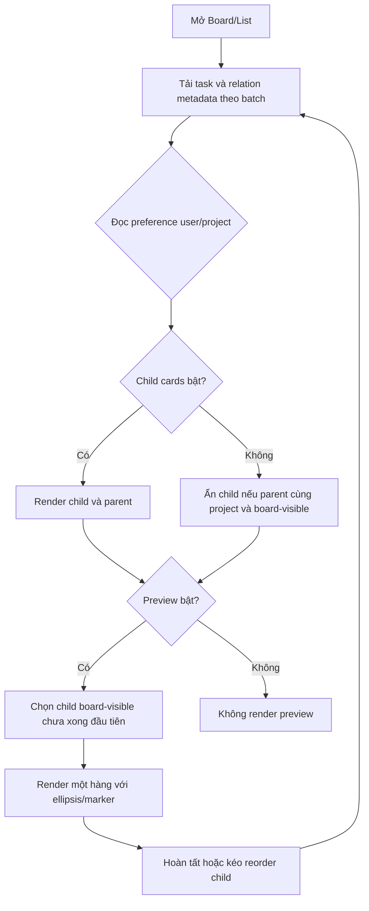
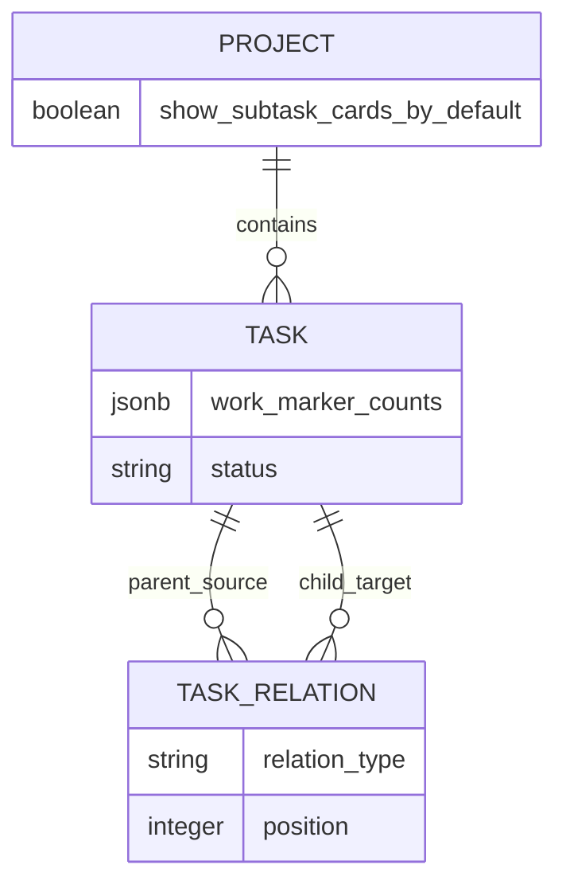

# Spec: Làm gọn board bằng subtask preview và work markers

## Context Snapshot

- Project: Kaneo, repo `D:\pcloud\workspace\code\kaneo`; nhánh `kaneo/prodesk-production`.
- Stack: pnpm monorepo; web React/TanStack/Tailwind v4; API Hono/Drizzle/PostgreSQL.
- Current behavior: subtask là task bình thường được nối bằng relation `subtask`. `GET /task/tasks/:projectId` trả task theo column; `planned`/`archived` được trả riêng, không render ở Board/List. Hàng con xếp theo `task_relation.position`. Subtask row có drag handle và hai nút mũi tên lên/xuống.
- Current card cues: `?` là chưa giao người phụ trách; `−` là không ưu tiên. Chúng không thuộc thay đổi này.
- Desired behavior: per-user/per-project toggle ẩn/hiện child card; dự án mới mặc định ẩn, dự án cũ giữ hiện; card cha hiện child chưa xong đầu tiên theo thứ tự Subtasks; task có bốn marker lặp được `❌`, `❎`, `⭕`, `✅`; bỏ nút mũi tên nhưng giữ kéo thả và keyboard reorder.
- Relevant files:
  - `apps/api/src/database/schema.ts` — `projectTable` và `taskTable`.
  - `apps/api/src/task/controllers/get-tasks.ts`, `get-task.ts` — project list và task-detail DTO.
  - `apps/api/src/task-relation/controllers/get-task-relations.ts`, `reorder-subtasks.ts` — relation, thứ tự, child DTO.
  - `apps/api/src/task/index.ts`, `apps/api/src/task/controllers/update-task-priority.ts` — route/permission pattern.
  - `apps/api/src/project/controllers/create-project.ts`, `apps/api/src/schemas.ts` — project defaults và API schemas.
  - `apps/web/src/store/user-preferences.ts` — preferences hiện persist bằng localStorage, key chung chưa scoped theo account.
  - `apps/web/src/components/board/board-toolbar.tsx`, `apps/web/src/routes/_layout/_authenticated/dashboard/workspace/$workspaceId/project/$projectId/board.tsx` — Board/List surface.
  - `apps/web/src/components/kanban-board/task-card.tsx`, `components/list-view/task-row.tsx`, `components/task/task-subtasks.tsx`, `subtask-row.tsx`, `task-properties-sidebar.tsx` — card, editor và hàng con.
  - `apps/web/src/components/providers/auth-provider/hooks/use-auth.ts` — authenticated `userId`.
  - `apps/web/src/hooks/queries/task/use-get-tasks.ts`, `use-get-task.ts`, `apps/web/src/types/task/index.ts` — client DTO và share mapping.
  - `apps/web/src/hooks/mutations/task-relation/use-reorder-subtasks.ts`, `apps/web/src/lib/subtask-order.ts` — optimistic ordering/cache.
  - Test patterns: `tests/api-integration/task-subtask-order.test.ts`, `tests/api-integration/full-share.test.ts`, `apps/web/src/components/task/subtask-row.test.tsx`, `apps/web/src/lib/subtask-order.test.ts`.
- UI authority: `apps/web/PRODUCT.md`, `apps/web/DESIGN.md`; surface Operate, giữ incumbent UI, không redesign. Không có surface brief riêng cho board. Visual refs là ảnh user cung cấp: `D:\pcloud\workspace\obsidian\archive\images\20261027112825.png`, `20261027113621.png`, `20261027113758.png`, `20261027121324.png`, `20261027121601.png`.
- Constraints: không nối marker vào title/description/status/priority; không đổi lane order tùy tiện; giữ drag reorder; không mở rộng full project share; marker API phải dùng permission/agent-control guards hiện có.

## Objective

Khi mở dự án, mày nhìn card cha là biết ngay việc con kế tiếp mà không cần mở task; nếu muốn bảng gọn thì ẩn child card riêng nhưng vẫn truy cập được trong Subtasks. Marker là dữ liệu riêng, không sửa tên hay trạng thái.

## Scope

- In:
  - Per-user/per-project toggle ẩn/hiện subtask card/row ở màn Tasks, gồm Board và List mode.
  - Dự án mới mặc định ẩn child card; dự án hiện có mặc định vẫn hiện như trước.
  - Preview trên parent bật mặc định; lấy child chưa hoàn tất đầu tiên theo thứ tự Subtasks; một hàng tối đa, tên dài có ellipsis.
  - Gắn/gỡ bốn marker vào parent hoặc child; số lượng mỗi marker tối đa 99.
  - Hiện marker cạnh title trong Board card, List row, Subtask row và parent preview.
  - Bỏ hai nút mũi tên lên/xuống; giữ drag handle, pointer/touch reorder và keyboard reorder.
- Out:
  - Không xóa task/relation; không đổi status, priority, title, execution state hoặc agent-control envelope.
  - Không đổi Backlog/Gantt; nếu “chỉ nằm trong Subtasks” có nghĩa ẩn ở cả hai view đó thì cần mở rộng scope trước implement.
  - Không thêm marker, preference hoặc setting vào anonymous/full project share link; không đổi public DTO/share permissions.
  - Không thêm global toggle; per-user overrides không sync giữa thiết bị trong phiên bản này.
  - Không đổi relation model hay cross-project relation behavior.

## UX Baseline

| # | Tiêu chí | Điều kiện đạt |
|---|---|---|
| 1 | Keyboard | Hai toggle và marker picker theo thứ tự Tab; Enter/Space thao tác; Escape đóng picker. Trong lúc DnD active, DnD độc quyền nhận Space/Enter/ArrowUp/ArrowDown/Escape; không kích hoạt selection, mở task hoặc clear focus/selection. Space/Enter lift/drop, arrows move, Escape cancel và giữ focus/selection trước drag; announce tên task/vị trí mới. Ngoài DnD giữ list keyboard behavior hiện tại. |
| 2 | Focus | Keyboard focus nhìn thấy rõ; pointer focus không tạo viền đen mới. |
| 3 | A11y | Marker có accessible name gồm glyph và số lần, không diễn giải thành status; toggle có label; contrast text ≥4.5:1; drag target ≥44×44px. |
| 4 | Viewport | 320–1440px không tràn ngang; preview tối đa một hàng; marker cluster không đẩy card tràn. |
| 5 | States | Parent không có child kế tiếp thì không có preview; lỗi lưu marker giữ dữ liệu cũ và báo lỗi có recovery. |
| 6 | Nhất quán | Dùng token/component trong `apps/web/DESIGN.md`, không dựng UI system mới. |
| 7 | Platform | Web; Board/List giữ behavior hiện có. |
| 8 | Copy | Toggle gọi rõ “Hiện card công việc con” và “Hiện công việc con tiếp theo”; không giải thích dài trên card. |

## Thuật ngữ

- Parent: task ở `sourceTaskId` của relation `subtask`.
- Child/subtask: task ở `targetTaskId` của relation `subtask`.
- Board-visible: task có `status` map tới `column.slug` của project. `planned` và `archived` là virtual status, không board-visible. Final column vẫn board-visible nhưng được tính là hoàn tất.
- Thứ tự Subtasks: `position` của relation, tie-break bằng `createdAt` như hiện tại.
- Child kế tiếp: child board-visible đầu tiên theo thứ tự relation mà column không final.
- Work marker count: `TaskMarkerCounts` là object bắt buộc có đủ bốn key `redCross`, `boxedRedCross`, `redCircle`, `greenCheck`; mỗi value là integer 0–99, mặc định 0. Đây là cue quen dùng, không mang nghĩa status/priority Kaneo.
- Per-user/per-project preference: lựa chọn cho một user và một project, lưu local-only dưới localStorage key namespace theo `userId` và `projectId`; không sync cross-device.

## Assumptions

1. Marker là task metadata dùng chung cho thành viên được phép xem task; không phải ghi chú riêng từng người. Full share holder không thấy hoặc sửa marker.
2. Hai toggle độc lập. Project cũ sau upgrade mặc định giữ child cards visible và preview bật, nên parent preview có thể lặp tên child card; đây là transition có chủ ý. User tắt “Hiện card công việc con” nếu muốn chỉ xem preview trong parent. Project mới mặc định child cards hidden + preview bật.
3. Setting được tách bằng `userId` và `projectId` (không dùng key chung `user-preferences`). Khi auth account đổi, state của account cũ phải được gỡ trước khi render account mới. Không có preference per-project cũ cần migrate; giá trị mới lưu local, không sync thiết bị.
4. Project DB giữ `showSubtaskCardsByDefault`: migration set rows hiện có `true`; default khi tạo project mới là `false`. User override local thắng project default.
5. Child chỉ ẩn nếu parent và child cùng project, đồng thời parent board-visible. Child có parent ở project khác không bị ẩn khỏi board nơi task thuộc về.
6. Preview chỉ xét child cùng project và board-visible; `planned`/`archived` bị loại. Mọi final column đều được coi là hoàn tất.
7. Marker editor dùng count 0–99 cho mỗi loại; 1–3 hiện đúng số glyph lặp; 4–99 hiện glyph + `×N` để giới hạn chiều ngang. Thứ tự nhóm cố định `❌`, `❎`, `⭕`, `✅`.
8. Marker mutation dùng authenticated task update permission và `phaseCardTaskGuard`; không bypass agent-control boundary.

## Open Questions

- Nếu yêu cầu hide phải áp dụng cả Backlog/Gantt chứ không chỉ Board/List, cần mở rộng scope trước implement.

## Approach

- `task.workMarkerCounts` là `TaskMarkerCounts` đủ bốn key, tất cả default 0. Endpoint authenticated `PUT /api/task/work-markers/:id` nhận full count object `{ workMarkerCounts: TaskMarkerCounts }`, validate từng integer 0–99 theo pattern update priority. UI render count 1–3 bằng glyph lặp; count ≥4 bằng `glyph×N`; accessible label luôn nêu glyph và count.
- `GET /task/:id` và project task-list trả `workMarkerCounts`. Public/share DTO không trả field này; client share mapping gán zero counts để `Task` type vẫn thống nhất.
- Project task-list trả `showSubtaskCardsByDefault`; từng task trả `isSubtask` và `nextSubtaskPreview: { id, title, workMarkerCounts } | null`.
- `isSubtask=true` chỉ khi task là child của parent cùng project có Board-visible status. Parent `planned`/`archived` không làm child biến mất khỏi Board/List.
- Preview chỉ lấy child cùng project có status map tới column và column không final; `planned`/`archived` và final statuses không được chọn. Tính trên toàn relation graph của project, độc lập `page`/`limit`; Board hiện gọi unpaginated route.
- Dùng batch query, không fetch relation riêng từng card. Kiểm tra invalidation hiện có trong reorder/status mutation đã refetch projection mới; không thêm invalidation trùng. Marker write invalidate task detail/list và `task-relations` ở tab hiện tại để parent SubtaskRow không stale; tab khác cập nhật theo refetch interval hiện có, không thêm event/websocket trong scope.
- Preference store mới có namespace localStorage riêng theo account `userId` + `projectId`, không reuse key `user-preferences`. Khi đổi account, hydrate theo key mới trước khi render project settings. Share capability không hiện toggle hoặc dùng preference này.
- Menu hiển thị đặt trong toolbar gần Board/List controls; marker editor đặt trong task properties. Marker hiển thị cạnh tên, title string nguyên vẹn.
- Bỏ ArrowUp/ArrowDown props/callbacks; giữ `GripVertical`, `useSortable`, `DndContext`, `SortableContext`, `onDragEnd`. Khi keyboard DnD active, list key handler phải nhường toàn bộ Space/Enter/ArrowUp/ArrowDown/Escape; không toggle selection, mở task hoặc clear focus/selection. Escape cancel giữ focus/selection cũ; sau drop/cancel, list keyboard behavior tiếp tục bình thường. Announcer nói tên task và vị trí/tổng số sau mỗi lần move/drop.

### Journey

1. Mở Board/List; app tải task projection, sau đó lấy preference theo account + project.
2. Nếu show child cards tắt, child cùng project chỉ còn trong Subtasks; parent vẫn hiện preview nếu có child kế tiếp và preview đang bật.
3. Kéo task con cần làm lên đầu hoặc hoàn tất child đầu; preview cập nhật sang child board-visible chưa xong đầu tiên.
4. Mở properties để tăng/giảm marker; marker hiện cạnh title ở các surface trong scope.

### Flow

### Data model

## Bỏ qua

- Không dùng title suffix như `task.title + " ❌❌❌"`; title phải giữ nguyên trong API/search/notifications/links.
- Không dùng priority, status, labels hoặc task completion checkbox để lưu marker.
- Không tạo query relation riêng cho từng card; child ẩn không biến mất khỏi database, task detail hoặc relation API.
- Không đổi project share capability, public DTO, hoặc visitor permissions.

## Risks

- Nếu query relation từng parent sẽ thành N+1; batch query và test projection trên project có nhiều parent/child.
- `planned`/`archived` không map vào column. Child của parent ở virtual status phải còn visible; virtual child không được hiện làm preview “việc tiếp theo”.
- API integration harness migrate một lần rồi TRUNCATE; test mặc định row mới không chứng minh backfill row cũ. Không claim integration chứng minh backfill; review migration SQL có `UPDATE` rõ ràng và UAT project cũ sau upgrade.
- `TaskSubtasks` tạo Task object thủ công; marker counts phải được copy. Share mappers phải tạo zero counts mà không lấy marker từ guest DTO.
- `❌` và `❎` khác glyph; API validation giữ hai key riêng.
- Count >3 được compaction thành glyph ×N; verify đúng số/accessibility và không tràn ở 320px.
- Drag handle hiện `size-8 sm:size-7`; sau khi bỏ arrows phải đạt 44×44px touch target. Custom document key handler hiện dùng Space/Enter/Escape/ArrowUp/ArrowDown cho selection/navigation; trong DnD active phải nhường cả năm phím để không chọn, mở task hoặc xóa focus/selection.
- Hai default bật cùng lúc ở project cũ có thể hiển thị child hai lần có chủ ý; UAT phải xác nhận và toggle xử lý được.
- Public DTO/API share phải tiếp tục không trả `workMarkerCounts` hoặc project default.

## Task List

### T1 — Lưu marker, default dự án và API projection

- Acceptance:
  - Migration thêm `task.work_marker_counts` JSONB với bốn key count integer 0–99; thêm `project.show_subtask_cards_by_default`; SQL migration set project rows có sẵn thành `true`, DB default cho row project mới là `false`.
  - `PUT /api/task/work-markers/:id` chỉ ghi full count map đã validate; thiếu key, 100/âm/số thập phân/unknown key bị 400; DB/API luôn normalize đủ bốn key với default 0. Giữ nguyên title/status/priority/position/taskRevision/executionState. Route dùng `workspaceAccess.fromTask`, `phaseCardTaskGuard`, `requireWorkspacePermission({ task: ["update"] })`.
  - `GET /task/:id` và authenticated `GET /task-relation/:taskId` trả `workMarkerCounts`; task-list trả `data.showSubtaskCardsByDefault` và mỗi task có `isSubtask`, `workMarkerCounts`, `nextSubtaskPreview: { id, title, workMarkerCounts } | null`.
  - `isSubtask` chỉ true với child cùng project có parent Board-visible. Preview chỉ chọn child cùng project có status map vào column non-final. `planned`/`archived` parent không làm child ẩn; virtual child không được preview.
  - Projection tính trên full project, không N+1 và không thay đổi public DTO. `tests/api-integration/full-share.test.ts` xác nhận guest payload không có key `workMarkerCounts`.
- Reproduce: từ `apps/api`, `pnpm exec vitest run --config vitest.integration.config.ts ../../tests/api-integration/task-subtask-order.test.ts ../../tests/api-integration/full-share.test.ts` (cả hai file tồn tại; mở rộng case projection/mutation và guest boundary tại đây).
- Verify: integration test chứng minh project row mới mặc định false, row true trả đúng; marker round-trip/validation/permission; preview bỏ final/virtual và theo relation order; public payload không rò field. Backfill row cũ phải được kiểm riêng: review migration SQL có `UPDATE` rõ ràng và User Test trên project tồn tại trước migration; không tuyên bố test harness migrate-then-TRUNCATE đã chứng minh backfill. `pnpm --filter @kaneo/api build`.
- Files:
  - `apps/api/src/database/schema.ts` — `projectTable`/`taskTable`; migration pattern `apps/api/drizzle/0049_wise_loners.sql`.
  - `apps/api/src/task/index.ts` — route/permission pattern `PUT /priority/:id`.
  - `apps/api/src/task/controllers/update-task-priority.ts` — field-only update pattern.
  - `apps/api/src/task/controllers/get-tasks.ts` — project task DTO; group columns và tách virtual statuses.
  - `apps/api/src/task/controllers/get-task.ts` — allowlist task-detail DTO.
  - `apps/api/src/task-relation/controllers/get-task-relations.ts` — relation target DTO.
  - `apps/api/src/project/controllers/create-project.ts` — new-project defaults.
  - `apps/api/src/schemas.ts` — `projectSchema`/`taskSchema`.
  - `tests/api-integration/task-subtask-order.test.ts` — authenticated relation fixture; `tests/api-integration/full-share.test.ts` — guest DTO boundary.

### T2 — Board/List preferences, preview, markers và bỏ mũi tên

- Acceptance:
  - Board toolbar có menu hiển thị hai toggle per-project. Preference key được namespace bằng cả `userId` và `projectId`; cùng browser, User A đổi Project X không đổi state của User B. Khi đổi account, state trong bộ nhớ phải thay trước khi render board. Giá trị local, không sync thiết bị.
  - Fallback child-card visibility lấy `showSubtaskCardsByDefault`; preview fallback bật. Project cũ default child cards visible + preview on là trạng thái transition có chủ ý; test/UAT xác nhận hai lần hiển thị và cách tắt card riêng.
  - Child cards tắt chỉ lọc child cùng project có parent Board-visible khỏi Board/List; parent/detail/Subtasks giữ nguyên. `planned`/`archived` parent không giấu child. Counts/filter/search không làm child ẩn tự xuất hiện lại.
  - Preview là child board-visible chưa xong đầu tiên theo relation position; khi hoàn tất hoặc reorder, dữ liệu cập nhật qua invalidation hiện có. Không có child đủ điều kiện hoặc toggle tắt thì không render dòng.
  - Title preview một hàng, ellipsis cuối; marker cluster không overflow. Count 1–3 hiện glyph lặp; 4–99 hiện một glyph + `×N`; screen reader đọc glyph + count.
  - `TaskCard`, List TaskRow, `SubtaskRow`, parent preview hiển thị marker cạnh tên. Marker editor trong task properties tăng/giảm count; task title/status không đổi. Client `Task` type khai báo `workMarkerCounts: TaskMarkerCounts`; `ProjectBoardTask = Task & { isSubtask: boolean; nextSubtaskPreview: Pick<Task, "id" | "title" | "workMarkerCounts"> | null }` được khai báo trong `types/project/index.ts`; `ProjectWithTasks.columns[].tasks` dùng type này. Share client mappers gán project default `true`, zero counts/`isSubtask=false`/`nextSubtaskPreview=null`, không lấy field từ public DTO; `buildTaskObject` copy counts của child; task fixtures/mappings khác được cập nhật theo typecheck.
  - Preference menu, child filtering, preview và marker editor chỉ hoạt động trên authenticated Tasks route. Share capability giữ nguyên child cards/rows hiện tại; shared BoardToolbar/KanbanBoard/ListView không áp preference projection cho guest. Public task/relation DTO không có marker; `share-full-api.ts` maps counts về zero. Marker mutation invalidates `task`, `tasks` và `task-relations` queries trong tab hiện tại để parent sheet đang mở không stale; tab khác cập nhật theo refetch hiện có, không thêm API event/WebSocket.
  - SubtaskRow không còn nút lên/xuống; grip target 44×44px trên touch. Keyboard drag: Space/Enter lift, ArrowUp/ArrowDown move, Space/Enter drop, Escape cancel. Từ lift đến drop/cancel, các phím này chỉ điều khiển DnD: không toggle selection, mở task hoặc clear focus/selection; Escape cancel giữ focus/selection có trước drag. Ngoài DnD, list keyboard behavior hiện tại vẫn chạy. Announce title + vị trí sau move/drop. Web tests xác nhận cả năm phím không chạy list action khi DnD active.
- UX Contract:
  - Surface: Operate, existing project Tasks Board/List; không redesign. `apps/web/DESIGN.md` là token/component authority.
  - States: child cards on/off; preview on/off; parent no eligible child; legacy default duplicate; marker empty/mixed/count 3/count 4/count 99; task title dài; save success/error; drag idle/active/cancelled/dropped.
  - A11y: marker accessible name mô tả glyph và count, không gán status semantics; 44×44px touch grip; live announcement sau reorder; focus-visible; hai toggle label rõ. Web test xác nhận Space/Enter lúc drag không toggle/open task, Escape chỉ cancel và giữ selection/focus, Arrow keys chỉ reorder khi DnD active.
  - Responsive: 320/375/414/768/1024/1280/1440px; preview một hàng; marker cluster có bound hiển thị.
  - Pre-lock rút gọn: chỉ mở rộng toolbar/component incumbent, không chọn visual world mới; ảnh user + `apps/web/DESIGN.md` là ref.
- Skills: `flow`, `impeccable`, `frontend-taste-chatgpt`, `mobile-responsive`.
- Visual Ref: `apps/web/DESIGN.md`; ảnh owner `20261027113621.png`, `20261027113758.png`, `20261027121324.png`, `20261027121601.png` trong `D:\pcloud\workspace\obsidian\archive\images\`.
- Reproduce: từ `apps/web`, `pnpm exec vitest run --config vitest.config.ts src/components/task/subtask-row.test.tsx src/lib/subtask-order.test.ts` (cả hai file tồn tại; mở rộng tests trong đó).
- Verify: chạy `pnpm exec vitest run --config vitest.config.ts src/components/task/task-subtasks.test.tsx src/components/task/subtask-row.test.tsx src/lib/subtask-order.test.ts src/store/project-display-preferences.test.ts` sau khi thêm test mới; test DnD key isolation, relation marker refresh và storage namespace theo hai `userId`; `pnpm --filter @kaneo/web typecheck`; `pnpm --filter @kaneo/web build`; `pnpm i18n:check`; render Board/List states desktop/mobile và chạy Impeccable detector một lần sau khi hoàn tất.
- Files:
  - `apps/web/src/store/user-preferences.ts` — global store giữ nguyên.
  - `apps/web/src/store/project-display-preferences.ts` — tạo mới: preference riêng theo user/project, localStorage key có `userId`; pattern storage trong `user-preferences.ts`.
  - `apps/web/src/store/project-display-preferences.test.ts` — tạo mới: cô lập hai user trên cùng browser storage.
  - `apps/web/src/components/providers/auth-provider/hooks/use-auth.ts` — nguồn `userId`.
  - `apps/web/src/components/board/board-toolbar.tsx`, `apps/web/src/routes/_layout/_authenticated/dashboard/workspace/$workspaceId/project/$projectId/board.tsx` — toolbar/data flow.
  - `apps/web/src/hooks/use-task-filters-with-labels-support.ts` — search/filter projection; hidden children must not reappear.
  - `apps/web/src/components/kanban-board/task-card.tsx`, `apps/web/src/components/list-view/task-row.tsx` — task title/card.
  - `apps/web/src/components/task/task-properties-sidebar.tsx` — marker editor.
  - `apps/web/src/components/task/task-subtasks.tsx`, `subtask-row.tsx` — order, DnD, child task construction; global keyboard navigation.
  - `apps/web/src/components/task/task-subtasks.test.tsx` — tạo mới: DnD active keys không kích hoạt global list actions; idle keyboard behavior giữ nguyên.
  - `apps/web/src/hooks/queries/task/use-get-tasks.ts`, `use-get-task.ts` — authenticated DTO + guest mapping (guest mapping gán zero counts).
  - `apps/web/src/hooks/queries/task-relation/use-get-task-relations.ts` — parent SubtaskRow relation cache.
  - `apps/web/src/fetchers/share/share-full-api.ts` — guest task/relation mapping dùng zero marker counts, không đọc marker từ server.
  - `apps/web/src/components/share/share-project-surface.tsx` — guest UI dùng component board/list chung; phải giữ nguyên và gate preference projection khỏi guest.
  - Marker mutation hook (file mới) — invalidate `task`, `tasks`, `task-relations`.
  - `apps/web/src/hooks/mutations/task-relation/use-reorder-subtasks.ts`, `apps/web/src/hooks/mutations/task/use-update-task-status.ts` — verify existing query invalidation covers projection; không thêm duplicate.
  - `apps/web/src/lib/subtask-order.ts`, `apps/web/src/types/task/index.ts`, `apps/web/src/types/project/index.ts` — helper/type pattern; `Task.workMarkerCounts` is required and share mappings supply zero counts; `ProjectBoardTask` contains projection fields.
  - `i18n/*.json`, `i18n/schema.json` — translated controls; regenerate schema through project script.

### T3 — Regression, migration upgrade và visual closeout

- Acceptance:
  - API integration proves new-row default, marker validation/persistence, exact task-detail/task-list DTO, same-project board-visible rule, virtual/final preview selection, and public share non-exposure.
  - Migration backfill is separately verified by SQL review and an upgrade check using a project row that exists before the new migration; do not claim migrate-then-TRUNCATE integration fixtures cover it.
  - Web tests prove independent toggles/account isolation, legacy duplicate default, 320px marker compaction, one-line truncation, empty/all-virtual states, arrow removal, keyboard drag and announcements.
  - Full build/typecheck/i18n gates pass; no unrelated diff; `git diff --check` clean.
  - Screenshot evidence covers Board/List at 1280px and 375px for legacy default, new-project default, hidden/shown children, long preview, repeated/compacted markers, keyboard/pointer reorder; overflow matrix 320/375/414/768/1024/1280/1440.
  - Keyboard regression proves lift/drop keys do not select/open tasks; Escape cancels drag without clearing pre-drag selection/focus; idle list keyboard shortcuts remain unchanged.
- Reproduce: repo root `pnpm --filter @kaneo/api build`; chạy riêng các gate web/i18n dưới Verify để shell không phụ thuộc `&&`.
- Verify: existing API test from T1 plus expanded web tests from T2; `DATABASE_URL=<connection-to-*_test> pnpm --filter @kaneo/api db:check-0050` runs the real pre-0050→0050 upgrade check on a unique disposable database; screenshots/runtime evidence; `D:\.claude\skills\impeccable\scripts\impeccable.cmd detect --json apps/web/src/components/board/board-toolbar.tsx apps/web/src/components/kanban-board/task-card.tsx apps/web/src/components/list-view/task-row.tsx apps/web/src/components/task/subtask-row.tsx apps/web/src/components/task/task-properties-sidebar.tsx`.
- Files: paths listed under T1/T2; evidence under `.impeccable/review/` or `uat/` per repo convention.

## Checkpoints

- Sau T1: API fixture chứng minh new-row default, DTO shapes, marker allowlist và board-visible preview; SQL backfill được review riêng.
- Sau T2: cùng browser account isolation; Board/List cache dùng invalidation hiện có; virtual parent không làm child biến mất; trong drag, list key handler nhường Space/Enter/ArrowUp/ArrowDown/Escape; khi drag idle, list keyboard behavior vẫn hoạt động.
- Trước DONE: API/web gates, migration upgrade check, visual evidence và user UAT đều PASS; không deploy production trong spec phase.

## External Review Brief

### Reviewer cần phán

- Có đúng flow: mở dự án → thấy parent + việc con kế tiếp → kéo thứ tự → preview cập nhật?
- Per-user/per-project storage key có tách account thật sự; migration defaults có phân biệt row cũ/mới?
- API DTO có đủ `showSubtaskCardsByDefault`, `isSubtask`, marker counts, preview shape; query relation có batch và xử lý virtual statuses đúng?
- Marker count/compaction có giữ glyph/số lượng, accessible, fit ở 320px?
- Existing-project duplicate default có được nói rõ và có UAT đúng không?
- Removing arrows có giữ keyboard drag + announcement, đặc biệt custom key handler trong `task-subtasks.tsx`?
- Verify plan có phân biệt migration backfill với new-row default, không claim sai integration coverage?

### Reviewer nên đọc trước

- Spec này; `apps/web/PRODUCT.md`, `apps/web/DESIGN.md`.
- API: `schema.ts`, task `get-tasks.ts`/`get-task.ts`, `task/index.ts`, `update-task-priority.ts`, `reorder-subtasks.ts`, `validate-task-fields.ts`, integration database helper.
- Web: `board.tsx`, `board-toolbar.tsx`, `task-card.tsx`, `task-row.tsx`, `task-subtasks.tsx`, `subtask-row.tsx`, `user-preferences.ts`, `use-get-tasks.ts`, `use-get-task.ts`.
- Owner screenshots: `20261027113621.png`, `20261027113758.png`, `20261027121324.png`, `20261027121601.png`.

### Review lanes

- DeepSeek: bounded API/data/migration/permission/test-plan review; chỉ đọc và đề xuất patch spec, không sửa file.
- Luna: dedicated UI/UX/flow/accessibility/responsive review; chỉ đọc và đề xuất patch spec, không sửa file.

### Reviewer không cần phán

- Visual redesign hoặc chọn style mới; project đã có `DESIGN.md`, yêu cầu giữ incumbent.
- Production deploy, share capability redesign, Backlog/Gantt redesign.

## User Test

| Hành động | Kết quả kỳ vọng | Chuẩn nhìn |
|---|---|---|
| Tạo project mới rồi mở Board | Child card không đứng riêng; parent có preview khi có child đủ điều kiện | Không thấy card child rời; preview một hàng |
| Mở project cũ sau upgrade | Child card riêng và preview cùng hiện; đây là transition có chủ ý | Bật/tắt từng toggle không làm mất task |
| Tắt/bật child cards ở Project X | Chỉ Board/List của user/project đó đổi; Subtasks parent vẫn còn | Project khác/user khác không bị ảnh hưởng |
| Kéo child khác lên đầu rồi hoàn tất child đầu | Preview theo relation order mới; hoàn tất xong chuyển sang child board-visible chưa xong kế tiếp | Không reload tay; title dài có `…`, một hàng |
| Gắn bốn marker, lặp 3 lần rồi tăng lên 4 | 1–3 render glyph lặp; từ 4 dùng `glyph×N` | Không tràn ở 320px; assistive label đọc đúng count |
| Kéo reorder bằng pointer và keyboard | Thứ tự được lưu; Space/Enter không chọn/mở task; Escape chỉ hủy drag và giữ selection/focus | Grip 44×44px; live announcement nêu task/vị trí; list shortcuts vẫn chạy khi drag idle |
| Chuyển User A → User B trên cùng browser profile | B thấy default/override riêng; A đăng nhập lại thấy state của A | Không kế thừa state từ account trước |

5 câu Y/N:

1. Child ẩn khỏi Board/List vẫn còn trong Subtasks và không biến mất khỏi dữ liệu?
2. Parent `planned`/`archived` không làm child card trong Board/List biến mất?
3. Preview có đúng child board-visible chưa xong đầu tiên theo thứ tự kéo?
4. Marker count 1–3 lặp glyph, count cao hơn gọn lại mà vẫn đọc được và không tràn?
5. Bỏ mũi tên vẫn reorder được bằng pointer/touch/keyboard và có thông báo vị trí mới?

## Post-UAT revision — 2026-10-28

Owner request: after production UAT, correct the drag settling delay, put work markers inline with titles, replace counter controls with quick presets, add a subtask-row quick picker, and expose assignee/priority display toggles.

### Evidence and diagnosis

- Supplied UAT screenshots: `1e65d690-dec1-40b9-871b-9bf6787bc3eb.png`, `b651cfc5-b624-4f53-b7c8-a70c00b18da9.png`, `2d7c243d-a29d-4907-86d0-2b2c3725aab5.png`, `a72af8d8-7e53-441a-bb70-4eb88a81631a.png`.
- Board/List drop handlers update the Zustand project store, but the rendered project remains derived from the TanStack Query result; each affected task is then PUT separately and each success invalidates/refetches the task list. The card therefore stays in the old query projection until refetch completes, then jumps. Replace this wait with an optimistic query projection and one final reconciliation; rollback on mutation failure.
- Marker editor currently exposes four independent `− / +` counters; Board/List/SubtaskRow render marker groups below the title. Replace both interaction and presentation with one fast selection path.

### Revised behavior

- Drag/drop in Board and List updates the visible lane/order immediately on drop, without waiting for the network. Persist current lane positions, reconcile once after the grouped writes complete, and restore the previous projection with an error on failure. Do not change move permissions, agent-control guards, or share-link behavior.
- Task properties show a compact `Marker` control in the metadata header beside the due-date control. It opens four choices; each choice writes exactly three repetitions of that marker and zero for the other marker types. Selecting the already-selected marker clears it. The old independent plus/minus controls are removed.
- Subtask rows place a marker-picker icon immediately left of the title-pencil action; it opens the same four-choice picker without opening the child task. Marker glyphs sit on the same row as the title in Board cards, List rows, Subtask rows, and previews. Titles truncate with ellipsis before markers; marker clusters never wrap or push the surface wider.
- Existing stored count maps are not rewritten on read. Legacy multi-type or non-triple values remain visible until the user selects a preset; a new picker write normalizes that task to one triple or zero.
- Authenticated Board/List `Hiển thị` menu adds independent `Hiện người được giao` and `Hiện mức độ ưu tiên` toggles. They use the existing per-user/per-project local preference namespace; Backlog, Gantt, and share surfaces keep their current behavior.
- Add project defaults `showAssigneesByDefault` and `showPriorityByDefault`: migration backfills existing projects to `true`, new project DB/API defaults are `false`, and a local per-user/project override wins. Thus existing boards do not lose information on upgrade, while new solo projects start uncluttered.

### Acceptance and verification

- Board and List drag: the moved task is rendered in the target position synchronously on drop before any response; no intermediate revert/jump; failed write restores the previous order and gives recovery feedback; successful grouped persistence performs one final list reconciliation.
- Marker picker: four options, each writes `{selected: 3, others: 0}`; choosing the current type clears all counts; duplicate submits are locked while pending; save failure preserves the prior state. Existing legacy counts are unchanged until an explicit choice.
- Marker placement: title and marker share one row at 320/375/414/768/1024/1280/1440px; long titles ellipsize; no horizontal overflow; SubtaskRow quick picker does not open/navigate the task and is keyboard/touch accessible.
- Project display defaults: existing project rows return both display defaults `true`, newly created projects return both `false`; account/project local overrides do not bleed across users or projects. Guest/share payloads do not gain these authenticated-only controls or marker data.
- API regression: real 0050→0051 upgrade check verifies legacy backfill; API integration verifies new-project defaults and task-list DTO values. Web tests verify optimistic drop/rollback, single-preset writes, local preference isolation, and inline marker rendering.
- `pnpm --filter @kaneo/api build`, relevant API integration tests, relevant web tests, web typecheck/build, `pnpm i18n:check`, `git diff --check`, one Impeccable detector pass, and rendered visual evidence for the supplied surfaces plus mobile/desktop. Production deploy is recorded separately in `.wave-uatfix6/APPLY-RECEIPT.md`; owner UAT remains the acceptance gate.

### Verification results — 2026-10-28 (final re-run)

- Web: typecheck PASS, vitest 37 files / 109 tests PASS, build PASS. Fix during re-run: `fetchers/task/update-work-markers.ts` now unwraps `workMarkerCounts` from the API task response so the optimistic mutation's `TaskMarkerCounts` type is honest (type-level only; runtime behavior was already correct).
- API: build PASS; integration 22 files / 222 tests PASS. i18n check PASS (13 locales in sync). Migration `0051` real-disposable-DB upgrade check PASS (run earlier, files unchanged since).
- Rendered UI (local dev, project Legacy Board / New Board / fresh `UAT Fresh Project`): drag of `legacy-board-5` to top of ToDo updated DOM order on drop and persisted after full reload (5→1→2); marker picker 4×3 in task properties; subtask quick picker writes counts that render on the subtask row and the board preview line; display menu shows legacy projects all-on (backfill) and a project created after 0051 all-off for assignee/priority/subtask-cards with next-subtask preview on; List view renders markers inline; 320/375px no horizontal overflow (eye icon collapse); browser console clean across all flows.
- Rendered evidence: `.impeccable/review/uat-revision-2026-10-28/` (board legacy 1280/375/320, list 1280, display-hidden state, task-detail marker picker, subtask marker selected, board after drag).

## Post-UAT round 2 — 2026-10-29

Owner production UAT found three visual refinements; supplied screenshots: `c3e0be17-1b88-4741-8b2c-c2b0096f6052.png` (current board), `c43f8812-3282-4d7b-af16-c966c07107af.png` (desired inline marker placement), and `cf210f38-17ab-42e6-8e94-d710d2095ba3.png` (task detail).

### Required behavior

- On Board cards, put parent markers immediately after the parent title and preview-child markers immediately after the preview title. Do not pin either cluster to the far right; keep the title shrinkable/ellipsized before its marker. Apply the same title/preview rule to List rows so the shared task presentation stays consistent.
- In the task-properties marker trigger, show only the marker glyph cluster when a task already has markers; keep the text `Marker` when it has none. The trigger remains accessible as `Marker` to assistive technology.
- Left-align the selected marker trigger with the other task properties in the stacked detail view; keep compact/mobile property rows left-aligned without forcing a full-width item into their wrapping layout.
- Do not change marker counts, picker choices, preview ordering, card visibility, or any API/data behavior.

### Acceptance / verification

- Render parent and child-preview marker clusters adjacent to their own titles at 320/375/1280px; a long title ends in ellipsis before the marker, and no horizontal overflow appears.
- Verify the marker trigger's empty state says `Marker`; selected state contains only glyphs visually while retaining its accessible name; desktop properties align left. Cover compact/mobile and stacked desktop placements of the shared picker.
- Add/update picker component tests for empty/selected labels and left-alignment class; run focused web tests, web typecheck/build, `git diff --check`, and one Impeccable detector pass. Render the same board/task-detail states after the change.
- Scope excludes API, migrations, data, marker preset semantics, reorder, and share DTOs.

### Implementation checks — 2026-10-29

- `TaskCard` and List `TaskRow` title/preview spans now shrink without growing, leaving marker clusters immediately after the visible text; ellipsis remains on the text before markers.
- `WorkMarkerPicker` keeps `Marker` as the accessible name; the visible text is present only when counts are empty. Selected glyphs are the only visible trigger content. The shared trigger is left-aligned; the stacked desktop properties instance uses the full property width. Picker options now use a labeled `fieldset`.
- Regression evidence: focused marker/sidebar tests 9/9 PASS; complete web suite 37 files / 111 tests PASS; web typecheck PASS; web build PASS (existing >500KB chunk-size warning); `pnpm i18n:check` 13 locales PASS; `git diff --check` PASS; Impeccable detector `[]`.
- Local visual capture after the patch was not available: the managed browser session redirected to sign-in, and no credentials were passed to browser tooling. Owner confirmed production UAT PASS on 2026-10-29 after uatfix7 for parent/preview marker adjacency, long-title ellipsis, selected/empty trigger states, left alignment, and narrow viewports. Deployment receipt: `.wave-uatfix7/APPLY-RECEIPT.md`.

## Completion Gates

- [x] T1 API tests pass: new-row defaults, detail/list DTO, marker validation, board-visible/virtual preview, public boundary — integration 22 files / 222 tests PASS.
- [x] Migration SQL backfill reviewed; real upgrade check and production verifier confirm project defaults (27/27 columns; zero gaps); see `.wave-uatfix6/APPLY-RECEIPT.md` and `.wave-uatfix7/APPLY-RECEIPT.md`.
- [x] T2 web tests, account isolation, typecheck, build, i18n pass — 37 files / 111 tests; typecheck/build/i18n PASS.
- [x] UI evidence and overflow criteria pass — previous rendered screenshot pack plus owner production UAT PASS after uatfix7; Impeccable detector `[]`.
- [x] User Test checklist PASS — owner confirmed UAT on 2026-10-29; implementation and deployment receipts are linked above.
