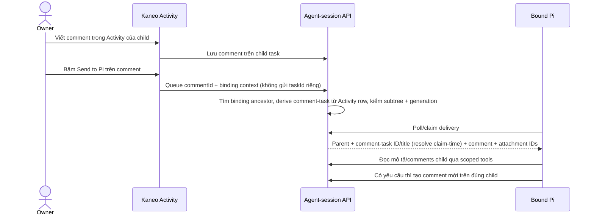

# Spec: Kaneo — Child Activity notes and Pi context

## Context Snapshot

- **Project:** Kaneo self-hosted PM/control plane. Web/API repo: `D:/pcloud/workspace/code/kaneo` (React/Vite, Hono, PostgreSQL/Drizzle, pnpm). Pi extension source: `D:/pcloud/workspace/code/python/app_presets/pi/extensions/kaneo-mcp`.
- **Current behavior:** Parent-bound `kaneo_card_get` returns direct child IDs/titles/status/markers, but not child descriptions or comments. Bound comment tools only read/write the root card. The task detail UI already shows an Activity composer and a Send-to-Pi action on comments; child comments resolve to a binding on an ancestor, but the Pi delivery lacks the child's ID/title.
- **Desired behavior:** Activity comments remain the one source of truth for notes. A bound Pi can read a child description and its comment notes, add a comment to that child, and receive a user-sent child comment with enough child context to know which item it refers to.
- **Relevant source:** `apps/api/src/agent-session/{card-tools.ts,index.ts,binding-service.ts,delivery-service.ts}`, `apps/web/src/components/activity/{comment-card.tsx,send-comment-to-pi-action.tsx}`, `tests/api-integration/{agent-session-binding.test.ts,agent-session-delivery.test.ts,agent-session-subtask-update.test.ts}`, plus the Pi extension paths listed in Task 2.
- **Constraints:** Bound mode hides global task/comment tools. Every child operation must resolve the live binding and remain inside its current same-project subtree. Comment text and attachments are untrusted context. No new database table or migration is expected; delivery rows already identify the comment's `taskId`.

## Objective

Khi mày ghi note trong Activity của một công việc con, Pi được gán vào card cha phải đọc được đúng mô tả/comment đó và biết nó thuộc child nào. Agent cũng phải có thể đọc và ghi comment vào Activity của child mà không mở quyền đọc task tùy ý trong workspace.

## Scope

### In scope

- Thêm bound tools để đọc chi tiết một subtask trong binding subtree (gồm description và direct-child summary để có thể đi tiếp trong cây), đọc comments có pagination, và tạo comment cho đúng subtask.
- Dùng Activity `type=comment` làm note; comment của agent cũng được ghi vào Activity của đúng child.
- Giữ Send-to-Pi action hiện có trên comment child. Delivery phải kèm parent task ID/title, child task ID/title, comment content và các attachment ID đã được scope-check.
- Giữ nguyên untrusted-content warning, binding generation/idempotency/stale checks, và quy tắc hiện tại: Pi trả lời lên card đang bound trừ khi owner chỉ định nơi khác.

### Out of scope

- Popup/nút note mới cạnh marker trong danh sách subtask; mày đã chọn hướng phased, nên mở child detail → Activity vẫn là đường nhập note đầu tiên.
- Bảng/field note riêng hoặc đồng bộ hai chiều giữa description và comment.
- Gửi status/system activity event sang Pi; chỉ comment mới gửi được.
- Bật global `kaneo_get_task`/`kaneo_list_task_comments` trong bound mode hoặc đọc task ngoài cây được gán.
- Thay đổi behavior marker, checkbox, reorder, execution manifest hay production rollout policy.

## Thuật ngữ

- **Bound card:** task gốc đang gắn với đúng một Pi session; server giữ binding ID + generation.
- **Subtask / child:** task nằm trong cây cùng project của bound card. Tool chỉ trả direct children ở mỗi lần đọc; agent đi tiếp bằng ID được trả về.
- **Activity comment / note:** activity row có `type=comment`. Không bao gồm event hệ thống như đổi status hay đổi title.
- **Send-to-Pi delivery:** yêu cầu đã được owner bấm gửi từ một comment; không phải cơ chế Pi tự đọc mọi activity.

## UX Baseline

1. **Keyboard:** giữ tab order/action hiện có; nút Send hoạt động bằng Enter/Space.
2. **Focus:** giữ cue focus hiện tại của Kaneo; không thêm outline đen khi pointer focus.
3. **A11y:** action có accessible name nêu Send to Pi và target; trạng thái pending/error được công bố; hit area hiện có giữ nguyên.
4. **Viewport:** dùng task detail Activity hiện có, không thêm layout; không tràn ngang ở 320–1440px.
5. **States:** giữ trạng thái bound/unbound/offline/pending/success/error trung thực; thất bại không hiện success. Phân biệt loading/query-unavailable với unbound thật (không báo “chưa bound” khi query đang lỗi); khi offline mà target đã biết, accessible name vẫn nêu Send to Pi + target.
6. **Consistency:** tái dùng `CommentCard` và `SendCommentToPiAction`; không dựng nút/popover thứ hai.
7. **Surface/scroll:** không đổi layout hoặc scroll container; scrollbar ẩn vẫn scroll được.
8. **Copy:** giữ copy hiện có; chỉ thêm nội dung Pi message cần thiết để phân biệt parent với child.

## Assumptions

1. Mày muốn ghi note như một comment Activity, không phải một trường “note” duy nhất có thể ghi đè; lịch sử comment được giữ lại.
2. Nút Send-to-Pi đang có trên comment child là đủ; thiếu hiện nay là child context trong Pi message và bound-agent tools.
3. Khi agent trả lời comment được gửi, behavior mặc định vẫn là comment lên card cha đang bound theo contract hiện có.
4. Binding subtree hiện là boundary; ID ngoài subtree, khác project, stale/rebound binding đều fail-closed.

## Open Questions

- Không còn câu hỏi để bắt đầu implementation. Popup cạnh marker được hoãn; có thể mở spec riêng nếu sau khi dùng Activity flow việc mở child detail vẫn gây ma sát.

## Approach

- **Chọn:** reuse Activity comments end-to-end. Thêm scoped `POST /card/subtasks/:subtaskId/get`, `/comments`, `/comments/create` theo binding-context pattern hiện có; mở rộng delivery payload bằng task ID/title child. Giữ UI child detail và nút Send-to-Pi hiện có.
- **Lý do:** không tạo kho note thứ hai. Một comment vừa là lịch sử cho người sau, vừa là payload gửi chủ động cho Pi. Popup chỉ rút bớt một lần mở child nhưng buộc thêm view/editor/API riêng; chưa cần trả chi phí đó.
- **Phụ thuộc:** API scoped tools phải ship trước extension tools; delivery context phải có trước khi poller format prompt.
- **Risk chính:** rò dữ liệu ngoài bound subtree hoặc gửi comment không đúng child. Server phải re-resolve scope ở mọi call và kiểm child ID, comment ownership/type, binding generation trước khi đọc/ghi/claim.

## Diagram

## Bỏ qua

- Không thêm một ô note riêng rồi copy nội dung qua Activity: hai nguồn sự thật sẽ lệch khi owner sửa một bên.
- Không gửi mọi event trong Activity sang Pi; chỉ nội dung owner chủ động gửi mới tạo delivery.
- Không dùng global task tools trong bound mode chỉ để né thêm scoped API.

## Risks

- Child bị xóa/di chuyển hoặc binding đổi giữa lúc comment được tạo và lúc Pi claim: request phải stale/fail closed, không fallback về task ID khác.
- Comment/attachment chứa prompt injection: giữ system warning và coi toàn bộ payload là dữ liệu thảo luận không đáng tin.
- Comment do agent tạo không được tự gửi ngược lại Pi; giữ `externalSource=agent-binding` loại khỏi Send-to-Pi eligibility.
- Context dài: giữ giới hạn pagination hiện có (mặc định 10, tối đa 50) và không đọc toàn bộ Activity mặc định.

## Task List

### Task 1: Scoped child detail/comments và delivery context trong API — IMPLEMENTED + VERIFIED + LIVE UAT PASS

- **Acceptance:**
  - Bound `get_subtask` trả description, ID/title/status/revision/markers và direct-child summary chỉ khi ID nằm trong live binding subtree.
  - `list_subtask_comments` chỉ trả `type=comment`, hỗ trợ cursor/limit bounded; `create_subtask_comment` ghi comment vào đúng child với source agent-bound.
  - ID ngoài subtree, task khác project, child đã move/delete, binding stale/rebound và comment không phải comment đều bị từ chối; không lộ nội dung ngoài scope.
  - `subtaskId` trùng root card ID bị từ chối trên cả 3 endpoint child mới (400/404 theo pattern `bindingCardUpdateSubtask` hiện có); thao tác trên root chỉ đi qua root routes.
  - Delivery queued cho comment child phải chuyển `stale` nếu child bị move ra khỏi live binding subtree giữa queue và claim: `markQueuedCommentStale` nhận `scope` và thêm điều kiện `scope.tasks.some(t => t.id === delivery.taskId)` vào biểu thức `unchanged` khi queue retry, claim và status refresh. Ack chỉ xảy ra sau claim thành công nên không thay thế guard tại claim. Claim không bao giờ trả content của task ngoài subtree; di chuyển sau claim không thể thu hồi content đã giao.
  - Parent/child title được resolve tại claim-time (join task trong cùng tx của claim); delivery row không lưu title snapshot; child ID dùng `delivery.taskId` hiện có, không thêm field.
  - Send-to-Pi claim trả child ID/title cùng parent ID/title, comment text và attachment IDs đã scope-check. Không thay đổi schema/migration nếu các field hiện hữu đủ.
  - Agent-created comments không thể gửi ngược thành delivery; browser Send-to-Pi chỉ nhận comment hiện hữu trong subtree. Case `externalSource=agent-binding` queue → 404 phải có test explicit (mechanism đã có, test chưa có).
  - Test case tối thiểu trong `agent-session-subtask-activity.test.ts`: out-of-tree ID và cross-project ID cho từng endpoint mới; root-ID reject; agent-binding queue → 404; pagination clamp (`limit > 50` → 50, `≤ 0` → 1), cursor round-trip không mất comment ở ranh giới timestamp, legacy ISO cursor vẫn đọc được, numeric cursor vượt BIGINT range bị bỏ qua thay vì 500, và cursor rác không crash (cursors are opaque); attachment của task ngoài subtree bị loại khỏi claim payload; move-out-of-subtree delivery → `stale`.
- **Reproduce:** `cd /d/pcloud/workspace/code/kaneo/apps/api && DATABASE_URL="postgresql://localhost:5432/kaneo_test" pnpm vitest run --config vitest.integration.config.ts ../../tests/api-integration/agent-session-subtask-activity.test.ts` (integration config refuses any database not suffixed `_test`).
- **Verify:** test mới + `agent-session-binding.test.ts` + `agent-session-delivery.test.ts`; `pnpm exec tsc --noEmit` trong `apps/api`; xác nhận migration head/schema không đổi.
- **Files:**
  - `apps/api/src/agent-session/card-tools.ts` — pattern: `bindingCardUpdateSubtask`, `bindingCardListComments`, `bindingCardCreateComment`.
  - `apps/api/src/agent-session/index.ts` — pattern: `POST /card/subtasks/:subtaskId/update`, `/card/comments`.
  - `apps/api/src/agent-session/delivery-service.ts` — pattern: `queueCommentDelivery`, `claimOneDelivery` (delivery đã lưu `taskId` comment). Fix bắt buộc: `markQueuedCommentStale` nhận `scope` và check `delivery.taskId ∈ scope.tasks` trước khi coi delivery `unchanged`; hiện tại queue-retry/claim/status refresh chỉ check snapshot fields, còn ack chỉ xử lý delivery đã claim.
  - `tests/api-integration/agent-session-subtask-activity.test.ts` — pattern: `agent-session-subtask-update.test.ts`, `agent-session-delivery.test.ts`.

### Task 2: Expose bound Pi tools và giữ Send-to-Pi child flow — IMPLEMENTED + VERIFIED + LIVE UAT PASS

- **Acceptance:**
  - Khi bound, tool allowlist thêm `kaneo_card_get_subtask`, `kaneo_card_list_subtask_comments`, `kaneo_card_create_subtask_comment`; khi unbound, không vô tình giữ các scoped tools. Tool mới được khai báo trong `registerTools` của `card-binding.ts` (runtime wrapper scoped), không đăng ký ở `tools.ts` global.
  - Poller message nêu rõ bound parent ID/title và comment-task ID/title, giữ untrusted warning, attachment IDs và yêu cầu trả lời lên card bound. Comment-task chính là parent thì payload không dán nhãn child — ghi rõ là một task duy nhất.
  - Comment child trong Activity vẫn có Send-to-Pi action; action chỉ gửi `commentId` + binding context, server derive comment-task từ Activity row (không thêm nguồn taskId thứ hai). Send-to-Pi action ẩn hoặc disable trên comment `externalSource=agent-binding` (server vốn 404) kèm test UI. Unbound/offline/error không báo thành công giả; loading/query-unavailable hiển thị khác unbound thật.
  - Agent thêm comment vào child thì nó xuất hiện trong Activity của child; tool không cho tạo comment vào task ngoài binding.
- **Reproduce:** `cd /d/pcloud/workspace/code/python && node --experimental-strip-types --test app_presets/pi/extensions/kaneo-mcp/kaneo-card-binding.test.ts app_presets/pi/extensions/kaneo-mcp/card-delivery-poller.test.ts`
- **Verify:** `cd /d/pcloud/workspace/code/kaneo/apps/web && pnpm exec vitest run --config vitest.config.ts src/components/activity/comment-card.test.tsx src/components/activity/send-comment-to-pi-action.test.tsx && pnpm exec tsc --noEmit -p tsconfig.app.json`; chạy extension tests trên; render/inspect child detail Activity ở desktop/mobile, không có thay đổi bố cục ngoài context message.
- **Files:**
  - `D:/pcloud/workspace/code/python/app_presets/pi/extensions/kaneo-mcp/card-binding-state.ts` — pattern: `CARD_TOOL_NAMES`, `boundActiveTools`, `unboundActiveTools`.
  - `D:/pcloud/workspace/code/python/app_presets/pi/extensions/kaneo-mcp/card-binding.ts` — pattern: `registerTools(pi)` là nơi khai báo toàn bộ tool `kaneo_card_*` (runtime wrapper scoped); thêm 3 tool mới tại đây.
  - `D:/pcloud/workspace/code/python/app_presets/pi/extensions/kaneo-mcp/index.ts` — chỉ gọi `cardRuntime.registerTools(pi)`; không đăng ký tool card mới trong `tools.ts` (sẽ thành global MCP tool thay vì scoped).
  - `D:/pcloud/workspace/code/python/app_presets/pi/extensions/kaneo-mcp/card-delivery-poller.ts` — pattern: `formatBoundCommentMessage`.
  - `apps/web/src/components/activity/comment-card.tsx`, `send-comment-to-pi-action.tsx` — pattern: comment action already receives current `taskId`; preserve the existing control and verify child context.
  - `app_presets/pi/extensions/kaneo-mcp/kaneo-card-binding.test.ts`, `card-delivery-poller.test.ts`; `apps/web/src/components/activity/{comment-card.test.tsx,send-comment-to-pi-action.test.tsx}`.
- **UX Contract:**
  - Surface: Operate; reuse child task detail → Activity. No new screen, popup, or row control.
  - States: existing comment composer and Send-to-Pi pending/success/error/unbound/offline states remain; successful delivery visibly belongs to the child comment.
  - Keyboard/A11y/Responsive: preserve existing comment/send controls and their accessible names, keyboard path, touch target and responsive behavior; no new layout.
- **Skills:** `ui-design`, `flow`, `pi-build-extension`, `project-knowledge`.
- **Visual Ref:** `D:/pcloud/workspace/obsidian/archive/images/20261119144035.png` (owner screenshot of child detail and Activity); parent-row context: `D:/pcloud/workspace/obsidian/archive/images/20261119143354.png`.

## Checkpoints

1. [x] Task 1 implementation complete: scoped child routes, delivery move-out scope fence, claim-time task context. Focused integration + binding/delivery/subtask-update regressions: 31/31 PASS; API `tsc --noEmit` PASS; schema/migration files unchanged. Independent code review remains part of the final gate.
2. [x] Task 2 source changes, extension/web tests, typechecks and full Kaneo build pass. Local real-browser component smoke at 320/375/414/768/1024/1280/1440 confirmed no horizontal overflow, target label and disabled/error states; Tab→Enter and Tab→Space exercised with mocked local API. Screenshots: `.agent-workbench/child-activity-context/{offline-1280.png,offline-320.png,send-error-320.png,online-focus-320.png,online-queued-320.png}`. This is component-level evidence, not a full authenticated child-detail UAT.
   - [x] Live bound-agent UAT + production rollout PASS 2026-11-20 sau owner approval "deploy đi": R10 guarded apply (plan PASS → apply SSH-interruption ở step 6 sau khi container đã recreate healthy với exact digest pin → resume PASS hoàn tất pin checks + migration verify + post-snapshot). Live UAT battery: scoped read/write/delete qua 3 tool mới trên throwaway card TOD-235 + sub TOD-237; fail-closed live: root-ID → 400, out-of-tree (#217 sub) → 404, cross-project (project "đọc") → 404 × 3 endpoint; agent comment không có Send-to-Pi, user comment có nút với accessible name gồm target session/host; Send-to-Pi delivery child comment → message 2 dòng parent + comment-task (ID + title) + Comment ID; root comment → 1 dòng Task duy nhất; reply loop qua root card PASS. Cleanup: sub xoá qua scoped tool (CAS 2→3), 2 throwaway card xoá qua UI, binding trả về #227.

## External Review Brief

### Reviewer cần phán

- API scope có fail-closed với child ở cùng binding subtree, cross-project/out-of-tree IDs, stale/rebound binding và attachment không?
- Delivery có giữ idempotency/generation/stale-comment protection, đồng thời gắn chính xác child ID/title không?
- Extension chỉ thêm scoped tools khi bound và không làm lộ global task/comment tools?
- UI có reuse Activity/comment action hiện có, không tạo note store hoặc popup thừa? Flow có thực sự gửi đúng comment child vào Pi session bound không?
- Tests có cover create/list/read, pagination, child delivery, prompt-injection boundary, stale binding và offline/unbound states không?

### Reviewer nên đọc trước

`apps/api/src/agent-session/{card-tools.ts,index.ts,binding-service.ts,delivery-service.ts}`, `apps/web/src/components/activity/{comment-card.tsx,send-comment-to-pi-action.tsx}`, `D:/pcloud/workspace/code/python/app_presets/pi/extensions/kaneo-mcp/{card-binding-state.ts,card-delivery-poller.ts}`, và integration/unit tests được liệt kê ở Task List.

### Reviewer không cần phán

Không review subtask reorder, marker semantics, generic Kaneo design refresh, migration/schema mới, hay một popup chưa nằm trong scope.

## User Test

| Hành động | Kết quả kỳ vọng | Chuẩn nhìn |
|---|---|---|
| Mở một child, ghi comment trong Activity rồi bấm Send-to-Pi | Đúng Pi bound nhận comment kèm parent + child title/ID | Pi message phân biệt rõ child, không chỉ hiện ID card cha |
| Trong bound Pi, yêu cầu đọc mô tả/comment child rồi thêm comment mới vào child | Pi đọc đúng child; comment mới xuất hiện trong Activity child | Comment nằm đúng child, không nhảy lên parent |
| Thử gửi khi binding offline/unbound | Không có delivery giả; trạng thái lỗi/disabled rõ | Không hiện success nếu queue/claim thất bại |
| Xem Activity có comment do agent tạo | Không có nút Send-to-Pi hoặc nút disabled | Không bấm được vào action luôn fail (server 404) |
| Ép lỗi gửi (offline/network fail) rồi thử lại | Error hiển thị đúng, không success giả, có đường retry | Trạng thái trung thực, retry được |
| Render 320px; Tab tới nút Send rồi Enter/Space | Không tràn ngang; keyboard kích hoạt được, focus/status được thông báo | A11y + responsive giữ chuẩn hiện có |

Câu hỏi Y/N:

1. Activity child vẫn vừa viewport và không tạo overflow ngang không?
2. Mày thao tác được comment và Send-to-Pi bằng keyboard/touch không?
3. Pending/sent/error của Send-to-Pi có nhìn ra đúng trạng thái không?
4. Khi binding offline/unbound, UI có nói đúng và không báo thành công giả không?
5. Luồng có đúng hướng đã chốt: comment Activity là source of truth, không có popup/field note riêng không?

## Completion Gates

- [x] Scoped API tests + extension/web tests + typecheck/full build pass.
- [x] `verify` đối chiếu từng acceptance; independent review PASS: 2 reviewer GLM độc lập (adversarial full-diff + scope/security lens) — NEEDS_FIX 2 P3 cursor (BIGINT range guard + legacy ISO regression test) đã vá + re-run API 31/31 + tsc PASS; scope lens APPROVED. Schema/migration diff không có (head 0056 giữ nguyên sau deploy).
- [x] Local component runtime evidence at 320–1440px + keyboard/offline/error states: `.agent-workbench/child-activity-context/`; live UAT PASS bổ sung (xem dưới).
- [x] Bound child read/write/delivery UAT trên integrated deployed API/extension: PASS 2026-11-20 trên production candidate `089e604e` (chi tiết ở Task 1/2 evidence).
- [x] Review lane scoped API/security + UI/flow PASS (GLM × 2, file:line evidence, 0 P1/P2); production rollout owner-approved ("deploy đi") + applied theo R10 runbook + UAT PASS + cleanup.
